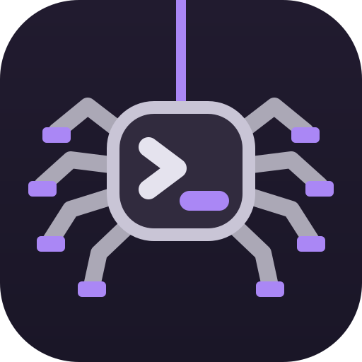
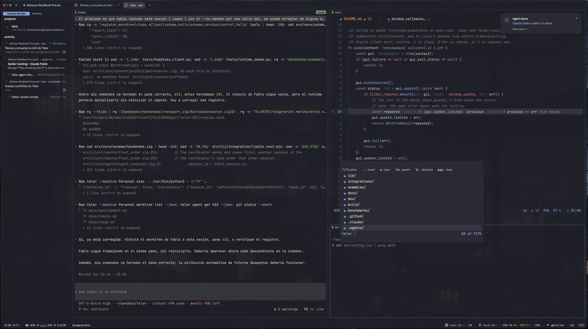
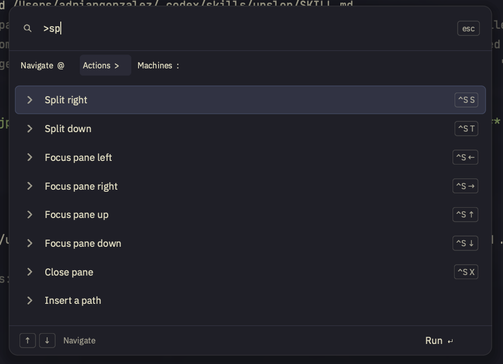
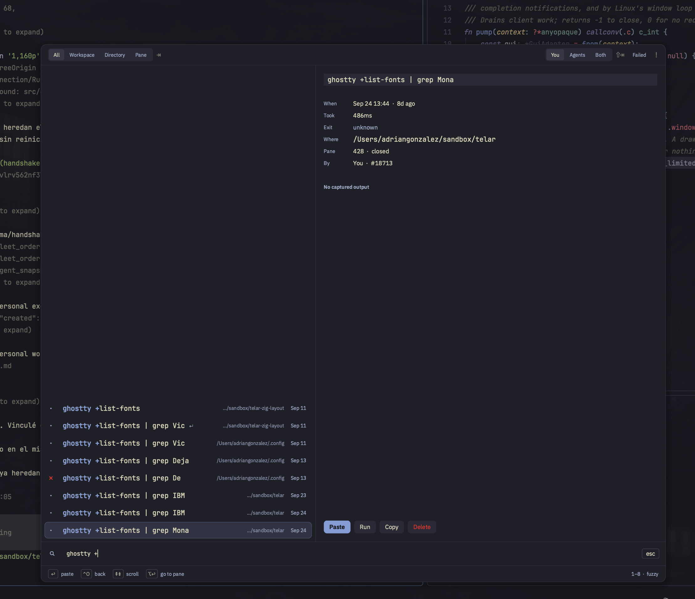

<p align="center">
  
</p>

<h1 align="center">Telar</h1>

<p align="center">
  A terminal for working with coding agents.<br>
  Persistent sessions, agent status and remote machines in one native window.
</p>

<p align="center">
  <a href="https://github.com/adriangs1996/telar/actions/workflows/ci.yml"></a>
  <a href="LICENSE"></a>
</p>

<p align="center">
  <a href="#features">Features</a> ·
  <a href="#getting-started">Getting started</a> ·
  <a href="#documentation">Documentation</a> ·
  <a href="#contributing">Contributing</a>
</p>



Telar is a terminal emulator and multiplexer for macOS and Linux. It puts
shells, editors and coding agents into workspaces, tabs and split panes, and
its sidebar shows which agents are working, waiting for input or done.

Your agents keep their own interfaces: Telar runs their existing CLIs. The
window is a client of a separate runtime that owns the processes. Close the
window and the work keeps running; reopen it, or connect over SSH to a
runtime on another machine.

Telar is written in C++23, with Ghostty's `libghostty-vt` for terminal
emulation and its own Qt Quick window and multiplexer. The name is Spanish
for *loom*.

> [!WARNING]
> Telar is in early development. There are no releases yet, and the
> configuration and CLI may change without notice.

## Features

- **Agent status.** Integrations for Claude Code, Codex, Pi, Cursor Agent and
  OpenCode report lifecycle events. Other programs get a status estimated from
  process and terminal activity.
- **A worktree per task.** Create a Git worktree, launch an agent in it, and
  follow its status and diff from the CLI, next to your shell and editor.
- **Remote machines.** Save SSH hosts and switch between their workspaces in
  the same window. Processes keep running on the remote host when the client
  disconnects.
- **Searchable history.** Search shell and agent commands by workspace,
  directory, pane or exit status, with captured output where available.
- **Command palette.** Find any action, workspace or machine by name.
- **Lua configuration.** Themes, fonts, keybindings, the sidebar and plugins.
  Kitty graphics protocol support for images.

<p align="center">
  
  
</p>

## Getting started

### Build from source

You need macOS 26 or Linux, Python 3.9+, Git and Rust 1.93.1+. The
[development guide](docs/development.md#build-requirements) lists the
platform SDKs. The bootstrap step installs the pinned LLVM, CMake, Ninja and
Just into `.toolchain/`.

```sh
git clone https://github.com/adriangs1996/telar.git
cd telar
tools/cpp bootstrap
export PATH="$PWD/.toolchain/bin:$PATH"
just app
```

`just app` builds the runtime, the `telar` CLI and the GUI, then opens a
window on an isolated development runtime. On macOS, `just install-gui`
installs the app bundle and links `telar` into `~/.local/bin`. For release
archives and a headless server build, see [packaging](docs/packaging.md).

### First steps

The keybinding prefix is `Ctrl+b`: press and release it, then press the next
key.

| After `Ctrl+b` | Action |
| --- | --- |
| `%` / `"` | Split left/right or top/bottom |
| Arrow key | Focus the adjacent pane |
| `c` | New tab |
| `n` / `p` | Next or previous tab |
| `s` | Toggle the sidebar |
| `g` | Command palette |
| `/` | Search command history |

Connect your agent, then start a new session of it inside Telar:

```sh
telar integration install claude   # or codex, pi, cursor, opencode
```

Open a window on another machine that has Telar installed:

```sh
telar gui --remote dev@box
```

## Documentation

The [user guide](docs/README.md) is the place to start. `telar --help` lists
every CLI command.

- [Using Telar](docs/usage.md): navigation, session lifetime, troubleshooting
- [Working with agents](docs/agents.md): integrations, status and worktrees
- [Remote machines](docs/remote.md): SSH hosts and reconnection
- [Configuration](docs/configuration.md): themes, fonts, keybindings, profiles
- [Plugins](docs/plugins.md) and the [Neovim integration](integrations/nvim/README.md)
- [Kitty graphics](docs/kitty-graphics.md)
- [TLS proxy and capture](docs/proxy-tls.md)

## Contributing

Bug reports and pull requests are welcome. When you
[open an issue](https://github.com/adriangs1996/telar/issues), include your OS,
the Telar commit, steps to reproduce, and whether the runtime is local or
remote.

The [development guide](docs/development.md) covers dependencies, tests,
diagnostics and benchmarks.

## Acknowledgements

[Ghostty](https://github.com/ghostty-org/ghostty) provides the terminal
emulation library at Telar's core. [herdr](https://github.com/herdrdev/herdr)
inspired the project, and [T3 Code](https://github.com/pingdotgg/t3code)
informed its sidebar.

## License

[MIT](LICENSE)
