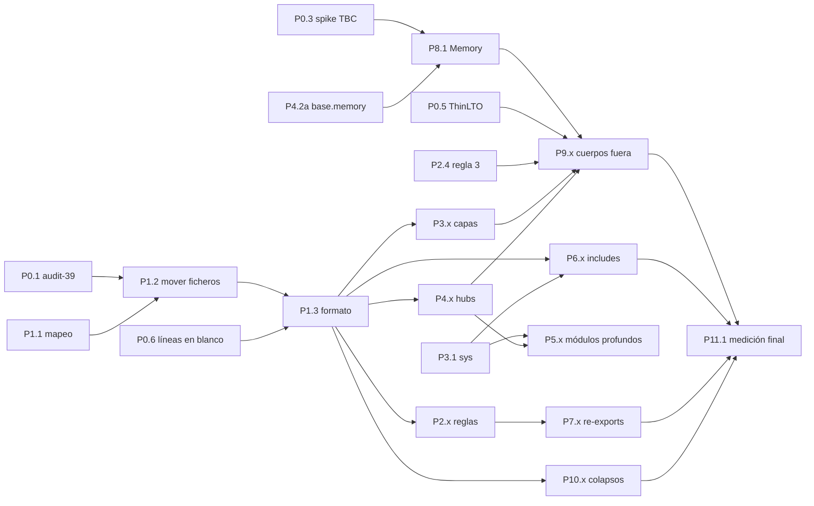

# TODO · Refactor a módulos profundos

Plan de origen: <https://claude.ai/artifact/LMd2ChCBMECmUbfQnPU7yx> (grafo de módulos de telar).
Estado de partida: `main @ 2890f72b1`, con `refactor/audit-39` abierta (30 commits por delante).

## Cómo se usa esta lista

- Cada tarea tiene un ID, sus dependencias (**Depende de**), lo que toca (**Toca**) y un criterio de cierre (**Hecho cuando**).
- Una tarea se puede empezar cuando todas sus dependencias están marcadas `[x]`.
- Cada tarea se ejecuta en su propio worktree y se integra al terminar. Un coordinador de telar las reparte entre máquinas: ver "Ejecución" más abajo.
- Dos tareas listas pueden ir a la vez si lo que tocan no se solapa. Si solo comparten ficheros calientes, también pueden ir a la vez y el conflicto se resuelve al integrar. Si se solapan en algo más, la segunda se despacha cuando la primera está integrada.
- Ficheros calientes que tocan casi todas las tareas: `docs/build/modules.json`, los `CMakeLists.txt` de cada árbol y `tools/check-cpp-modules.py`. Cada tarea toca ahí lo mínimo, para que el conflicto al integrar sea trivial.
- Cada regla nueva del checker entra en modo estricto con una **allowlist** de las violaciones que existen hoy. Cada tarea de arreglo borra sus entradas. Así las reglas entran pronto y los arreglos no dependen unos de otros. Si una tarea de arreglo llega antes que su regla, no hay entrada que borrar y no pasa nada.
- **Patrón agregador** para partir un módulo con muchos importadores: (1) crear los módulos nuevos y dejar el antiguo como agregador que hace `export import` de todos ellos, (2) migrar los importadores a los imports estrechos, un árbol por tarea (runtime, gui, cli, lib, tests) y en paralelo, (3) borrar el agregador. Las tareas con sufijo `a/b/c…` siguen este patrón.
- Tests: solo los del área tocada. La suite completa se ejecuta en P1.2, en los cierres de fase y en P11.1.
- Después de mover ficheros (P1.2) las rutas cambian. Por eso las tareas posteriores nombran módulos y no rutas.

## Ejecución

El coordinador es un agente en el checkout principal que usa la skill `telar-coordinator`. Es el único que edita esta lista y el único que integra.

- **Rama de integración:** `refactor/deep-modules`, creada desde `main` después de P0.1. Contiene esta lista, `docs/code-style.md` y `.clang-format` commiteados, porque a otra máquina solo viajan commits. Cuándo pasa a `main` lo decides tú; los cierres de fase (P3.17, P6.8, P9.11 y P11.1) son puntos estables.
- **Rama de cada tarea:** `refactor-<id>`, por ejemplo `refactor-p3-6`, creada desde la cabeza de la rama de integración en el momento de despacharla.
- **Elegir máquina:** el coordinador compara `telar --machine <label> runtime metrics --json` de las máquinas habilitadas (hoy, esta y `Personal`) y despacha a la que tenga más memoria libre. No pasa del máximo de tareas simultáneas por máquina, que sale del pico de memoria de un build en frío medido en P0.2: 3 en `Personal` y 3 en esta. Cada worktree empieza sin build, así que cada tarea paga un build completo.
- **Despachar:** la rama se crea en local (`git branch refactor-<id> refactor/deep-modules`) y después se lanza `telar worktree create refactor-<id> [--machine <label>] --setup --title "<id> · <título>" --json -- claude --dangerously-skip-permissions "<brief>"`. El brief cabe en 32 palabras: *"Lee la tarea <id> de TODO.md y docs/code-style.md. Impleméntala, cumple su Hecho cuando y commitea en esta rama. No edites TODO.md."*
- **LFS:** el historial antiguo tiene 11 punteros LFS (wallpapers de `desktop-mode`, materializados en `82ce41d42`). Con un hook `pre-push` de git-lfs, el despacho remoto falla al intentar subirlos; se despacha con `GIT_LFS_SKIP_PUSH=1` delante.
- **Integrar:** cuando el agente termina, el coordinador revisa el diff y ejecuta en el worktree el checker y los tests del área (`telar [--machine <label>] worktree exec`). Si la tarea corrió en otra máquina, la trae con `telar worktree fetch refactor-<id> --machine <label>`. Después hace merge en la rama de integración, resuelve los conflictos de los ficheros calientes, compila y prueba el área sobre el resultado, marca la tarea `[x]` aquí, commitea y borra el worktree con `--delete-branch`. Hasta P11.1, compila también en Release (`tools/cpp configure <árbol> --config Release`) cada árbol que toca la tarea, con `runtime-probes` y `gui-probes` si toca runtime o GUI, antes de marcarla `[x]`; el brief pide lo mismo al agente. Release es lo que se entrega y lo que se mide, y sin `TELAR_DIAGNOSTICS` compila código que Debug no ve. **Linux también es criterio de cierre:** `refactor/deep-modules` no tiene upstream y el job `linux` de `.github/workflows/runtime-cpp.yml` (ubuntu-24.04 y ubuntu-24.04-arm, Debug y Release) no ha corrido nunca sobre el refactor. Antes de cerrar P6.8 y P11.1, y en cada tarea que toque código con ramas de Linux, se reproduce ese job en la VM `telar-linux` con el toolchain fijado, en Debug (con sanitizers) y en Release: `auth` y `base` con sus tests, `check-cpp-modules.py`, `tools/tests/test_cpp_*.py`, `check-cpp-package.py`, `check-cpp-editor.py`, y el runtime con sus targets y `ctest -R '^(runtime-tests|tls-tests|hook-tests|event-loop-tests|linux-platform-tests|server-cli-tests|diagnostics-tests)$'`. Push y PR los decide Adrian. **x86_64:** al integrar cada bloque de P6.8c, `terminal/control` compila y pasa sus tests también para x86_64, porque la rama SSE2 no la compila ninguna máquina arm64.
- **Lints de TBC:** no se ejecutan sobre el árbol entero (`runtime-lifetime`, `gui-lifetime`, `*-blank-lines`, `*-interface-bodies`): saturan la máquina y tardan más de una hora en la GUI. Como mucho, `tbc-lint` sobre los ficheros que la tarea toca. Hacerlos manejables queda para después del refactor. `tools/check-cpp-modules.py` sí se pasa siempre.
- **Pérdidas de rendimiento en la fase 9:** se investiga la causa con datos y se arregla dentro de la separación interfaz/implementación. Devolver cuerpos a la interfaz o inlinearlos no es una solución: la separación no es opcional. "Se perdió el inlining" no es una causa hasta descartar lo que el inlining escondía: bucles que dejan de vectorizarse, reservas en el heap, trabajo repetido por elemento y disposición de datos. Se mira el desensamblado y se cuentan reservas, y se prueba a mover el bucle al otro lado de la llamada (una llamada por lote, con spans o estructura de arrays). En P9.8c, la escena de texto pasó de perder entre un 10 % y un 44 % a ganar 6–7 de 7 vectorizando por lote y quitando reservas en el heap. Solo la pérdida que queda después, la de la llamada en sí, se acepta y se anota con su medición; el coste de las llamadas indirectas se trata más adelante, junto con las funciones virtuales. Si no se recupera sin romper la separación, se para y se informa.
- **Comandos de shell:** nada de construcciones de zsh como `files=(${(f)"$(...)"})` en Bash: el analizador de Claude Code no las entiende y pide permiso aunque el agente corra sin prompts, así que la tarea se queda parada. Para pasar una lista de ficheros, `git diff --name-only ... | xargs ...` o un fichero.
- **Barreras:** P1.2 y P1.3 se despachan solas, sin ninguna otra tarea en vuelo. Tocan todo el árbol, y cualquier tarea abierta tendría que rehacerse.
- **Límite de telar:** sigue como mucho 64 worktrees por máquina, así que los worktrees se borran al integrar.

## Vista por olas

Cada ola puede ejecutarse entera en paralelo cuando la anterior ha cerrado las dependencias que necesita. No hace falta esperar a que termine toda la ola anterior; manda el campo **Depende de** de cada tarea.

| Ola | Tareas |
|---|---|
| 0 · desde el día 1 | P0.7 primero; después P0.1, P0.2, P0.3, P0.4, P0.5, P0.6, P1.1, P2.4 (desarrollo del linter) |
| 1 · bloqueante | P1.2 → P1.3, P6.1 |
| 2 · tras el movimiento | P2.1, P2.2, P2.3, P2.4, P3.1, P3.2, P3.6–P3.16, P4.1a, P4.2a, P4.3a, P4.4a, P6.2, P6.7, P10.1–P10.3 |
| 3 | P3.3, P3.4a–e, P4.1b, P4.2b, P4.3b, P4.4b, P4.5, P5.1–P5.7, P6.3, P6.4, P7.1, P8.1 |
| 4 | P3.5, P4.1c, P4.2c, P4.3c, P4.4c, P6.5a–e, P6.6, P8.2, P8.3, P9.6–P9.9 |
| 5 | P3.17, P6.8, P7.2, P9.1–P9.5 |
| 6 · cierres | P9.10, P9.13a–e, P9.11, P11.1 |

Camino crítico: P0.1 → P1.2 → P1.3 → P4.2a → P8.1 → P9.x → P9.11 → P11.1. P0.3 tiene que estar verde antes de P8.1; si falla, la decisión de `Memory` se replantea antes de seguir.

---

## Fase 0 · Preparación (sin dependencias)

### [x] P0.1 · Integrar `refactor/audit-39`
- **Depende de:** —
- **Toca:** la rama entera (worktree `telar-worktrees/refactor`).
- **Hecho cuando:** el worktree del refactor parte de `main` con audit-39 integrada. Anotar en esta lista qué partes de P3.11 (caso 31), P3.14 (caso 34), P6.1 y P10.3 (caso 38) ya cubre la rama, para no repetirlas.
- **Resultado:** audit-39 entró en `main` por fast-forward (`2890f72b1..d1ab27cb6`). Lo que cubre queda anotado en cada tarea como **audit-39:**. Los dueños únicos que creó viven en `telar.platform` y `telar.base.text`, no en los submódulos del plan: P4.1 y P4.3 los mueven a su familia. Esos dos hubs y `telar.config` crecieron (unas 570, 180 y 600 líneas). Hay módulos nuevos que P1.1 tiene que mapear: `runtime.http.content` y `runtime.platform.private_tunnel`. El commit `d66fa0c16` metió por error `lib/tbc/out` como symlink en bucle; lo borra `5ab196eaa`.

### [x] P0.7 · Receta de setup para worktrees nuevos
- **Depende de:** —. Va antes que cualquier otra tarea y la ejecuta el coordinador en local, porque sin ella ningún worktree puede compilar.
- **Toca:** `.telar/setup.json` (nuevo).
- **Qué hace:** declara la receta que prepara un worktree recién creado: el bootstrap del toolchain fijado (`tools/cpp bootstrap`, que crea `.toolchain/`, ignorado por git) y lo que haga falta para configurar el build. Tiene que funcionar en cualquier máquina, sin rutas de una máquina concreta.
- **Hecho cuando:** `telar worktree create … --setup` deja un worktree que compila los tres procesos, tanto en local como en `Personal`.
- **Resultado:** `.telar/setup.json` ejecuta `tools/setup-checkout`, que enlaza `.toolchain`, `.dependencies-cache` y `.qt-cache` al checkout principal del clon y hace el bootstrap (`a44482e01`). `a3a2d2d46` hace que la clave de las dependencias gestionadas use la ruta real del toolchain, para que los worktrees reutilicen OpenSSL y Qt. Verificado: P0.2 compiló los tres procesos en un worktree de `Personal`, y P0.4, P6.1 y P10.3 el runtime y la GUI en worktrees locales.

### [x] P0.2 · Script de métricas y línea base
- **Depende de:** — (el script se escribe ya; la línea base se toma después de P0.1)
- **Toca:** `tools/` (script nuevo), `docs/build/` (fichero con la línea base).
- **Mide:** porcentaje del código de módulos que está en interfaces (hoy 94,7%), dependientes transitivos de los hubs (`telar.client.protocol` 148, `telar.base.memory` 167), aristas hacia arriba (hoy 41 entre componentes y 55 entre módulos), ciclos (5), aristas `export import` (681 de 1236), líneas en fragmentos globales (4,84 M) y unidades que recompila `ninja -n` después de tocar la interfaz de cada hub. Además, el tiempo y el pico de memoria de un build en frío en cada máquina, que el coordinador usa para decidir cuántas tareas caben a la vez.
- **Hecho cuando:** el script es reproducible y los números de partida están commiteados. P11.1 los vuelve a medir.
- **Resultado:** `tools/module-metrics.py` y `docs/build/module-metrics.json`, medido sobre `a1e1beb3c`. Interfaces 94,8 %; dependientes de `telar.client.protocol` 148 y de `telar.base.memory` 169; aristas hacia arriba 41 entre componentes y 56 entre módulos; 5 ciclos; `export import` 687 de 1251; camino crítico de 21 módulos; tocar un hub recompila 432–480 de 1154 unidades. Las líneas de fragmentos globales se cuentan sin blancos ni comentarios: 1,87 M en 231 unidades (no comparable con los 4,84 M del plan). Build en frío de los tres procesos: `Personal` (`Adrians-Laptop`, 10 núcleos, 32 GiB) 128 s y 7,5 GiB de pico; esta máquina (`Adrians-MacBook-Pro`, 8 núcleos, 16 GiB) 141 s y 3,5 GiB. El desempate del orden de componentes no reproduce exactamente la tabla del final: P2.1 toma su allowlist de la lista `upward` del JSON.

### [x] P0.3 · Spike: el lifetime checker de TBC con `tbc::view<Memory &, …>` sobre un tipo abstracto
- **Depende de:** —
- **Toca:** código desechable fuera del árbol del refactor. Se borra al terminar.
- **Hecho cuando:** hay un ejemplo mínimo que el checker acepta (o un parche a TBC que lo hace posible). Si no es viable, se para P8.1 y se replantea la decisión de `Memory` con tipo borrado.
- **Resultado:** viable sin tocar TBC (`bdcb86436`). Un `Memory` abstracto marcado `TBC_SHARED` se comparte por `tbc::view<Memory &, …>` y sus llamadas virtuales no invalidan préstamos; guardar un adaptador local que muere antes sigue dando `tbc-dangling-borrow`. El spike queda como 4 casos de regresión en `lib/tbc/tests/spec/declarations.cpp`. `590f57ca4` arregla cuatro procedencias rotas del corpus que hacían fallar `ctest -L spec` desde audit-39.

### [x] P0.4 · Launcher que conserva el `.pcm` cuando no cambia
- **Depende de:** —
- **Toca:** `cmake/managed_build.cmake` (ya cablea `CMAKE_CXX_COMPILER_LAUNCHER`), un launcher nuevo en `tools/`.
- **Qué hace:** compila a un fichero temporal y solo sustituye el BMI si el contenido cambia, para que `restat = 1` de ninja corte la cascada en los importadores directos.
- **Hecho cuando:** está medido en el build real, con el número de unidades que recompila tocar un comentario y un cuerpo no inline en un hub, antes y después. Si no compensa, se descarta con los números.
- **Resultado: descartado** (`docs/build/bmi-restat.md`). Tocar un comentario o un cuerpo no inline en `telar.base.memory` recompila 257 unidades con y sin launcher; en `telar.client.protocol`, 221. Clang 23 ya emite el BMI reducido, pero guarda offsets en bytes y un valor que depende del cuerpo de cada función, así que el `.pcm` cambia de verdad. El launcher solo ayuda cuando un fichero se reescribe sin cambiar (1 unidad frente a 257), y cuesta unos 35 ms por compilación. Lo que corta la cascada es P9.x.

### [x] P0.5 · ThinLTO en los builds optimizados
- **Depende de:** —
- **Toca:** `cmake/` y los presets de release. Hoy no hay `-flto` en ningún sitio.
- **Hecho cuando:** release y dev-release enlazan con ThinLTO, y están medidos el tiempo de build, el tamaño del binario y los benchmarks de hot path existentes (`tools/bench_*`, probes de latencia). Las regresiones quedan anotadas para P9.
- **Resultado:** `b1698437c`, medidas en `docs/build/thinlto.md`. Opción `TELAR_THIN_LTO` (activa) en `cmake/cpp_modules.cmake`: Release y RelWithDebInfo compilan con `-flto=thin` vía IPO de CMake, con caché de ThinLTO por build; en macOS enlaza ld64 con el libLTO del toolchain y en Linux `ld.lld` (sin verificar en Linux). Binarios: `telar-runtime` −16,7 %, `telar` −27,2 %, `telar-gui` −17,4 %. Build en frío dentro del ruido. Reenlazar el runtime tras editar un cuerpo pasa de 1–3 s a unos 18 s. Hot paths: escena `full` −5,4 %, PTY `cursor-byte-writes` −16,8 %. **Para P9:** separadores de comandos +1,2 % (pérdida consistente, causa sin establecer), `mode-report` +0,2 % (en el ruido), y repetir la medida del reenlace.

### [x] P1.1 · Tabla y script de destino de cada fichero
- **Depende de:** — (se escribe ya; se vuelve a ejecutar sobre `main` después de P0.1)
- **Toca:** `tools/` (script de movimiento), un fichero de mapeo.
- **Reglas del mapeo:** la carpeta es el módulo y la ruta sale del nombre actual del módulo, sin renombrar nada (`telar.base.memory` → `lib/base/memory/memory.cppm`). Las unidades de implementación van a la carpeta del módulo que declaran. Las particiones de interfaz se llaman `<módulo>-<partición>.cppm`. `src/runtime-cpp` → `src/runtime`, `src/gui-cpp` → `src/gui`, `src/cli-cpp` → `src/cli`. Las carpetas no llevan números.
- **Decisión abierta:** destino de las librerías que el árbol propuesto no nombra: `telar-git`, `telar-tls`, `telar-plugins`, `telar-lua`, `telar-machines`, `telar-render`, `telar-shell`, `telar-vocabulary`, `websock`, `ebnf`, `tbc`, `clipboard` y `src/auth-daemon`. Se decide aquí y queda escrita en el mapeo.
- **Hecho cuando:** el script genera el mapeo completo de forma determinista y `--dry-run` no deja ningún fichero sin destino.
- **Resultado:** `tools/move-cpp-tree.py` (`--dry-run`, `--write-map`, `--apply`) y `docs/build/tree-moves.json`: 1769 ficheros, 1560 se mueven, 209 se quedan y 3 symlinks se reapuntan. Las librerías `telar-*` pierden el prefijo (`lib/git`, `lib/tls`…); `clipboard`, `tbc`, `ebnf` y `src/auth-daemon` se quedan donde están. Las cabeceras siguen en `lib/<x>/include/telar_<x>/`, así que los `#include` solo cambian de include dir en CMake.

### [x] P2.4 · Regla 3 en el linter de TBC: la interfaz solo lleva declaraciones
- **Depende de:** — para desarrollarla en `lib/tbc/linter`. Para activarla en el build, de P1.2.
- **Toca:** `lib/tbc/linter`, `cmake/lint_prepare.cmake`.
- **Qué comprueba (sobre el AST, no con regex):** no hay cuerpos de función en unidades de interfaz salvo los `inline` de hot path anotados (definir la anotación aquí) y las plantillas que siguen siéndolo (primitivas de `base`).
- **Hecho cuando:** corre en CI con una allowlist por módulo, que hoy los contiene casi todos. P9.x la vacía.
- **Resultado:** `18dc56943`. `tbc-lint --checks=interface-bodies` avisa con `tbc-interface-body`. Se permiten las funciones `constexpr` y `consteval` (los importadores las evalúan; excepción añadida al implementar) y lo anotado con `TBC_HOT_PATH` (`<tbc/hot_path.hpp>`; en una clase cubre a todos sus miembros, y una función que no es plantilla tiene que ser además `inline`). La allowlist está en `docs/build/interface-bodies-allowlist.txt`, por módulo: 175 de 188. El check falla también si un módulo de la lista ya no tiene cuerpos, así que cada tarea de P9 borra su línea. Corre en `runtime-cpp.yml` y `gui-cpp.yml` (Release) y con `just runtime-interface-bodies` y `just gui-interface-bodies`; todavía no se ha ejecutado en GitHub.

### [x] P0.6 · Reglas de líneas en blanco de `docs/code-style.md` en el linter de TBC
- **Depende de:** —
- **Toca:** `lib/tbc/linter` y su integración en `cmake/lint_prepare.cmake`. Lo comparte con P2.4: P2.4 se despacha cuando P0.6 está integrada.
- **Qué comprueba sobre el AST, y cómo lo arregla insertando la línea en blanco:**
  - Una sentencia que acaba en su propia llave de cierre (bucle, `if`, `switch`, lambda o lista con llaves de varias líneas) va seguida de una línea en blanco, salvo que lo siguiente sea `else`, `catch`, el `while` de un `do` o el `}` que cierra el bloque.
  - Un grupo de declaraciones va seguido de una línea en blanco antes de la primera sentencia que no es una declaración. Hay una excepción: un `if` cuya condición usa la variable recién declarada va pegado a ella.
  - Una traza (`TELAR_TRACE(...)`) al principio de la función no exige línea en blanco.
- **Límites:** solo inserta líneas en blanco y nunca las borra, porque una línea en blanco que ya existe puede separar dos bloques por lo que hacen, que es la parte que no se puede automatizar. Lo que inserte se conserva después de clang-format (`MaxEmptyLinesToKeep: 1`).
- **Hecho cuando:** el linter avisa en cada caso, tiene un modo que aplica los arreglos y hay tests para cada regla y cada excepción, incluido que el resultado no cambia al pasarle clang-format.
- **Resultado:** `3038a2302`. `tbc-lint --checks=blank-lines` avisa con `tbc-blank-line-after-block` y `tbc-blank-line-after-declarations`; `--fix` inserta, `--header-filter` añade cabeceras. Sin `--checks` solo comprueba lifetimes, como antes. `telar_blank_line_check(... [FIX] [HEADERS <regex>])` en `cmake/lint_prepare.cmake` lo lanza; no está conectado a ningún proyecto ni a CI, eso es P1.3. Una macro de sentencia cuenta como sentencia, así que `TELAR_TRACE` no pide línea. Las etiquetas `case` no piden línea antes. Dos sentencias en una línea o una línea con `\` no se arreglan. Sobre las fuentes del propio linter salen unos 800 avisos, casi todos en `lifetime_analysis.cpp`: los arregla P1.3.

---

## Fase 1 · Movimiento físico

### [x] P1.2 · Commit que solo mueve ficheros
- **Depende de:** P0.1, P1.1
- **Toca:** todo el árbol, CMake, `docs/build/modules.json`, `tools/check-cpp-modules.py` (`SCOPES`, `LIBRARY_LAYERS`), `cmake/lifetime_check.cmake`, `cmake/lint_prepare.cmake` y los scripts de `tools/` con rutas fijas.
- **Contenido permitido:** `git mv`, rutas de `#include` relativas y CMake. Nada más.
- **De P2.4:** las regex de rutas de `src/runtime-cpp/cmake/interface_bodies.cmake` y `src/gui-cpp/cmake/interface_bodies.cmake` cambian con el movimiento. La allowlist va por nombre de módulo y no cambia.
- **Regla 1 en el checker:** ruta = nombre del módulo, ninguna unidad de implementación fuera de la carpeta de su módulo, ningún fichero de la carpeta declara otro módulo y las particiones siguen la forma `process-spawn.cppm` ↔ `:spawn`. Las particiones internas (`module X:detail;`) están permitidas.
- **Hecho cuando:** compilan los tres procesos, pasa la suite completa y pasa el checker con la regla 1 sin allowlist. Los módulos cajón (P3.14) y los ciclos (P3.13a, P3.14a, P3.15a, P3.15b) quedan a la vista en el árbol, pero cumplen la regla porque cada unidad está en la carpeta del módulo que declara.
- **Resultado:** `7ed3d95a6` es el movimiento (1559 renombrados, más rutas en `#include`, CMake, scripts, CI y docs) y es el commit que va a `.git-blame-ignore-revs`; `343b6d6f5` añade la regla 1 sin allowlist. Compilan los tres procesos en macOS (Linux sin compilar). Runtime 50/50 (también sobre la rama integrada), GUI 139/140: `gui-quick` ya fallaba antes (tarda ~126 s con límite de 90 y falla `configuredTooltipsYieldToOpenSurfaces`). `tests/controlled_awake_clock.cpp` declara `gui.platform.profile_file`, así que vive en su carpeta y el checker lo trata como unidad solo de test (`TEST_UNITS`) hasta P3.14a. Los filtros `out[^/]*` pasan a `out(-[^/]*)?` por la carpeta nueva `src/cli/output/`.

### [x] P1.3 · Aplicar el estilo de `docs/code-style.md` a todo el árbol
- **Depende de:** P1.2, P0.6. Todas las tareas que dependen de P1.2 dependen también de esta: el reformateo toca todos los ficheros, así que ninguna otra tarea puede estar editando mientras corre.
- **Toca:** todo el árbol (sin `vendor/`).
- **CI de TBC:** el workflow `tbc` falla en `main` desde al menos el 9 de noviembre en `format-check` y `lint` de `lib/tbc` (`tests/spec/*` y, desde P0.6, los `enum` de `blank_lines.hpp` y `main.cpp`). Esta tarea lo deja en verde.
- **Qué hace:** borra los 16 `.clang-format` por directorio (hoy hay 4 variantes, y tapan al de la raíz). Aplica los arreglos de líneas en blanco de P0.6, ejecuta después el `clang-format` del toolchain sobre todos los ficheros C++, Objective-C++ y de módulo, y añade los commits del movimiento y del formato a `.git-blame-ignore-revs`. Las comas finales en listas con llaves y la separación de bloques por lo que hacen no se pueden aplicar de forma mecánica: las aplica cada tarea a los ficheros que toca.
- **Hecho cuando:** solo queda `.clang-format` en la raíz, `clang-format --dry-run --Werror` y las reglas de P0.6 pasan en todo el árbol y se comprueban en CI, compilan los tres procesos y pasa la suite completa.
- **Resultado:** `8149b4971` inserta las líneas en blanco (solo añade líneas vacías), `b45e86560` borra los 17 `.clang-format` por directorio y formatea 1075 ficheros (además de la disposición, solo cambia un `#include` duplicado eliminado en `font_fixture`), y `a2207b63c` añade `.git-blame-ignore-revs` con los tres commits de movimiento y formato y las comprobaciones a CI. Las comprobaciones de CI no se han ejecutado en GitHub. Compilan los tres procesos en macOS. Falla `gui-quick`, igual que antes de la tarea (supera el timeout de 90 s y falla `configuredTooltipsYieldToOpenSurfaces`); `queuedFramesCannotSurviveAWindowBindingChange` es intermitente. Sin cubrir: el código solo de Linux y los probes sueltos fuera de las bases de compilación no han pasado por el chequeo de líneas en blanco. Si la rama se rebasa o se aplasta, `.git-blame-ignore-revs` hay que actualizarlo.

### [x] P1.4 · Lifetime checker en verde tras el movimiento y el formato
- **Depende de:** P1.3
- **Toca:** lo que haga falta para que el checker vuelva a pasar; sin cambios de diseño.
- **Qué pasa:** sobre `b52d70b74` (cabeza tras P1.3) el lifetime checker da 389 errores en `lib/git`, `lib/ebnf` y `src/runtime` (lo vio P4.2a). audit-39 lo dejó en verde. Hay que averiguar qué commit lo rompe (`7ed3d95a6` movimiento, `8149b4971` líneas en blanco, `b45e86560` formato, `a2207b63c` CI) y por qué: rutas en la configuración del checker, supresiones ancladas a líneas, o un cambio real.
- **Hecho cuando:** el lifetime check del runtime, la CLI, la GUI y las librerías da el mismo resultado que en `d1ab27cb6` (sin errores nuevos), y la causa queda anotada aquí.
- **Resultado:** no había regresión (`b19abb1e8`, commit vacío con las cifras). Los errores ya estaban en `d1ab27cb6`: audit-39 solo arregló los de las líneas que escribió, así que el check nunca estuvo en verde. Comparados uno a uno con las rutas traducidas por `tree-moves.json`: runtime, CLI y librerías 594 (52 distintos), GUI 728 (37 distintos), `lib/ebnf` 117, auth-daemon y clipboard 0, los mismos en los dos lados. Son regiones sin etiquetar en `lib/git`, `lib/ebnf` y el tracker de comandos, y algunos sueltos en el runtime y la GUI. Dejarlo en verde no es parte de este plan.

---

## Fase 2 · Reglas del checker (en paralelo tras P1.2)

### [x] P2.1 · Regla 2: solo se importa hacia abajo
- **Depende de:** P1.2
- **Toca:** `tools/check-cpp-modules.py`, `docs/build/modules.json`.
- **Qué hace:** generaliza `LIBRARY_LAYERS` a todos los componentes de `src/` y mueve el orden de capas a `modules.json`. La allowlist inicial son las 55 aristas entre módulos de la sección "Aristas hacia arriba" del final.
- **De P0.2:** la allowlist sale de la lista `upward` de `docs/build/module-metrics.json` (56 aristas), no de la tabla del final, que se calculó con otro desempate.
- **Hecho cuando:** el checker falla con cualquier arista hacia arriba nueva.
- **Resultado:** `7f7e342b4`. `process_layers` en `modules.json` ordena los componentes de `runtime`, `gui` y `cli` (con `tests` arriba); las librerías quedan por debajo de los procesos y entre ellas manda `library_layers`. La regla lee también los imports de las unidades de implementación. `upward_imports` es la allowlist: 53 aristas (las 56 de P0.2 menos las 3 que cerraron P3.15a y P3.15c), y el checker falla también si queda una entrada cuya arista ya no sube. **Cada tarea de P3 borra sus entradas de `upward_imports` al integrar.**

### [x] P2.2 · Regla 4: `export import` solo si el tipo aparece en la interfaz exportada
- **Depende de:** P1.2
- **Toca:** el linter de TBC (lo más fiable sobre el AST) o el checker si basta una aproximación.
- **Hecho cuando:** la allowlist contiene los re-exports actuales que no cumplen (al menos los 67 que no mencionan ningún tipo del módulo re-exportado) y falla con cualquiera nuevo.
- **Resultado:** en `tools/check-cpp-modules.py` leyendo tokens, no sobre el AST: todas las interfaces exportan con `export { }`, `export namespace` o `export extern "C++"`, el chequeo tarda 1–2 s y no necesita build. Un re-export cumple si una declaración exportada nombra un tipo del módulo re-exportado; no cuentan las menciones dentro de cuerpos de función, y un nombre cualificado solo cuenta si el cualificador es un namespace del tipo. Allowlist en `docs/build/reexports.json`: 352 re-exports en 124 módulos (143 no mencionan el tipo en ningún sitio). El checker falla también con una entrada obsoleta: **cada tarea que quite o añada un `export import` la actualiza.** Límite: se cuentan las dos ramas de un `#if`.

### [x] P2.3 · Regla 5: ningún `#include` fuera de las excepciones
- **Depende de:** P1.2
- **Toca:** `tools/check-cpp-modules.py`, `textual_boundaries` en `modules.json`.
- **Excepciones permitidas:** `lib/sys`, las cabeceras de macros del proyecto (P6.3), Qt/moc y Objective-C++.
- **Hecho cuando:** hay allowlist por fichero con los includes de hoy y el checker falla con cualquiera nuevo.
- **Resultado:** `f25185aaa` y `6e8549845`. Pueden incluir `lib/sys`, los adaptadores Qt/moc (los que incluyen una cabecera `<Q…>`), las fuentes C y Objective-C(++) y las cabeceras que todos ellos alcanzan; un módulo puede incluir sus propias cabeceras de `header_owners` que cruzan esa frontera; `macro_headers` (vacío hasta P6.3) no puede incluir nada. Tests y herramientas quedan fuera. La allowlist está en `docs/build/textual-includes.json` (3130 includes tras integrar P3.6), y el checker falla también con una entrada obsoleta: **cada tarea que quita o mueve un include actualiza ese fichero**. El checker también mira los ficheros sin rastrear, para comprobar los nuevos antes del commit.

### [x] P2.5 · TBC lee los cuerpos de las funciones llamadas en otras unidades
- **Depende de:** P8.3
- **Toca:** `lib/tbc/linter` y su corpus de spec.
- **Por qué:** TBC solo ve la declaración de la función llamada. Si el cuerpo está en otra unidad, supone que toda referencia o `this` no `const` invalida lo que se haya prestado de ella, como Rust con `&mut`. Al sacar cuerpos en la fase 9 eso dio errores nuevos (27 en la CLI, 5 por los accesores de `JsonNode`), y las tareas los esquivaron dejando los cuerpos en la interfaz con `TBC_HOT_PATH`, que el plan reserva para camino caliente medido. **Decidido:** que TBC lea los cuerpos, en vez de firmas más estrictas o de aceptar la marca.
- **Qué hace:** una primera pasada sobre la base de compilación calcula un resumen de efectos por función definida (qué parámetros y qué `this` invalida, qué préstamos devuelve y de dónde), y la comprobación usa ese resumen cuando el cuerpo no es visible. Las llamadas virtuales e indirectas siguen con el supuesto conservador. Los resúmenes se guardan por unidad para que el lint no se vuelva cuadrático.
- **Hecho cuando:** el corpus tiene casos para una función fuera de línea que no muta (se acepta), una que muta (se rechaza), recursión y una virtual (conservadora); el lint de runtime, CLI y GUI no tiene errores nuevos; y el tiempo del lint completo está medido antes y después.
- **Resultado:** `5cc5d12fc`. Una primera pasada resume cada unidad una vez: por función llamable desde fuera, qué parámetros, campos del receptor y entorno invalida, con el nombre de enlace como clave (encaja con `extern template` y la instanciación explícita). Siguen conservadoras las llamadas virtuales no `final`, las indirectas, los constructores y los resúmenes que nombran algo local de su unidad. 6 casos nuevos en `tests/spec/cross_unit.cpp`; 309/309. Sin errores nuevos, medido con `-ferror-limit=0` (con el límite de 20 por unidad salía uno falso): runtime, CLI y librerías 76 → 72 diagnósticos distintos y 55 → 85 s de reloj (357 → 668 s de CPU); GUI 89 → 88 y 122 → 231 s (960 → 1867 s). **Pendiente:** los resúmenes no se guardan en disco entre ejecuciones, y solo se resumen las fuentes de esa ejecución.

---

## Fase 3 · Capas

### [x] P3.1 · Crear `lib/sys` (`telar.sys.*`)
- **Depende de:** P1.2
- **Toca:** `lib/sys/` nuevo.
- **Qué hace:** esqueleto de `telar.sys.posix`, `telar.sys.socket`, `telar.sys.process`, `telar.sys.apple` y `telar.sys.linux`, siguiendo el patrón `using ::open;` de `telar.platform.primitives`. Este es el único sitio con includes de C. Las conversiones de macros las hace P6.4.
- **Hecho cuando:** los módulos compilan, `telar.platform.primitives` pasa a reexportar desde `telar.sys.*` y la capa `sys` está en `modules.json`, por debajo de `platform`.
- **Resultado:** `3fd821cef`. `telar.sys.posix`, `.socket`, `.process`, `.apple` y `.linux` en `lib/sys/<familia>/`, con los nombres que el árbol llama hoy (`using ::open;`); `apple` y `linux` solo se compilan en su plataforma, y las extensiones solo de glibc van bajo `__GLIBC__` porque el código soporta musl. `telar.platform.primitives` hace `export import telar.sys.posix`. El orden de capas de las librerías pasa del checker a `library_layers` en `docs/build/modules.json`. Compilan los tres procesos en macOS; los módulos de Linux, sueltos, en Fedora (glibc) y Alpine (musl).

### [x] P3.2 · `telar.wire.vocabulary`
- **Depende de:** P1.2
- **Toca:** `telar.client.protocol`, `lib/wire/` nuevo.
- **Qué hace:** sacar de `telar.client.protocol` los tipos base, enums y codecs (`Byte`, `TerminalSize`, `FailureCode`, `TabLocation`, `Cursor`…) a `telar.wire.vocabulary`, y pasar `telar_protocol.hpp` y `telar_messages.hpp` a código de módulo. `telar.client.protocol` queda como agregador.
- **Hecho cuando:** compila sin cambiar ningún importador.
- **Resultado:** `a2f0cedd6`. `lib/wire` con `telar.wire.vocabulary`, dueño de las cabeceras de codecs, serializer, celdas, frame y mensajes, que reexporta los tipos base. El vocabulario de `telar_protocol.hpp` pasa a `telar_messages.hpp`, y `telar_protocol.hpp` se queda con los mensajes y sus schemas. Compilan los tres procesos y pasan los tests del área. **No convierte las cabeceras a código de módulo:** las incluyen unos 170 adaptadores Qt, tests y los fragmentos globales de `runtime.terminal.control`, `gui.core.primitives` y `gui.terminal.screen`, que no pueden importar módulos. Por eso el agregador reexporta el vocabulario desde su propio fragmento en vez de `export import telar.wire.vocabulary`: con dos BMI que llevan copia del texto, cada importador las fusiona (+7,8 % al compilar `client_control`). `telar-wire` toma sus cabeceras de `lib/client/include` hasta esa conversión.

### [x] P3.3 · Schemas de mensajes por dominio
- **Depende de:** P3.2
- **Toca:** `lib/wire/`.
- **Qué hace:** repartir los 128 `MessageSchema` en `telar.wire.<dominio>`: pane I/O, agentes, historial, tráfico y layout (la lista final sale del análisis). **El texto también se parte:** `telar_protocol.hpp` se divide en una cabecera por dominio (`protocol/pane_io.hpp`…), cada una con un único dueño, su módulo `telar.wire.<dominio>`. `telar_protocol.hpp` queda solo como paraguas que incluye las de dominio, y el agregador sigue reexportando. No migra includers ni importadores: eso es P3.4.
- **Por qué:** los adaptadores Qt nunca podrán importar módulos (moc no entiende `import` y sus cabeceras declaran señales con tipos del protocolo), así que partir solo los módulos no corta la cascada real. Medido sobre `ef8914a51`: `telar_protocol.hpp` lo incluyen 155 ficheros (77 adaptadores Qt, 67 tests, 44 cabeceras y su dueño), y llega por fragmento global a `gui.core.primitives` (`terminal_size.hpp`), `gui.terminal.screen` (`row_cache.hpp`) y `runtime.client_control` (`clipboard.hpp`). Un `export import` de dominios con una cabecera textual compartida además obliga a fusionar copias del texto (+7,8 % medido en P3.2).
- **Hecho cuando:** compila sin cambiar importadores, cada schema vive en un único dominio y cada cabecera de dominio tiene un único módulo dueño.
- **Resultado:** `b39218792`. 12 cabeceras en `telar_client/protocol/` con su módulo dueño `telar.wire.<dominio>`: `pane_io`, `content`, `layout`, `agents`, `history`, `graphics`, `worktrees`, `execution`, `clipboard`, `runtime`, `clients` y `editor`. Sin dominio de tráfico: su único mensaje, `ProxyStatus`, va a `runtime`. `clipboard.hpp` sustituye a `telar_clipboard_protocol.hpp` y `telar_runtime_clipboard.hpp`. 135 especializaciones, cada una en un solo dominio. Con BMI reducidos, cada dominio exporta `using telar::MessageSchema;` (y `clipboard`, `BodySchema`), o sus schemas no se ven importando solo ese dominio. Compilan los tres procesos y pasan los tests que decodifican mensajes.

### [x] P3.4a–e · Migrar los importadores de `telar.client.protocol`
- **Depende de:** P3.3
- **Toca:** a = runtime, b = gui, c = cli, d = lib, e = tests. Las cinco van en paralelo.
- **Qué hace:** cada unidad importa solo `telar.wire.vocabulary` y los dominios que usa. Las 33 unidades que no usan ningún nombre del módulo pierden el import. Cada fichero textual (adaptadores Qt en b, tests en e, cabeceras en su árbol) incluye solo las cabeceras de dominio que usa en lugar del paraguas, y lo mismo las tres cabeceras que llegan por fragmento global (`terminal_size.hpp`, `row_cache.hpp`, `clipboard.hpp`).
- **Hecho cuando:** ningún fichero del árbol importa `telar.client.protocol` ni incluye `telar_protocol.hpp`.
- **Decidido tras a y b:** se sigue con los 12 dominios aunque cuesta compilación. Medido en tiempo de CPU por unidad, alternando antes y después: en el runtime, las unidades que importan varios dominios suben de +59 % a +103 % (`client_control` +101 %; casi todo al escribir el BMI, que pasa de 1,41 a 3,06 s) porque cada dominio lleva su copia del vocabulario textual; en la GUI, +5 % a +8 %. P3.5 no lo quita: importar vocabulario y 7 dominios directamente cuesta +50 %. La cascada (`ninja -n`) no baja hasta que d y e dejen el agregador.
- **Resultado de a:** `ff03ad9cf`. 47 unidades importan vocabulario y dominios, 6 pasan a `telar.vocabulary`, 9 pierden el import; `clipboard.hpp` incluye solo su dominio.
- **Resultado de b:** `7d229c3f3`. 52 unidades de módulo (9 pierden el import, 34 solo vocabulario, el resto vocabulario y dominios; `session` importa 11) y 84 ficheros textuales (adaptadores Qt, herramientas, `terminal_size.hpp` y `row_cache.hpp`) incluyen solo sus cabeceras de dominio. `gui.prompt.routing` reexporta `pane_io` y el vocabulario en vez del agregador. Al integrar, las cabeceras de dominio que Qt ya no alcanza pasan a la allowlist de la regla 5 (32 entradas).
- **Resultado de c:** `f07f17cdd`. 25 unidades de la CLI: 18 importan vocabulario (13 también dominios; `worktree` 7), `command_limit` y `output` pasan a `telar.vocabulary`, 5 pierden el import y `main.cpp` deja de incluir el paraguas. CPU por unidad: `runtime_observer` +33 %, `worktree` y `project_setup` +8 %, `command_limit` −6 %. Pasan los 14 tests de la CLI.
- **Resultado de d:** `d2f677bf3`. `telar.client` y `telar.plugins` importan solo `telar.wire.vocabulary`; `telar.config`, también `telar.wire.clients` (codifica un `ShowNotification`); `wire` entra en las capas de `plugins` y `config`. Primera bajada medida de la cascada (runtime, builds reales): tocar `pane_io.hpp` recompila 62 unidades en vez de 91, `clients.hpp` 85 en vez de 91; `telar_messages.hpp` sigue en 113. `config` +4 % de CPU.
- **Resultado de e:** `fb0ed0838`. 122 unidades de test (18 pierden el import, 19 a `telar.vocabulary`, 32 solo vocabulario, 53 vocabulario y dominios), 12 fixtures que reexportaban el agregador reexportan solo sus módulos wire, y 67 ficheros textuales incluyen sus dominios o pierden el paraguas. CPU por unidad −8 % a +7 %, salvo `session_fixture` (+38 %, importa 8 módulos). Con a–e, ningún fichero fuera de `lib/client` importa el agregador ni incluye el paraguas.
- **De P3.3:** las cabeceras de dominio incluyen el vocabulario como texto, así que un fichero que importe el vocabulario y varios dominios fusiona una copia del vocabulario por dominio (el coste medido en P3.2). `ClientCommand`, `PaneForeground`, `PaneFrame`, `RequestRuntimeState` y `SystemMetrics` los exportan tanto el vocabulario como el dominio de su schema. Medir con `ninja -n` y con el tiempo de compilación de alguna unidad que importe varios dominios antes de cerrar cada subtarea.

### [x] P3.5 · Borrar el agregador `telar.client.protocol`
- **Depende de:** P3.4a–e
- **Qué hace:** borra el módulo y la cabecera paraguas `telar_protocol.hpp`.
- **Hecho cuando:** ni el módulo ni la cabecera paraguas existen, y `ninja -n` tras tocar la cabecera de un dominio recompila solo a sus usuarios, adaptadores Qt y tests incluidos (no basta con el grafo de módulos de P0.2).
- **Resultado:** `39aebf84a`. Medido con builds reales (un `ninja -n` en seco no puede hacer restat de los dyndep y da por sucias todas las unidades de cada target), runtime y GUI con tests, tocar la cabecera de un dominio recompila (runtime / GUI, entre paréntesis los adaptadores Qt): `execution` 45 / 1 (1), `worktrees` 47 / 77 (3), `graphics` 63 / 112 (6), `agents` 74 / 221 (10), `clipboard` 83 / 186 (3), `pane_io` 86 / 139 (77), `editor` 98 / 98 (6), `history` 99 / 138 (5), `layout` 126 / 235 (15), `runtime` 133 / 88 (71), `content` 149 / 221 (8), `clients` 172 / 240 (58). Antes, tocar el protocolo recompilaba unas 267 unidades del runtime y 530 de la GUI. Al integrar, dos ficheros de P3.9 (`graphics_storage` y su probe) aún importaban el agregador y pasan a `telar.wire.vocabulary`.

### [x] P3.6 · Bajar `background_executor` y limpiar `runtime/platform`
- **Depende de:** P1.2
- **Toca:** `telar.runtime.runtime.background_executor`, `runtime.platform.request_worker`, `runtime.platform.stream_read_buffer`, `runtime.platform.process_probe`, `runtime.history.store`, `runtime.editors.remote_editor`, `runtime.metrics.host_sampler`, `runtime.agents.session_host`.
- **Cierra:** `platform → runtime`, `editors → runtime`, `history → runtime` (las tres por `background_executor`), `platform → metrics`, `platform → agents`.
- **Hecho cuando:** `background_executor` vive en platform o en un componente de ejecución base y esas 5 aristas salen de la allowlist de P2.1.
- **Resultado:** `53ae00b9f`. `telar.runtime.platform.background_executor` (con `RequestContext`, `EditorCandidate` y `SuggestionService`), `platform.session_host` (antes en agents) y `platform.host_metrics` (`HostCounters`, `HostMetricsProbe`, `NativeHostMetrics` y sus `.cpp` de macOS y Linux). El concept `BackgroundExecutor` no puede bajar sin crear el ciclo `platform ↔ worktrees` y la arista `platform → history`, así que sube con `SubmitsRequest` a `runtime.runtime`, su único usuario. `upward_imports` de 53 a 48. El `host_metrics.cpp` de Linux no se ha compilado.

### [x] P3.7 · Separar el vocabulario de diagnóstico del colector de telemetría
- **Depende de:** P1.2
- **Toca:** `runtime.diagnostics.*`, `runtime.diagnostics.runtime_telemetry`, `runtime.platform.request_worker`.
- **Qué hace:** los contadores y las operaciones van a un módulo base sin dependencias. El colector (`runtime_telemetry`) sube junto a `runtime.runtime`.
- **Cierra:** `diagnostics → graphics, history, model, proxy, terminal` y `platform → diagnostics` (`request_worker → diagnostics.operation`).
- **Hecho cuando:** graphics y terminal importan solo el vocabulario y esas 6 aristas salen de la allowlist.
- **Resultado:** `ace1ea675`. El colector pasa entero (con el log, `LogSession` y los samples) a `telar.runtime.runtime.runtime_telemetry`, junto a `runtime.runtime`; el namespace no cambia. En `runtime/diagnostics` quedan `line`, `operation` y `runtime_counters`, que solo importan librerías, y `diagnostics` pasa a ser el primero de `process_layers.runtime`. Salen 7 aristas, no 6: también cae `runtime_telemetry → exchange_capture.exchange`, que no estaba en la tabla. Los tres módulos de vocabulario no se fusionan en uno: habría ensanchado los imports de más de 60 importadores. `upward_imports` de 48 a 41.

### [x] P3.8 · Romper `history.event` → `command_capture.tracker`
- **Depende de:** P1.2
- **Toca:** `runtime.history.event`, `runtime.command_capture.tracker`, `runtime.platform.request_worker`.
- **Cierra:** `history → command_capture` y `platform → history` (`request_worker → history.event`). Las dos están en el camino crítico de 20 módulos.
- **Resultado:** `e36bfddca`. `CapturedCommand` pasa a `telar.runtime.history.command` (lo importan el tracker y `history.event`), `HistoryQueryOrder` a `request_worker`, su único usuario, y `history` baja por debajo de `command_capture` en `process_layers`; de rebote deja de subir `agents.snapshot → history.store`. Tres módulos de `redirect` usaban `Byte` por una cadena de re-exports cortada y ahora importan `telar.vocabulary`. Camino crítico de 22 a 21.
- **Hecho cuando:** salen de la allowlist.

### [x] P3.9 · Romper `terminal.text_reader` → graphics
- **Depende de:** P1.2
- **Toca:** `runtime.terminal.text_reader`, `runtime.graphics.kitty`, `runtime.graphics.pane_media`, `runtime.graphics.prepared_images`.
- **Cierra:** `terminal → graphics` (3 aristas).
- **Resultado:** `b1648c7cb`, `3dd416e1e` y `bf322a45e`. `GraphicsStorage` y lo que lee las imágenes kitty de ghostty pasan a `telar.runtime.terminal.graphics_storage`. `Terminal` ya no guarda `PaneMedia`: `feed`, `resumeControl`, `resize` y `consumeResponses` reciben la media como parámetro de plantilla, así que sus llamadas se inlinean (`feedControl<PaneMedia>` sin llamadas indirectas); `Pane::resumeControl()` pasa la media del panel y en Debug un `assert` detecta una media que falta o no es la suya. Medido con `src/runtime/tools/bench_terminal_media_feed.py` en `Personal` en reposo: la primera versión, con punteros a función, perdía de +1,7 % a +2,7 % en feeds de 1 y 16 bytes y se descartó; la final, con las funciones alineadas igual en A y B, empata o gana (16 bytes −0,2 % a −0,5 %; cursor de 1 byte −0,8 % a −1,0 %, 14–15 de 15). Sin alinear queda +0,4 % en 16 bytes, que es colocación de código. `upward_imports` de 26 a 23.

### [x] P3.10 · Bajar lo que usan otros de `model.client_layouts` y de `execution_service`
- **Depende de:** P1.2
- **Toca:** `runtime.model.client_layouts`, `runtime.agents.snapshot`, `runtime.persistence.session_store`, `runtime.runtime.execution_service`.
- **Cierra:** `agents → model`, `persistence → model` y `persistence → runtime`. La arista `diagnostics → model` la cierra P3.7.
- **Resultado:** `6533c068a`. `AgentSnapshotBuilder` lee el modelo entero, así que sube a `runtime.runtime`, su único usuario, en vez de bajar el modelo (como `BackgroundExecutor` en P3.6). `Restore` recibe el servicio de paneles como parámetro de plantilla acotado por un concept nuevo, `PaneLauncher` (`launch` y `flushInput`), y `SessionStore` pierde `Poller` y `History`. `persistence → model` ya no subía con el orden actual. `upward_imports` de 36 a 34. El módulo sigue llamándose `agents.snapshot` aunque el builder ya no está ahí.

### [x] P3.11a · `telar.platform.net`
- **Depende de:** P1.2. Antes, revisar qué dejó hecho el caso 31 de audit-39.
- **Toca:** `telar.platform` (nueva familia `net`), `runtime.proxy.relay_direction` y sus importadores (tls, traffic, redirect, plugins).
- **Qué hace:** socket, address y would-block salen de `relay_direction` a `telar.platform.net`.
- **audit-39:** `socketWouldBlock` y `earliest` ya están en `telar.platform` (`3c491c53c`), y existen `NetworkAddress::ipv4/ipv6` (`bd74f143f`). Queda crear la familia `net` y llevar allí `NetworkAddress` y `SocketStream`, que siguen en `relay_direction`. Las seis aristas siguen abiertas.
- **Resultado:** `0d14f0c2e`. `telar.platform.net` (`lib/platform/net/`) con `NetworkAddress`, `configureProxySocket`, `openOriginSocket`, `SocketStream`, el contrato de byte stream y las funciones de socket que quedaban en el agregador. El resolver DNS (`SystemNameResolver`, `NameResolutions`) no puede ir a `lib` porque avisa por `CompletionSignal`, así que va a `telar.runtime.platform.name_resolutions`, por debajo de proxy y redirect; `ProxyTarget` pasa a `telar.base.text`. `OriginConnection` y `RelayDirection` se quedan en `relay_direction`. Se rompen los ciclos proxy ↔ tls, redirect y traffic. Al integrar con P4.1b y P4.2b, cuatro conflictos de imports. Compilan runtime, CLI y GUI. `upward_imports` de 21 a 20.
- **Cierra:** `plugins → proxy`, `redirect → proxy` (3), `tls → proxy`, `traffic → proxy` (2). Con eso caen los ciclos proxy ↔ tls, proxy ↔ redirect y proxy ↔ traffic.

### [x] P3.11b · `traffic.vocabulary`
- **Depende de:** P1.2. Comparte `traffic.control_backend` con P3.11a: no se ejecutan a la vez.
- **Toca:** `runtime.plugins.protocol`, `runtime.plugins.tap_configuration`, `runtime.traffic.control_protocol`, `runtime.traffic.control_backend`, `runtime.http.message`, `runtime.http1.intercepted_relay`, `runtime.redirect.ingress`, `runtime.redirect.socket_owners`.
- **Qué hace:** lo que comparten proxy, plugins, traffic y http pasa a un módulo de vocabulario por debajo de todos ellos.
- **audit-39:** no lo cubre. `43f4b712e` añadió `HttpInterceptionSlot` como unidad `http/interception_slot.cppm` del módulo `http1.intercepted_relay`, otra unidad fuera de la carpeta de su módulo para P1.2.
- **Resultado:** `2ae197abe`. Componente nuevo `runtime/vocabulary` con `telar.runtime.vocabulary.frames` (codec de frames) y `telar.runtime.vocabulary.traffic` (lo que había en `plugins.protocol`, `ServiceSpec` y `connect`/`sendAll`); `plugins.protocol` desaparece. `http1.intercepted_relay` pasa a `telar.runtime.proxy.intercepted_relay`, junto a su único importador. Caen los ciclos plugins ↔ traffic, http ↔ plugins, http ↔ http1 y redirect ↔ traffic. `upward_imports` de 20 a 7.
- **Cierra:** `traffic → plugins` (3), `redirect → plugins`, `redirect → traffic`, `http → plugins`, `http1 → http`, `http1 → traffic`. Con eso caen los ciclos plugins ↔ traffic y http ↔ plugins.

### [x] P3.12a · Sacar `PaneLayout` y la geometría de `gui.application.sound_playback`
- **Depende de:** P1.2
- **Toca:** `gui.application.sound_playback` (contiene `pane_layout`, `workbench_geometry`, `pane_bottom_reservation`, `layout_token`, `navigation_history`, `saved_layouts`), `gui.presentation.frame_pacer`, `gui.presentation.history_inspection_geometry`, `gui.graphics.pauses`.
- **Cierra:** `presentation → application` (2) y `graphics → application`.
- **Hecho cuando:** `sound_playback` contiene solo la reproducción de sonido y la geometría vive en su propio módulo, por debajo de presentation.
- **Resultado:** `01e026c63`. `telar.gui.layout.geometry` (`PaneBottomReservation`, `PaneLayout`, `WorkbenchGeometry`) y `telar.gui.layout.snapshots` (`TabLayoutPreset`, `LayoutToken`, `NavigationHistory`, `SavedLayouts`); el componente `gui/layout` va justo encima de `core` e `history` en `process_layers`. `sound_playback` se queda con `SoundRequestOutcome` y `SoundPlayback`. Al integrar con P3.4b, los tres módulos importan `telar.wire.layout`/`telar.wire.vocabulary` en vez del agregador. Compilan GUI, runtime y CLI sobre la rama integrada.

### [x] P3.12b · Sacar las notificaciones y los records de `gui.application.workspace_replica`
- **Depende de:** P1.2
- **Toca:** `gui.application.workspace_replica`, `gui.presentation.notification_stack`, `gui.presentation.activity_order`.
- **Cierra:** `presentation → application` (2).
- **Resultado:** `telar.gui.model.records` y `telar.gui.model.replicas` en un componente nuevo `gui/model`, y `telar.gui.presentation.notification_center`; `workspace_replica` se queda con `Pane` y los records de entrada y reexporta los tres. `StatusAge` baja a `model.records` y `TabActivity::derive` recibe el `PaneProgressState` en vez del `Pane*`, porque `Pane` contiene un `GraphicsStore` de una capa superior.

### [x] P3.12c · Sacar el payload de notificación y el estado de vista de `gui.application.host_effects`
- **Depende de:** P1.2
- **Toca:** `gui.application.host_effects`, `gui.config.gui_query`, `gui.platform.notification_commands`.
- **Cierra:** `config → application` y `platform → application`.
- **Resultado:** `df0f7863f`. `NotificationPayload` pasa a `telar.gui.text.notification_payload` y `ClientViewState` a `telar.gui.presentation.client_view_state`, sin cambiar su código; `host_effects`, `notification_commands` y `gui_query` los reexportan porque sus interfaces los usan. Con el orden de `process_layers` esas dos aristas ya no contaban como hacia arriba, así que `upward_imports` no cambia.

### [x] P3.13a · `gui.terminal.copy_mode` y el ciclo con `gui.fonts.face`
- **Depende de:** P1.2
- **Toca:** `gui.terminal.copy_mode` (contiene Symbol, box_edges y text_runs), `gui.fonts.face` (su `face.cpp` cierra el ciclo), `gui.input.copy_pointer`, `gui.input.key_encoder`.
- **Cierra:** `terminal → fonts`, `terminal → input` (2) y el ciclo `fonts.face` ↔ `terminal.copy_mode`.
- **Resultado:** `51116a128`. `copy_mode` se parte sin cambiar código en `gui.terminal.glyphs` (box y símbolos; `face.cpp` importa solo esto), `gui.terminal.selection` (`CellSelection`), `gui.fonts.text_runs` y `gui.input.copy_mode` (el modo copia sube a input porque depende de teclas y puntero). `upward_imports` de 32 a 29. Compila la GUI sobre la rama integrada.

### [x] P3.13b · Sacar tab drag/drop de `gui.input.child_mouse`
- **Depende de:** P1.2
- **Toca:** `gui.input.child_mouse`, `gui.presentation.frame_pacer`, `gui.presentation.history_filter_geometry`, `gui.presentation.history_meta_geometry`.
- **Cierra:** `input → presentation` (3).
- **Resultado:** `47948ad82`. `gui.presentation.tab_drop` (`TabDrag`, `TabDropTarget`, `TabDropSurface`…) y, porque solo el drag/drop no cerraba las tres aristas, `gui.presentation.history_pointer` (`HistoryActionCapture`, `HistoryHover`). `child_mouse` se queda con `ChildMouse*` y `HistoryScroll`. Código movido sin cambios. `upward_imports` de 29 a 26. Compila la GUI sobre la rama integrada.

### [x] P3.13c · `gui.input.configuration` y `gui.components.builtin_content` contra config
- **Depende de:** P1.2
- **Toca:** `gui.input.configuration`, `gui.config.gui_query`, `gui.components.builtin_content`, `gui.config.plugin_effects`.
- **Cierra:** `input → config` y `components → config`.
- **Resultado:** `ddc9844c2`. `default_bindings.inc` pasa de `gui/config/` a `gui/input/` (solo lo usaba `input.configuration`). `BindingContext`, `BindingEffects`, `InputExpression` y las descripciones de acciones pasan a `telar.gui.input.binding_effects`, que reexportan `plugin_effects` y `plugin_query`. Código movido sin cambios. `upward_imports` de 23 a 21. Compila la GUI sobre la rama integrada.

### [x] P3.14a · Módulo cajón `gui.platform.profile_file` y el ciclo con `login_shell`
- **Depende de:** P1.2. Antes, revisar qué cubre el caso 34 de audit-39.
- **Toca:** `gui.platform.profile_file` (implementa `awake_clock`, `runtime_endpoint`, `shared_image_source` y un fichero de test), `gui.platform.login_shell` (`managed_directory.cpp`, `runtime_endpoint.cpp`), `gui.attachments.catalog`, `gui.machines.discovery`.
- **Qué hace:** cada unidad pasa a su propio módulo. `tests/controlled_awake_clock.cpp` deja de ser una unidad de un módulo de producción.
- **Cierra:** `platform → attachments`, `platform → machines` y el ciclo `login_shell` ↔ `profile_file`.
- **Resultado:** `aec8b60ed`. Las ocho interfaces de `profile_file` pasan a módulos propios en `gui/platform/` (`awake_clock`, `clipboard_image_pipe`, `clipboard_image_transfer`, `file_stamp`, `path_limits`, `runtime_endpoint`, `shared_image_source`) y `profile_file` se queda con `ProfileFile`; `managed_directory` sale de `login_shell`. El ciclo caía con un import que `runtime_endpoint.cpp` no usaba. `AwakeClock` se declara `extern "C++"` (como `ClipboardImageTransfer`), así que `tests/controlled_awake_clock.cpp` deja de ser unidad de un módulo de producción y el checker pierde `TEST_UNITS`. Al integrar con P4.1b, seis conflictos de imports. Compila la GUI.

### [x] P3.14b · Módulo cajón `gui.platform.private_file_stamp`
- **Depende de:** P1.2
- **Toca:** sus unidades `background_effect`, `glyph_rasterizer`, `peer_identity`, `process_group` y `secure_random`.
- **Cierra:** `platform → fonts`.
- **audit-39:** `secure_random.cpp` ya no existe (`f8cc271a9`). Las otras cuatro unidades y la arista siguen. P3.14a, P3.14c y P3.14d no los cubre.
- **Resultado:** `ea929a9c1`. `private_file_stamp` se queda con `PrivateFileStamp`; salen `gui.platform.keyboard`, `.background_effect` (solo Linux), `.peer_identity`, `.process_group`, `.progress_cosine`, `.secure_random` y `gui.fonts.glyph_rasterizer` (solo macOS), que cierra `platform → fonts`. `secure_random` importa `platform.primitives` en todas las plataformas: en Linux usaba `randomBytes` sin ese import.

### [x] P3.14c · Módulo cajón `gui.platform.notification_commands`
- **Depende de:** P1.2. Toca `host_effects`, igual que P3.12c.
- **Toca:** sus unidades `stdio_socket`, `wall_clock` y `window_lease`.
- **Resultado:** `15ab97148`. `gui.platform.stdio_socket`, `.wall_clock` y `.window_lease` pasan a módulos propios; `notification_commands` se queda con `CommandLine`, los comandos de notificación y sonido y `SocketLimits`. **Para P3.17:** sigue la arista `gui.machines.discovery → gui.platform.notification_commands`, y `discovery` no parece usar nada de ese módulo.

### [x] P3.14d · Módulos cajón del runtime
- **Depende de:** P1.2
- **Toca:** `runtime.platform.system_certificates` (contiene `event_loop`) y `runtime.platform.launch_program` (contiene `local_listener`).
- **Resultado:** `204f10bb3`. `system_certificates` se queda con `SystemCertificates`; salen `runtime.platform.event_loop` (con `macos/event_loop.cpp`) y `runtime.platform.descriptor_path`. `launch_program` se queda con `launchedProgram`; salen `runtime.platform.local_listener`, `.tunnel_sockets` y `.proc_file` (solo Linux, en `TELAR_LINUX_MODULES`). Código movido sin cambios.

### [x] P3.15a · Ciclo `cli.tab` ↔ `cli.integration.settings`
- **Depende de:** P1.2
- **Toca:** `cli.tab`, su unidad `integration.cpp`, `cli.integration.settings`, `cli.server`.
- **Cierra:** `integration → (root)` (`→ cli.server`, `→ cli.tab`) y el ciclo.
- **Resultado:** `e20d44089`. `CommandError` sale a `telar.cli.base.command_error` (`cli.server` lo reexporta) e `IntegrationAction`, `IntegrationOptions` y `runIntegration` pasan de `cli.tab` a `cli.integration.settings`, con su `integration.cpp`. La salida de los errores al usuario no cambia. Ciclos de 5 a 3. Sobre la rama integrada con P3.15b compila el CLI y pasan 11 de 12 tests: `machine-setup-cli-tests` se cuelga en esta máquina también con el binario de P3.15a sola, que su agente vio pasar, así que es del entorno y no de la integración.

### [x] P3.15b · Ciclo `cli.window` ↔ `cli.machine`
- **Depende de:** P1.2
- **Toca:** `cli.window`, `cli.machine`, `launch_commands.cpp`.
- **Resultado:** `5287efcf6`. `launch_commands.cpp` y `completions.cpp` pasan a un módulo nuevo, `telar.cli.launch_commands`, por encima de `cli.machine` y `cli.window`, con las declaraciones de arranque que estaban en `window.cppm`. Compila el CLI y pasan sus 6 tests; `cli-window-tests` falló una vez y luego pasó 5 de 5 (intermitente). El checker solo lee interfaces, así que este ciclo, que pasaba por una unidad de implementación, no lo veía: P3.17 tiene que cubrirlo.

### [x] P3.15c · `cli.hooks.session` → `cli.runtime_observer`
- **Depende de:** P1.2
- **Cierra:** `hooks → (root)`.
- **Resultado:** `849a9af15`. `ControlFailure`, `RuntimeConnection` (con su `.cpp`) y `ControlSession` pasan sin cambios a `telar.cli.control_session`; `hooks.session` importa solo ese módulo y `runtime_observer` lo reexporta. Compila el CLI en Release y pasan sus 12 tests.

### [x] P3.16 · `gui.core.primitives` sin application ni input
- **Depende de:** P1.2
- **Toca:** `gui.core.primitives`, que incluye `application/dependencies.hpp` e `input/wheel_accumulator.hpp`.
- **Hecho cuando:** core no incluye ni importa nada de application ni de input.
- **Resultado:** `9904e212c`. `primitives` incluye `core/memory.hpp` en vez de `application/dependencies.hpp` y deja de exportar `ApplicationAllocator` y `ApplicationMemory`, que solo usan fuentes Qt y Objective-C++. La rueda del ratón pasa a `telar.gui.input.wheel_accumulator`.

### [x] P3.17 · Cierre de capas
- **Depende de:** P2.1, P3.6–P3.16
- **Hecho cuando:** la allowlist de la regla 2 está vacía, el checker no encuentra ciclos (tampoco a través de unidades de implementación) y P0.2 da 0 aristas hacia arriba. Se ejecuta la suite completa.
- **Resultado:** `d735bc3c4`. `upward_imports` vacía; el checker busca ciclos también a través de los imports de los `.cpp` (comprobado con un ciclo temporal que la versión anterior no veía) y no encuentra ninguno; `module-metrics.py` da 0 aristas hacia arriba y 0 ciclos. Los dos ciclos que quedaban se rompen con `telar.runtime.model.launch_record` y `telar.runtime.vocabulary.exchange` (antes `exchange_capture.exchange`); el resto, reordenando `process_layers`; `gui.machines.discovery` deja de importar `notification_commands`. Suite completa: falla `runtime-tests` en checks con plazo de tiempo bajo carga alta (`observation_test.cpp:176`, `process_identification_test.cpp:355`; un binario sin estos cambios falla igual) y `gui-quick` por su límite de 90 s, los dos ya conocidos. **Fase 3 cerrada.**
- **Fuera del plan, para arreglar aparte:** los checks con plazo de tiempo de `runtime-tests` fallan con la máquina cargada.

---

## Fase 4 · Estrechar los hubs anchos

Cada hub sigue el patrón agregador: `a` crea los módulos y deja el agregador, `b` migra a los importadores (una subtarea por árbol, en paralelo) y `c` borra el agregador.

### [x] P4.1a/b/c · `telar.platform` por familias
- **Depende de:** a: P1.2 · b: P4.1a · c: P4.1b, P3.11a
- **Familias:** process (`Command`, `PipeProcess`, `PtyProcess`, `SpawnOptions`), git (`GitFiles`, `GitHead`, `LinkedWorktree`, `HardenedGit`: **decidido, se mueve a `telar.git`**, que pasa a ser el único dueño de lo de git; si alguna librería por debajo de `git` lo usa, se ajusta el orden de capas), fs (`PrivateDirectory`, `ReadFile`, `WritePrivateFile`, `OpenBeneath`), paths y entorno, events. La familia `net` la crea P3.11a.
- **Contexto:** 127 dependientes, 34 secciones, cada importador usa de media el 8%.
- **Resultado de a:** `284a6e6ba`. `telar.platform` reexporta un módulo por familia en `lib/platform/<familia>/`: `error`, `process` (con login shell y ruta del ejecutable), `thread`, `fs`, `paths`, `daemon`, `events` (`ObservationTime`, `earliest`), y dos que el plan no nombraba, `sha256` y `graphics`. La familia git va a `telar.git.checkout` (lib/git), que importan directamente sus 5 importadores y 3 tests, porque `platform` no puede reexportar algo de una capa superior; `git` puede importar `vocabulary`. `socketWouldBlock`, `suppressSocketSignals` y `peerCredentials` se quedan en el agregador para P3.11a. Compilan runtime, CLI, GUI y `lib/git` sobre la rama integrada. El `[x]` del título marca solo `a`.
- **Resultado de b:** `7e2002561`. 110 unidades importan solo sus familias (`error` 61, `fs` 53, `process` 37, `paths` 26…), 4 pierden el import y 17 siguen con el agregador porque usan las funciones de socket que P3.11a lleva a `net`. Lo que llegaba de rebote (`base.memory`, `base.text`) se importa directamente. Al integrar con P4.2b, nueve conflictos de imports y dos interfaces que perdían `FixedText` (`telar.plugins`, `telar.config.gui`), que ahora hacen `export import telar.base.memory.containers`. Compilan runtime, CLI, GUI y `lib/git`.
- **Resultado de c:** `7f37d863c`. Los 17 importadores que quedaban pasan a `telar.platform.net` y `lib/platform/platform.cppm` desaparece. Al integrar, `gui.platform.profile_file` (P3.14a) importaba aún el agregador y pasa a `platform.error` y `platform.fs`. **P4.1 cerrada.**

### [x] P4.2a/b/c · `telar.base.memory` por familias
- **Depende de:** a: P1.2 · b: P4.2a · c: P4.2b
- **Familias propuestas:** allocators (`allocator`, `buffer`, `recycling`, estadísticas), sensibles (`erasing_allocator`, `sensitive_allocation`, `sensitive_buffer`, `sensitive_text`) y contenedores (`byte_queue`, `slot_indexes`, `retained_stream`, `drop_channel`, `fixed_text`, `c_allocation_blocks`).
- **Contexto:** 167 dependientes, 7% de uso medio.
- **Resultado de a:** `4536d6696`. `telar.base.memory.allocators` (dueño de `allocator.hpp` y `allocation_statistics.hpp`, más `BufferAllocator`), `.sensitive` (`eraseSensitive`, `ErasingAllocator`, `RecyclingAllocator`, `SensitiveAllocation`, `SensitiveBuffer`, `SensitiveText`) y `.containers` (`fixed_text.hpp`, `ByteQueue`, `ByteStorage`, `CAllocationBlocks`, `DropChannel`, `RetainedStream`, `SlotIndexes`). `RecyclingAllocator` va a sensitive y no a allocators: borra cada bloque con `eraseSensitive`, y en allocators crearía un ciclo. `telar.base.memory` queda como agregador sin cuerpos. Compilan los tres procesos. **b y c siguen abiertas**: el `[x]` del título marca solo `a`.
- **Resultado de b:** `4ddd9d0bb`. 228 ficheros: cada importador trae solo las familias que usa (`allocators` en 191 unidades, `containers` en 55, `sensitive` en 32), los `export import` reexportan solo lo que su interfaz necesita y 34 unidades pierden el import. `telar.platform` deja de reexportar la memoria. Ningún fichero importa ya `telar.base.memory` salvo el agregador. Compilan runtime, CLI y GUI sobre la rama integrada.
- **Resultado de c:** `881d53943`. `lib/base/memory/memory.cppm` borrado. Compilan base, runtime, CLI y GUI sobre la rama integrada. **P4.2 cerrada.**

### [x] P4.3a/b/c · `telar.base.text`: JSON aparte
- **Depende de:** a: P1.2 · b: P4.3a · c: P4.3b
- **Qué hace:** `json`, `json_error`, `json_fields` y `json_node` a `telar.base.text.json`. ASCII, `fields`, `hostname` y `schema_version` se quedan en su propio módulo.
- **Resultado de a:** `450f8127a`. `telar.base.text.json` (`JsonError`, `JsonValue`, `JsonEscapes`, `escapeJson`, `appendJsonText`, `JsonFields`, `JsonKind`, `JsonNode`), con `import std` y dependiendo solo de `base.memory.allocators` y de un módulo nuevo, `telar.base.text.utf8` (dueño de `utf8.hpp`), sin el cual había un ciclo entre el JSON y `SchemaVersion`. `telar.base.text` hace `export import` de los dos. **En b, los importadores que solo usan UTF-8 pasan a `telar.base.text.utf8`.** El `[x]` del título marca solo `a`.
- **Resultado de c:** `17ff16ba3`. `telar.base.text` deja de reexportar `json` y `utf8`; sigue importando el JSON porque `SchemaVersion::isOne` recibe un `JsonValue`. No hay fichero que borrar: el módulo conserva ASCII, `fields`, `hostname`, `schema_version`… **P4.3 cerrada.**
- **Resultado de b:** `683e960ef`. De 134 importadores: `telar.base.text.json` en 31, `.utf8` en 41, `telar.base.text` en 57, y 51 pierden el import; `telar.platform` y `telar.config` dejan de reexportarlo, `telar.client` reexporta solo UTF-8. El árbol compila con el agregador sin reexports, así que c puede quitarlos. Al integrar con P4.4b y P4.1c, 29 conflictos de imports (regla: `config` y `platform` de P4.4b/P4.1c, `base.text` de P4.3b), y `proxy.relay_direction` importa `telar.base.text` directamente.

### [x] P4.4a/b/c · `telar.config` por proceso
- **Depende de:** a: P1.2 · b: P4.4a · c: P4.4b
- **Decidido:** módulos separados (`telar.config.core`, `.runtime`, `.client`, `.gui`), no particiones: una partición no se puede importar desde fuera de su módulo, así que no corta la cascada entre procesos. La tarea `a` actualiza la regla "un módulo por biblioteca" de `docs/build/cpp-modules.md`.
- **Contexto:** 86 dependientes, 45 secciones, 4,3% de uso medio y 15 secciones que nadie usa desde fuera. Las 15 se borran o se pasan a internas en `a`.
- **Resultado de a:** `7c0014718`. Cinco módulos y `telar.config` como agregador:
- **Resultado de b:** `b113c9cab`. 90 unidades: 59 importan módulos estrechos (`.runtime` 25, `.core` 16, `.client` 10, `.snapshot` 3, `.gui` 2…) y 31 pierden el import. Compilan runtime, CLI y GUI. `.core` (lo compartido: avisos de límites, restricciones, proveedores de agentes, `IntegrationProvider`, `LocalModules`, `GraphicsLimits`), `.runtime`, `.client`, `.gui` (secciones `gui` y `theme`) y `.snapshot` (`SnapshotReader`, que valida el config entero y usan los tres procesos; dentro de `.runtime` habría obligado a importar `.client` y `.gui`). `docs/build/cpp-modules.md` actualizado. El `[x]` del título marca solo `a`.
- **Resultado de c:** `fd239ac18`. `lib/config/config.cppm` borrado; `docs/build/cpp-modules.md` dice "un módulo por proceso" (cinco interfaces). Compilan runtime, CLI y GUI sobre la rama integrada. **P4.4 cerrada: con P4.1, P4.2 y P4.3, la fase 4 queda hecha salvo P4.5.**

### [x] P4.5 · Un solo lector tipado del schema de config
- **Depende de:** P4.4a
- **Qué hace:** hoy el schema se valida en la lib y la GUI lo vuelve a leer por su cuenta, por eso la GUI rechaza `client.prompt.skin` y la lib lo acepta. Queda un único lector tipado y la GUI consume su resultado.
- **Hecho cuando:** hay un test que cubre `client.prompt.skin` en los dos procesos y no queda código de lectura del schema en la GUI.
- **audit-39:** `3529b1fdc` creó `GuiReader` y `PromptReader` en `telar-config`, que ya leen `gui` y `client.prompt` y aceptan `skin`. La GUI sigue leyendo por su cuenta el resto de `client.*`, los temas, los atajos y los componentes (unas 130 llamadas a `field(…)` en `gui.config.generation`), y el test de `skin` solo existe en la GUI.
- **Resultado:** `e4baaf901`. Cada sección tiene un único lector tipado en `telar.config.*` (`ThemeReader`, `ClientReader`, `BindingReader`, `CallbackResultReader`, `SourceReader`, `BarsReader`, `ClientDefinitionsReader`, `ElementReader`, `ConfigurationLayers`…) y la GUI solo traduce sus resultados. Fuera de los tests no queda en la GUI ninguna lectura del schema. `client.prompt.skin` tiene test en los dos procesos. **Cambio visible:** el runtime rechaza ahora un `mark` o `icon` de panel que no sea texto, como ya hacía la GUI.

---

## Fase 5 · Módulos profundos para el conocimiento duplicado

Cada tarea empieza localizando todas las copias, crea un módulo con una interfaz mínima y borra las copias.

| ID | Conocimiento | Copias | Destino | Depende de |
|---|---|---|---|---|
| [x] P5.1 | Ruta del config | 6 | `telar.platform.paths` | P4.1a |
| [x] P5.2 | Paste framing / paste encoder | 3 | módulo en platform | P1.2 |
| [x] P5.3 | Hardening de git | 3 | `telar.platform.git` | P4.1a |
| [x] P5.4 | `setup.json` | 2 | módulo dueño único (decidir capa) | P1.2 |
| [x] P5.5 | Login shell | 4 | `telar.platform.process` o `telar.sys.process` | P4.1a, P3.1 |
| [x] P5.6 | Nombres de errno | 8 | `telar.sys.posix` (`lastError()` y el nombre) | P3.1 |
| [x] P5.7 | Spawn con higiene de descriptores | — | `telar.platform.process` | P4.1a, P3.1 |

**audit-39** ya dejó un dueño único para casi todo, aunque en el hub y no en el destino de la tabla. Mover cada dueño a su familia es parte de P4.1 y P4.3:
- P5.1: `RuntimePaths::configHome/configFile` y `SocketLocation` en `telar.platform` (`c96b3e0ee`).
- P5.2: `BracketedPaste` en `telar.base.text` (`743848d0a`).
- P5.3: `HardenedGit` en `telar.platform` (`e1d10a384`).
- P5.4: `cli.project_setup::prepare` (`b12d9a859`).
- P5.5: `loginShell` y `loginShellScript` en `telar.platform` (`8bfa863cd`). Quedan dos lecturas sueltas de `$SHELL`: en la CLI (`worktree_git`) y en `Command` de `telar.platform`.
  - **Cerrada:** `Command` sin argumentos y `workspace create` sin comando usan `loginShell()`, que trata una ruta relativa igual que una vacía; las dos copias de esa regla en la GUI desaparecen. Test `testLoginShell` con `SHELL` absoluto, relativo y vacío. **Cambio visible:** con `SHELL=zsh` (relativo) la CLI usa el shell de la cuenta en vez de buscarlo en el `PATH` del runtime, como ya hacía la GUI.
- P5.6: `systemErrorName` en `telar.platform` (`845c69d6d`), sin `lastError()`. Quedan copias en `runtime.runtime.execution_service`, `runtime.execution.execution` y en `worktree_git` e `history` de la CLI.
  - **Cerrada** (`9ac9af040`): `telar::sys::errorName(code, fallback)` y `telar::sys::lastError()` en `telar.sys.posix`; `systemErrorName` sale de `platform.error` y las copias del runtime y la CLI usan la tabla común. `ENOMEM`, `ENOBUFS` y `EBADF` se nombran igual en todos los mensajes.
- P5.7: todos los spawns usan `SpawnOptions` (`be47a6b84`). Tres sitios repiten a mano "conservar los tres flujos estándar y cerrar el resto": `traffic.control_backend`, `machine_ssh` de la CLI y `tls` del runtime.
  - **Cerrada** (`3a1c0e8`): `SpawnOptions::keepStandardStreams()` en `telar.platform.process` (dup2 de cada flujo sobre sí mismo, que en macOS lo mantiene abierto, y `closeOthers()`); las tres copias lo llaman. `testStandardStreamsOnly` falla si se quita el dup2 o si el hijo hereda un descriptor de más. **Fase 5 cerrada.**

---

## Fase 6 · Includes

### [x] P6.1 · Borrar los includes muertos
- **Depende de:** P0.1 (audit-39 trae "Drop the remaining unused code, options and includes": revisar antes qué queda). Puede entrar antes o después de P1.2, porque el movimiento va por script.
- **Toca:** `Security.h` en `proxy/runtime.cppm`, `traffic/control_backend.cppm` y `platform/system_certificates.cppm` (34 mil líneas cada uno). `<print>` textual en `cli/server.cppm` (26 600 líneas) pasa a `import std;`.
- **audit-39:** `73136591c` lo quitó de `proxy/runtime.cppm`. Queda el de `traffic.control_backend`, que no lo usa; en `system_certificates` está incluido dos veces y sí lo usa, así que solo sobra el duplicado; y el `<print>` sigue en `runtime.cli.server`.
- **Resultado:** `3e840f6d6` quita `Security.h` y `CoreFoundation.h` de `traffic.control_backend`, el bloque duplicado de `system_certificates` (también el de OpenSSL en Linux) y `<print>` de `runtime.cli.server`. Compilado y probado en macOS; en Linux no se ha compilado. Tres tests siguen incluyendo `Security.h` (`linux_platform_test`, `tls_trust_test`, `traffic_control_test`): son de la pasada de tests, fuera de alcance.

### [x] P6.2 · Partir `tbc/view.hpp`
- **Depende de:** P1.2
- **Qué hace:** una cabecera mínima solo con las anotaciones TBC (`TBC_SHARED`) y un módulo con el resto. Los `UINT*_MAX` pasan a `std::numeric_limits`.
- **Contexto:** 98 unidades de módulo y 456 mil líneas; 68 de ellas no usan ninguna macro suya.
- **Resultado:** `1e26112e0`. `tbc/annotations.hpp` (solo `TBC_SHARED`, `TBC_CONSTRUCTS` y `TBC_RAW`, sin includes) y el módulo `telar.tbc` (`lib/tbc/tbc.cppm`), que envuelve `view.hpp` en su fragmento global y exporta `tbc::view`, `tbc::raw` y `tbc::lt::*`. `view.hpp` se queda para Qt, `.mm` y los tests de tbc, con `telar.tbc` como dueño. 139 unidades migradas: 124 importan `telar.tbc`, 19 incluyen `annotations.hpp`, 17 se quedan sin fragmento global. `UINT*_MAX` → `std::numeric_limits`. Target `telar::tbc` y capa `tbc` en `modules.json`. Runtime: las 103 unidades afectadas de 583 153 a 470 178 líneas de fragmento global. Allowlist de includes: 3002 tras integrar.

### [x] P6.3 · Cabeceras de macros del proyecto (categoría C)
- **Depende de:** P6.2
- **Qué hace:** dos o tres cabeceras sin includes propios: traza (`TELAR_TRACE`), diagnóstico (`TELAR_DIAGNOSTIC(S)`, `TELAR_DEBUG`) y anotaciones TBC (la de P6.2). Se registran como excepción en la regla 5.
- **Resultado:** `ac93eebb8`. `macro_headers` registra `telar_platform/trace_macro.hpp`, `telar_base/diagnostics/config.hpp`, `tbc/annotations.hpp` y `telar_client/codecs/telar_annotations.hpp` (`_throw`, `_changes`). `TBC_HOT_PATH` pasa a `tbc/annotations.hpp` y `hot_path.hpp` se borra. Allowlist de includes: 3002 → 2902. **Las tareas de la fase 9 en vuelo que incluyan `tbc/hot_path.hpp` pasan a `tbc/annotations.hpp` al integrar.**

### [x] P6.4 · Convertir macros de sistema en `telar.sys.*` (categoría B)
- **Depende de:** P3.1
- **Qué hace:** las constantes pasan a `inline constexpr` (`O_CLOEXEC`, `EINTR`, `PATH_MAX`, `POLLIN`…), las macros con forma de función a funciones `inline` (`WIFEXITED`, `S_ISREG`, `htons`) y `errno` a `lastError()`. `isfinite` pasa a `std::isfinite`. Las comprobaciones de plataforma (`__APPLE__`) no necesitan include.
- **Se puede partir por familia en paralelo:** fs, wait/process, socket, apple y linux.
- **Resultado:** `f54dd51e1`, rehecho sobre la fase 9 en `5d46180ff` y `385f0d337`. Unas 300 macros con el mismo nombre en `telar.sys.*`: constantes como `inline constexpr`, macros con forma de función como funciones; los enumeradores de glibc (`SOCK_STREAM`, `EPOLLIN`…) y `stdin`/`stdout`/`stderr` con `using`; lo que solo existe en una plataforma va a `telar.sys.apple` o `.linux`. `errno` pasa a `sys::lastError()` en 62 unidades (y `sys::setLastError()`); los miembros de struct definidos con macro tienen accesores `constexpr`. Por la regla 3, los envoltorios de macros sin valor constante (`lastError`, `errorName`, `WIFEXITED`, `CMSG_*`, `EV_SET`…) están en un `.cpp` por módulo: no se inlinean sin LTO, y todos van junto a una llamada al sistema. `telar.client` deja de pasar `MSG_NOSIGNAL` en macOS, sin efecto porque el socket ya tiene `SO_NOSIGPIPE`. En Linux solo se han compilado `telar.sys` y su test.

### [x] P6.5a–f · Sustituir los includes por imports (categorías A y B)
- **Depende de:** P3.1, P6.4, P6.3
- **Toca:** a = lib, b = runtime, c = gui (sin Qt ni `.mm`), d = cli, e = auth-daemon. Las cinco van en paralelo.
- **Decidido (librerías de terceros):** cada librería externa (OpenSSL, ghostty, freetype, brotli, pcap, nghttp2, xcb, wayland, md4c…) se incluye solo en el fragmento global de un módulo dueño registrado en `modules.json`, y el resto importa ese módulo. Subtarea **f**: mover cada include de terceros a su dueño. Quedan como excepción de la regla 5 el linter de TBC (herramienta Clang sin módulos, 73 includes de Clang/LLVM) y los fragmentos de datos `.inc` generados. **Cambio de decisión (P6.8, Adrian):** la allowlist de la regla 5 queda vacía del todo; el linter de TBC deja de ser excepción permanente (ver P6.8d).
- **Qué hace:** la libc estándar pasa a `import std;` o `import std.compat;` (está en el toolchain y hoy nadie lo usa), las cabeceras del proyecto al módulo dueño y POSIX/Apple a `telar.sys.*`. Cada subtarea borra sus entradas de la allowlist de P2.3.
- **P6.5a** (`c4788c13a`): las unidades de módulo de `lib/` dejan las cabeceras estándar y de sistema (`import std`, `telar.sys.*`, que exporta además `_NSGetExecutablePath`, `F_GETFL`, `sigprocmask`, `pthread_join`, `ucred`). `program_identity.hpp` pasa a `telar.base.text`, `random_bytes.hpp` y `trace.hpp` a `telar.platform.primitives`, y las 9 cabeceras de protocolo que Qt ya no alcanza a su `telar.wire.*`; `open_directory.h` se queda como cabecera para Qt, con dueño `telar.platform.fs`. `base`, `lua`, `machines` y `config` dependen ahora de `sys` (direcciones IPv6), y el paquete `telar-base` lleva `telar::sys`. `telar.sys.linux` exporta `gettid` también para musl y `SYS_close_range` también para glibc (sin compilar en Linux). En `lib/` quedan 112 includes del linter de TBC, 28 de terceros (subtarea f) y 41 de clipboard y del ejemplo de TBC. Allowlist de includes: 1114.
- **P6.5b** (`8f803f6c8`): el runtime deja todas las cabeceras estándar, de C y del sistema (`import std`, `telar.sys.*`, que exporta lo que faltaba: Mach, libproc, utun, pthread, `_POSIX_VDISABLE`, `SIOCPROTOATTACH`; `_IOW`/`_IOWR` pasan a `sys::ioctlWrite<T>`/`ioctlReadWrite<T>`). Las cabeceras generadas pasan a `.inc` con un dueño; `ghostty_grid.hpp` pasa a `telar.runtime.terminal.grid`; `client_control` es dueño de `clipboard.hpp`. `assert` no llega por import: se sustituye por `TELAR_ASSERT` (`telar_base/diagnostics/config.hpp`), que con `NDEBUG` desaparece y si falla para con `__builtin_verbose_trap`. Allowlist de includes: de 2565 a 1404 (runtime de 1527 a 366). Quedan 157 includes de terceros (subtarea f) y 25 + 184 por la frontera SIMD de los tests (P6.8). Ramas `__linux__` revisadas a mano, sin compilar.
- **P6.5c** (`9d48c01ad`): las unidades de la GUI fuera de Qt dejan las cabeceras estándar y de sistema (`import std`, `telar.sys.posix`, `.socket`; `CLOCK_UPTIME_RAW` por `telar.sys.apple`). Los `.inc` escritos a mano (acciones de paleta, temas, atajos, bordes de caja) pasan dentro del módulo que los incluía; `gui_config_bootstrap.hpp` pasa a `.inc` generado dentro de `telar.gui.config.generation`. Se borran `process_group.c/.h` (`kill` por `telar.sys.process`) y `clipboard_image_source.cpp`. Dueños nuevos: `fonts.face`, `glyph_rasterizer`, `clipboard_image_pipe` y `terminal.fold_map`. Quedan Lua, FreeType, HarfBuzz y ghostty (subtarea f), `src/gui/qt` y `background_effect.cppm` (solo Linux). Allowlist de includes: de 856 a 659. Pasan los 138 tests de la GUI y `gui-quick` como antes (140, falla solo `configuredTooltipsYieldToOpenSurfaces`).
- **P6.5f, mitad de la GUI** (`70b978ccf`, `9ef9e6053`): la GUI ya no incluye cabeceras de terceros fuera de `src/gui/qt`. El checker lee una clave nueva, `library_owners` en `modules.json`, que da a cada cabecera de terceros un único módulo dueño; sus unidades de implementación también pueden incluirla. Lua es de `telar.lua`, que exporta tipos y funciones; `LUA_NOREF` y `LUA_REGISTRYINDEX` son constantes y `lua_call`, `lua_newtable`, `lua_pop`, `lua_remove` y `lua_replace` pasan a funciones en `lua.cpp` (una llamada más, en código de configuración). FreeType y HarfBuzz son de `telar.gui.fonts.face`. `<ghostty/vt/unicode.h>` es de `telar.ghostty.unicode`, en la biblioteca nueva `lib/ghostty`, por debajo de `telar.config.runtime` y de la GUI; `telar.ghostty.vt` queda libre para `<ghostty/vt.h>`. La CLI sigue sin enlazar libghostty-vt. Allowlist de includes: de 659 a 624. En Debug pasan runtime (49), CLI (12) y GUI (138); el agente compiló la GUI y la CLI también en Release (138 y 12 tests), sin `gui-probes`, que comprueba `fix-runtime-release`. `gui-lint` da 1668 errores en la GUI, ninguno en las líneas cambiadas y sin cifra de antes.
- **P6.5f, mitad de `lib/`, el runtime y la CLI** (`01217ec55`, `927b63b67`, test `0cb06b3b9`): cada cabecera de terceros tiene un único dueño en `library_owners`. ghostty: `telar.ghostty.vt` (`<ghostty/vt.h>`) y `telar.ghostty.wuffs`, en `lib/ghostty`; las constantes con macro se capturan y exportan `constexpr`, y `ghostty-modes-tests` compara cada `GHOSTTY_MODE_*` con el `ghostty_mode_new` real usando la misma lista que el módulo (`TELAR_GHOSTTY_MODES` en `telar_ghostty/vt.hpp`). Lua amplía `telar.lua`. OpenSSL es de `telar.tls`, salvo `sha.h` y `md5.h`, de `telar.platform.sha256`. zlib, brotli, zstd, nghttp2, pcap y sqlite tienen un módulo cada una en la biblioteca nueva `lib/native`; md4c es de `telar.render.markdown`; xcb y Wayland, de `telar.clipboard.x11` y `.wayland`. El checker cuenta una cabecera de `header_owners` como unidad de su módulo dueño, así que `ghostty_handle.hpp`, `ghostty_allocator.hpp`, `tracked_row.hpp` y `graphics_query.hpp` incluyen las cabeceras de entrada del dueño hasta P6.8. Fuera del criterio: CoreFoundation, IOKit y Security (SDK de macOS) y `arm_neon.h`/`emmintrin.h` (frontera SIMD, P6.8). El build standalone de `lib/clipboard` en Linux exige ya el toolchain fijado. Allowlist de includes: de 624 a 434. Sobre el árbol integrado, en Debug y en Release compilan runtime (`all runtime-probes`), CLI y GUI (`all gui-probes`) y pasan runtime (50 + `ghostty-modes-tests`), CLI (12) y GUI (138). Linux: `telar-clipboard` compila en la VM de OrbStack; el resto de ramas Linux (`system_certificates`, `lib/native`) sin compilar.
- **P6.5d** (`4565f2c4e`): las 31 unidades de la CLI dejan los includes de C, C++ y POSIX (`import std`, `telar.sys.posix`, `.socket`, `.process`); las cabeceras generadas pasan a fragmentos `.inc` dentro de un único módulo dueño (`telar.cli.server`, `telar.cli.integration.settings`, `telar.cli.machine`, `config_check`), y la regla 5 acepta un `.inc` generado fuera del árbol. Solo quedan `<openssl/sha.h>`, `<openssl/md5.h>` y Lua, para la subtarea f. Allowlist de includes: 2563.
- **P6.5e:** sin cambios. `src/auth-daemon` es un `main` vacío sin includes ni entradas en la allowlist.

### [x] P6.6 · Los hubs dejan de ser dueños textuales
- **Depende de:** P4.2a, P4.3a, P4.4a
- **Toca:** `base.memory`, `base.text`, `base.diagnostics` y `telar.config`, que incluyen entre 7 y 20 cabeceras de C++ en su fragmento global por compartir cabeceras con Objective-C++ y Qt.
- **Qué hace:** lo que cruza a `.mm` y a Qt se reduce a una cabecera C o de tipos mínima. El resto pasa a código de módulo con `import std`.
- **Resultado:** `be35fa9ba`. Los fragmentos globales de `base.memory.*`, `base.text` y `base.diagnostics` se quedan sin cabeceras estándar de C++ (`import std`); `TimedScope` y `constantTimeEqual` pasan a código de módulo (`constant_time.hpp` se borra) y `<algorithm>` sale de cuatro cabeceras compartidas. El checker ya no exime a los módulos dueños de "import std instead". `telar.config` ya no tenía cabeceras de C++, solo C (P6.4/P6.5). Medido en líneas preprocesadas del fragmento global: las 6 unidades de `base` de 215 869 a 81 257, `timing.hpp` de 47 961 a 662 y `allocator.hpp` (que carga cada adaptador Qt, `.mm` y cabecera textual del runtime) de 54 048 a 30 442, que no baja más porque Qt y la CLI nombran `Vector`, `String`, `Owned` y `SynchronizedAllocator`. Allowlist de includes: 3056.

### [x] P6.7 · Cabeceras pesadas que convierten módulos pequeños en sumideros
- **Depende de:** P1.2
- **Qué hace:** partir `runtime.terminal.control` (118 líneas propias y 13 256 de cabeceras, `control/engine.hpp` y sus 28 headers) por familia de secuencias: graphics, clipboard, glyph y checksum. Revisar `gui.terminal.screen` (6456 líneas de cabeceras) y `gui.attachments.catalog` (7784). Lo de `gui.core.primitives` es P3.16.
- **Se puede partir:** a = terminal.control, b = gui.terminal.screen, c = attachments.catalog.
- **Resultado de a:** `07d2de5a4`. `runtime.terminal.control` se queda con parser, estado VT, replies, reports, clasificación y consultas de color y graphics; `control.clipboard`, `control.glyph`, `control.checksum` y `control.engine` pasan a código de módulo. Fragmento global de la base: 12 888 → 7 934 líneas del proyecto. Graphics no se separa: sus consultas leen cabeceras de `graphics.kitty`, que está por encima, y con `<arm_neon.h>` en dos fragmentos globales Clang emite dos veces sus intrínsecos. `VtState::writeAscii` pasa a pública porque el `friend class Engine` no se puede nombrar entre módulos. El `[x]` del título marca solo `a`.
- **Resultado de b:** `446e6430d`. `RowCache` pasa a código de módulo en `telar.gui.terminal.row_cache`; `screen` se queda con `CellValue`, `Screen`, `FrameApplication` y `CellPosition`, que tienen que seguir textuales porque los nombran los adaptadores Qt. Builds reales: tocar `content.hpp` recompila 59 unidades en vez de 123; el fragmento global apenas baja (46 137 → 45 788, de ellas 4 150 → 3 801 del proyecto).
- **Resultado de c:** `8df10ddb6`. El fragmento global de `gui.attachments.catalog` se queda con lo que usa el Objective-C++ del portapapeles (`types`, `secure_erase`, `sensitive_bytes`, `capture`); los marcadores y `AttachmentCatalog` pasan a código de módulo y se borran 5 cabeceras. Fragmento: 65 504 → 56 232 líneas, 6 298 → 741 del proyecto. **P6.7 cerrada.**

### [ ] P6.8 · Cierre de includes
- **Depende de:** P2.3, P6.1–P6.7
- **Decidido (Adrian):** la allowlist de la regla 5 (`docs/build/textual-includes.json`) queda vacía del todo, sin excepciones declaradas. Cambia la decisión de P6.5 que dejaba el linter de TBC como excepción permanente, y la de P6.5f que dejaba fuera los frameworks del SDK de macOS.
- **Hecho cuando:** la allowlist está vacía, compilan en Debug y en Release los árboles tocados con sus probes y pasan sus tests, y P0.2 da la nueva cifra de líneas en fragmentos globales.
- **Desglose** (434 includes al partirla):
  - Frontera SIMD de los tests del runtime, unos 258: `terminal` 142 en 26 ficheros, `graphics` 57 en 13, `diagnostics` 9, `platform` 1, y las cabeceras de `lib/` que esas incluyen y por eso no pueden importar (49: `base64.hpp`, `decimal.hpp`, `descriptor_path.hpp`, `child_name.hpp`, `child_shared_memory.hpp`, `mapped_region.hpp`, `sequence.hpp`, `diagnostics/line.hpp`, `timing.hpp`) más los 10 includes de sus dueños y de las cabeceras de entrada `telar_ghostty/vt.hpp` y `telar_native/zlib.hpp`. Hoy `control-scalar-scanner-tests` y `control-scalar-ascii-tests` incluyen `styled_ordinary.hpp` y compilan con `-U__AARCH64EL__ -U__SSE2__` para probar la rama escalar del mismo código.
  - `lib/tbc`, 120 en 11 ficheros: 79 de Clang/LLVM, 29 estándar y 12 propios.
  - Independientes, 56: `lib/clipboard` 22 (backends de Linux y `main.cpp`), frameworks de macOS en `src/runtime/platform` 6 (`CoreFoundation`, `IOKit`, `Security` en `host_metrics` y `system_certificates`), `src/gui/qt` 27 en 3 ficheros (`application_effects.cpp`, `lua_host.cpp`, `terminal_input.cpp`) y `src/gui/platform/background_effect.cppm` 1 (solo Linux).

#### [x] P6.8a · `lib/clipboard` y los frameworks de macOS
- **Qué hace:** los includes de `lib/clipboard` pasan a `import std`, `telar.sys.*` y sus dueños; `CoreFoundation`, `IOKit` y `Security` pasan a un único dueño (`telar.sys.apple` o uno propio) en `library_owners`. Las ramas Linux de clipboard se compilan en la VM de OrbStack con el toolchain fijado.
- **Resultado:** `4be73f591`, `db91d4a02`. Salen 28 entradas (22 de `lib/clipboard` y 6 de frameworks). `telar.clipboard` es dueño de `clipboard.hpp` y exporta su API (`client_control` la importa en vez de reexportarla; la cabecera se queda para Objective-C++); `backend.hpp` pasa a `telar.clipboard.linux`, y Wayland y X11 leen POSIX de `telar.sys`; el `read` de Linux y `unavailable.cpp` quedan fuera del módulo, como `trace.cpp`, para no cerrar un ciclo con los backends. El CLI de clipboard pasa a `cli.cpp` (el test incluía `main.cpp` con `#define main`). CoreFoundation, IOKit y Security tienen dueño propio en el runtime, `telar.runtime.platform.frameworks`, porque solo el runtime los usa y enlaza; `telar.sys.posix` exporta `getpagesize`, que `host_metrics` recibía de rebote. `CLIPBOARD_WARNINGS_AS_ERRORS=ON` volvía a fallar (CMake compila el `std` sintetizado con las opciones del target): `-Werror` pasa a ser propiedad de cada fuente de clipboard. El build standalone de clipboard exige ya el toolchain fijado también en macOS. Sobre el árbol integrado (`P6.8a + P6.8b`), en Debug y en Release compilan runtime (`all runtime-probes`), CLI y GUI (`all gui-probes`) y pasan runtime 51, CLI 12 y GUI 138. Linux, en `telar-linux` con el toolchain fijado: clipboard compila en Debug y en Release, con y sin `-Werror`, y pasa `clipboard-smoke`; las suites con Sway y Xvfb no se ejecutaron.

#### [x] P6.8b · `src/gui/qt` y `background_effect`
- **Qué hace:** los tres adaptadores de Qt y `background_effect.cppm` dejan sus includes estándar y de proyecto; lo que Qt obligue a dejar textual se justifica en el commit y se resuelve aquí, no con una entrada en la allowlist.
- **Resultado:** `510d41d20`. `application_effects.cpp` se queda con `application_effects.hpp`, `application.hpp` e `import std` (sobraban 17 includes estándar y 5 de proyecto); `terminal_input.cpp` pasa `<array>` a `import std`. Los tres ficheros definen miembros de clases declaradas en cabeceras de Qt (`Application` y `LuaHost` son `QObject` y moc necesita sus cabeceras; `terminalKey` recibe un `QKeyEvent`), así que son adaptadores Qt: el checker solo reconocía como tal al fichero que incluía `<Q…>` él mismo, y su función nueva `qt_adapters` cuenta también los que llegan a Qt por las cabeceras del proyecto (solo cambian de clase estos tres). `background_effect.cppm` deja `platform/window.hpp` (la usa también Objective-C++): `configureBackgroundEffect` recibe la opacidad y el blur. Allowlist de includes: de 314 a 286. En Debug y en Release compila la GUI con `gui-probes` y pasan sus tests; `gui-quick` como en la base (falla `configuredTooltipsYieldToOpenSurfaces`, y en Release el SIGBUS pendiente). Linux, en `telar-linux` con el toolchain fijado y el Qt 6.12.0 de Arch ARM: `background_effect.cppm`, `background_effect.cpp` y `platform/linux/window.cpp` compilan sin cambios ni avisos en Debug y en Release, y compilan todas las unidades de la GUI (921 en Debug, 831 en Release). Los ejecutables no enlazan: ese Qt está construido con libstdc++ y el toolchain usa libc++ (49 símbolos `std::__1` sin resolver, como `QString::toStdString`); para enlazar y pasar los tests de la GUI en Linux hace falta el Qt gestionado construido desde fuente. Al compilarla salieron cinco roturas de Linux anteriores, arregladas en `37a47b7d1`: `fs.cpp` elegía entre glibc y musl con `__GLIBC__`, que ya no define nadie al no incluir libc (ahora siempre la syscall `renameat2`, y `telar.sys.linux` exporta `SYS_renameat2`), `pipe_process.cpp` y `stdio_socket.cpp` sin imports, `prompt_window_test.cpp` sin `key_adapter.hpp` y dos probes con `std::int64_t` ambiguo frente a `qint64`. macOS sigue en verde en Debug y en Release (runtime 51, CLI 12, GUI 138).

#### [ ] P6.8c · Frontera SIMD de los tests
- **Problema:** el camino más caliente del terminal (`styled_ordinary.hpp`, `ascii_ordinary.hpp`, `graphics_base64_wide.hpp`) tiene dos implementaciones por macro de arquitectura, y los tests escalares las recompilan quitando esas macros. Una cabecera textual no puede importar, así que todo lo que alcanzan (unos 258 includes) se queda textual.
- **Opción 1, dos funciones con nombre en el módulo dueño:** `telar.runtime.terminal.control` compila siempre la escalar y la vectorial (`scanOrdinaryScalar`, `scanOrdinaryVector`) en su unidad de implementación; el parser de producción llama a la vectorial dentro de esa misma unidad, así que sigue insertada, y el módulo exporta las dos solo para los tests. Se quita el `-U__AARCH64EL__ -U__SSE2__`. Riesgo bajo de rendimiento si el bucle y su llamador comparten unidad (hay que medirlo con el PTY y los gráficos); la escalar entra en el binario, salvo que el enlazador la quite por no tener llamadores; el test escalar prueba la función que usaría otra arquitectura en vez del mismo texto recompilado.
- **Opción 2, plantilla sobre la ISA:** `Scanner<Isa::scalar>`, `Scanner<Isa::neon>`, `Scanner<Isa::sse2>` con `extern template` de las instancias de cada plataforma; producción usa la nativa y los tests instancian las dos. Riesgo: si el llamador está en otra unidad, el bucle queda detrás de una llamada por lote (barata, pero se mide según la regla de Ejecución); más código de plantilla que la opción 1.
- **Opción 3, frontera mínima:** solo las tres cabeceras SIMD siguen textuales, con `<arm_neon.h>`/`<emmintrin.h>` y tipos triviales, y el resto (unos 250 includes) pasa a módulos. Riesgo de rendimiento nulo, pero deja unas 10 entradas en la allowlist, contra la decisión de vaciarla.
- **Decidido (Adrian): opción 1.** Dos funciones con nombre en el módulo dueño; producción llama a la vectorial dentro de la misma unidad y los tests llaman a las dos; se quita `-U__AARCH64EL__ -U__SSE2__`.
- **Rendimiento:** es el camino más caliente del terminal. Se mide en Release con el PTY y los gráficos, con control A′ e instrucciones por operación como en P9.13d, y se comprueba en el desensamblado que el bucle vectorial sigue insertado en el parser.
- **Tamaño:** se reparte por bloques al despacharla: primero `terminal/control` con las cabeceras SIMD, después `graphics` y las cabeceras de `lib/` con sus dueños.
- **x86_64:** la rama SSE2 solo existe en x86_64 y todas las máquinas son arm64. Cruzado en macOS no es viable con el toolchain fijado: su `libc++`, `libc++abi` y `libclang_rt.osx.a` solo traen arm64 y el manifiesto solo tiene LLVM `Darwin-arm64`; habría que compilar esas bibliotecas para x86_64 desde el tarball de fuentes, o enlazar contra la `libc++` del sistema, de otra versión. Se usa una máquina amd64 de OrbStack (Rosetta) con el LLVM `Linux-x86_64` del manifiesto, el mismo del CI de ubuntu-24.04: al integrar cada bloque, `terminal/control` compila y pasa sus tests ahí.
- **Primer bloque** (`a47ec1f2e`, integrado en `7299c0d12`): `terminal/control` y sus cabeceras SIMD pasan a código de módulo; `control-scanner-tests` y `control-ascii-tests` ejecutan las dos variantes y desaparecen `-U__AARCH64EL__ -U__SSE2__` y los dos objetivos escalares (el runtime pasa de 51 a 49 tests). `<arm_neon.h>` y `<emmintrin.h>` tienen a `control` como dueño en `library_owners`. Tuvieron que moverse ya: las 11 cabeceras de `src/runtime/graphics`, que `control` incluye y que importadas serían una arista hacia arriba, pasan al módulo nuevo `telar.runtime.terminal.kitty` (con `GraphicsCursor`; `png_decoder.cpp` se queda en `graphics`, y se renombra el import en unos 60 ficheros), y `ghostty_handle`, `ghostty_allocator` y `tracked_row` a `telar.runtime.terminal.ghostty`; `lib/ghostty/vt` exporta unos 30 nombres más y una versión en tiempo de ejecución de `ghostty_mode_new`. Desviación de la opción 1: el llamador del escáner estaba en `engine.cpp`, así que el cuerpo de `Engine::ordinaryRun` pasa a `VtState::writeOrdinaryRun` en `vt_state.cpp`, junto a los escáneres, con `[[gnu::always_inline]]` en `ControlScanner<Set>::next`, `styledLength`, `asciiEligible`, `asciiWiden` y `writeInput<CheckGraphics>`, y `[[gnu::noinline]]` en `writeOrdinaryRun`, `writeAsciiRun` (para que solo ese camino reserve 16 KiB de pila) y `Engine::reportCursor`; ninguno en una interfaz. El desensamblado de `writeOrdinaryRun` tiene la misma mezcla vectorial que el `ordinaryRun` de A (10 `cmeq.16b`, 5 `shrn.8b`). Medido en `Personal`, Release, con A′ en cada ronda: `runtime-probe` (11 casos, 18 rondas) 0,986–1,018 sin separarse de A′, instrucciones iguales salvo `graphics-cursor` +0,23 % (`MappedImages::resolve` pasa a llamada); round trips del PTY (8 casos con `graphics-png-1x1` y `512x512`, 12 rondas) 0,961–1,013, instrucciones 0,996–1,005. Componente en proceso, 18 rondas con A′ e instrucciones por consulta: `cursor` +22,0 instrucciones (1,012, p = 0,0002) por `cursorReport<ConcurrentMemory>`, que ya no se inserta en `Engine::reportCursor` (un marco y un segundo protector de pila); `mixed` +36,7 (A′ ya da 1,029) por eso más dos marcos del camino ASCII (la llamada de cola a `writeOrdinaryRun` y `writeAscii`); `palette` −1 instrucción y +0,7 % de ciclos, colocación. Ganan `operating-status` −4 %, `burst-32` −10 %, `size` −2,5 % y `attributes` −1,5 %. Sin pérdida de vectorización, reservas ni trabajo por elemento: se acepta como coste de la llamada en sí según "Ejecución". El mensaje de `a47ec1f2e` atribuye esas pérdidas a los getters de `VtState`; no es así (van insertados en los dos builds). `tbc-lint` sobre lo tocado: regla 3 y líneas en blanco limpias; un aviso de lifetimes nuevo en `GraphicsQueries::validate`, código sin cambios que antes ocultaba el fragmento global: `tbc-invalidated-borrow` en `control-graphics_query.cppm:307:40`, el argumento `image.data` de `ghostty_free(allocator_.get(), image.data, image.data_len)`. **Clasificado como falso positivo:** `image.data` es un búfer propio que `decodePngImage` reserva con `allocator_->vtable->alloc` (`CodecBuffer pixels`, entregado con `release()`), no apunta a la entrada (`decoded_`/`inflated_`) ni al almacenamiento del decodificador; `ghostty_free` lo libera con el mismo allocator, que recibe como `const GhosttyAllocator*` y no modifica, y `data_len` va por valor; después solo se leen `width` y `height`. El checker lo ve porque `decodePngImage` ata `image` y `allocator` a la misma región `tbc::lt::a`, y toma "no sobrevive al allocator" por "comparte almacenamiento con él". Allowlist de includes: de 258 a 59.

#### [x] P6.8d · `lib/tbc` fuera del alcance de la regla 5
- **Problema:** el linter es una herramienta de Clang: usa el AST, los matchers y los diagnósticos de Clang/LLVM, que llegan por cabecera (79 includes). Los 29 estándar y los 12 propios se pueden resolver en cualquiera de las opciones.
- **Opción 1, módulo dueño `telar.tbc.clang`:** incluye las cabeceras de Clang/LLVM en su fragmento global y exporta lo que usa el linter. Riesgo medio-alto: las macros de las cabeceras de Clang/LLVM no cruzan un import (el linter no usa `AST_MATCHER`, `LLVM_DEBUG` ni las de `DiagnosticIDs`, como se dijo al plantearla sin comprobarlo); el BMI de las cabeceras del AST es grande y lento y puede tropezar con fallos de módulos de Clang; la LLVM de la toolchain se compiló sin módulos, y mezclar `import std` con sus cabeceras en una misma unidad puede dar conflictos de redeclaración.
- **Opción 2, unidades de cabecera de C++20** (`import <clang/AST/RecursiveASTVisitor.h>;`): las macros sí cruzan. Riesgo alto: CMake no construye unidades de cabecera y habría que montarlas a mano.
- **Opción 3, el linter fuera del alcance de la regla 5:** `check-cpp-modules.py` deja de escanear `lib/tbc` por ser una herramienta de build, no código de telar. Riesgo nulo, pero es una excepción con otro nombre, contra la decisión de vaciar la allowlist.
- **Decidido (Adrian): opción 3.** `check-cpp-modules.py` deja de escanear `lib/tbc` por ser una herramienta de build. El motivo se documenta donde el checker define su alcance, y el alcance se declara por directorio, no con una lista de ficheros. Los 29 includes estándar y los 12 propios del linter se quedan como están.
- **Hecho cuando:** `lib/tbc` sale del alcance declarado del checker, sus 120 entradas salen de la allowlist y `check-cpp-modules.py` pasa.
- **Resultado:** `f6a09bab3`. `check-cpp-modules.py` declara `OUTSIDE_RULE_5 = ('lib/tbc/',)` junto a `SCOPES`, con el motivo encima, y solo admite directorios enteros. `lib/tbc` sale solo de la regla 5: `telar.tbc` (que importan 139 ficheros) sigue en las reglas 1–4, y los ficheros de telar que incluyen `tbc/annotations.hpp` o `tbc/view.hpp` siguen sujetos a la regla 5. Salen de la allowlist las 11 entradas de `lib/tbc` con sus 120 includes: quedan 314.

---

## Fase 7 · Re-exports

### [x] P7.1 · Quitar los `export import` que no cumplen la regla 4
- **Depende de:** P2.2
- **Se puede partir por árbol:** runtime (`runtime.runtime` re-exporta 23 y `runtime.cli.server` ve 90), gui (`gui.application.session` re-exporta 29, `gui.machines.profile_store` ×3…) y cli.
- **Qué hace:** los importadores que dependían del transitivo pasan a import explícito. Los 443 imports directos "redundantes" se quedan, porque la regla elige el estilo explícito.
- **Resultado:** `1f4b9b7de`. Los 330 `export import` de la allowlist (119 módulos) pasan a `import`, y 142 unidades que solo los veían por el re-export los importan ellas mismas (226 imports). Al integrar con P6.4, 41 unidades que leían `sys::lastError` por esa vía importan `telar.sys.posix`, y `git`, `plugins` y `tls` pueden importar `sys`.

### [x] P7.2 · Cierre de re-exports
- **Depende de:** P7.1
- **Hecho cuando:** la allowlist de la regla 4 está vacía.
- **Resultado:** la dejó vacía P7.1; el checker da `0 re-exports without a type left` sobre la rama integrada. **Fase 7 cerrada.**

---

## Fase 8 · `telar::Memory` con tipo borrado en la frontera de servicio

### [x] P8.1 · `Memory`, `ConcurrentMemory`, `ErasingMemory`, `MemoryAdapter<A>`
- **Depende de:** P0.3, P4.2a
- **Qué hace:** una interfaz de unas 20 líneas con `allocate`/`deallocate` virtuales `noexcept` que devuelven `nullptr` al fallar (no `std::pmr`). `ConcurrentMemory : Memory` sustituye al concept `ConcurrentAllocator` y `ErasingMemory : Memory` cubre los secretos. `MemoryAdapter<A>` envuelve cualquier `Allocator`, también los fakes de los tests.
- **Hecho cuando:** está en la familia de allocators de base, tiene tests con los fakes que fallan y con presupuesto, y el lifetime checker lo acepta en el build real. No se migra ningún servicio en esta tarea.
- **De P0.3:** `TBC_SHARED` no se hereda. `Memory`, `ConcurrentMemory`, `ErasingMemory`, `MemoryAdapter<A>` y cada implementación llevan su propia marca.
- **Resultado:** `812d232a1`, en `telar.base.memory.allocators`. `Memory` tiene destructor protegido no virtual y prohíbe la copia, y cumple el concept `Allocator`, así que `Vector<T, Memory>` funciona sin cambios. `ConcurrentMemory` lleva `thread_safe = true`. `ErasingMemory` se detecta con un concept nuevo, `SensitiveAllocator` (`erasing = true` en `ErasingAllocator` y `RecyclingAllocator`). `MemoryAdapter<A>` es `final`, guarda el allocator por referencia y toma el tipo más fuerte que `A` permite, con el borrado por delante de la concurrencia. `testMemoryInterface` cubre un fake que rechaza todo, un presupuesto que se agota y el borrado. Sin avisos del lifetime checker en `lib/base`. Compilan runtime, CLI y GUI, y pasan los tests de base y de render.

### [x] P8.2 · Medir el coste de la llamada virtual
- **Depende de:** P8.1, P0.5
- **Qué mide:** alloc+free con `Memory` frente al concept, con ThinLTO y con `-fwhole-program-vtables` (lo medido sin LTO es de +0,50 a +1,08 ns sobre 13 a 26 ns de `malloc`). También los hot paths del proxy y del render.
- **Hecho cuando:** los números están en `docs/build/` y queda decidido si `-fwhole-program-vtables` entra en release.
- **Resultado:** `b7a71f7b1`, en `docs/build/memory-call.md`, medido en `Personal` en reposo. Con ThinLTO, alloc+free por `Memory&` frente al concept: +0,75 ns sobre ~27 ns (3 %) con un bloque, +1,1 a +2,1 ns (hasta 9 %) con 32 bloques, `Vector` que crece +1,3 %. Sin LTO, el `Vector` cuesta +17,8 ns porque deja de inlinearse el camino lento de `push_back` (solo afecta a Debug). **`-fwhole-program-vtables` no entra en release:** solo no cambia nada; necesita `-fvisibility=hidden`, que hoy es inseguro con el Objective-C++ y las dependencias sin LTO; con varias implementaciones de `Memory` (P8.3) no devirtualiza; y en los hot paths queda en el ruido salvo la escena de texto, que pierde (`create/128`, 0 de 7). Probes `memory-call-probe` en `lib/base/tests` y drivers `tools/bench_memory_call.py` y `src/runtime/tools/bench_proxy.py`.

### [x] P8.3 · Allocators de producción detrás de `Memory`
- **Depende de:** P8.1
- **Toca:** las raíces de composición que combinan `BudgetAllocator<SystemAllocator>`, `Synchronized`, `Erasing`, `Recycling` y `Buffer`, y el allocator de la GUI que elige `TELAR_GUI_ALLOCATOR`.
- **Hecho cuando:** cada raíz de composición construye un `MemoryAdapter` y lo pasa como `Memory &`, `ConcurrentMemory &` o `ErasingMemory &`.
- **Resultado:** `4f1a731d6` a `47f69ea84`. Cada raíz envuelve su allocator en un `MemoryAdapter` y lo pasa como `Memory &` o `ConcurrentMemory &`: runtime (traffic, plugin y tap worker, servidor), CLI (`run`, `dispatchMachine`, `window::connected`, `checkConfiguration`, familia `proxy`) y GUI (`ApplicationMemory`, con `ApplicationAllocator` como el `Memory` más fuerte que admite `TELAR_GUI_ALLOCATOR`). La familia `Memory` pasa a `allocator.hpp` porque las cabeceras Qt y Objective-C++ tienen que nombrarla; `Memory::statistics()` es virtual en builds con diagnósticos para que la telemetría siga escribiendo `heap_live_bytes`. Lifetime checker: instanciar con `Memory` subía el lint de `main.cpp` de 43 a 50; vuelve a 43 con (1) etiquetas de región en `Engine`, (2) un arreglo en TBC, que releía los argumentos de una llamada después de aplicar sus invalidaciones, (3) `PaneService` y `Restore` reanotados con regiones y dos cambios pequeños en `Restore` (`writeResume`, y `dropEmptyTabs` recoge antes de borrar), y (4) una exención de `TBC_SHARED`: un lugar que pasa por un campo de otro tipo o sin nombre es almacenamiento entregado por el objeto compartido. La exención está fijada con casos reducidos desde `Restore` (`declaration.shared_borrow_held_*`): acepta el patrón y sigue rechazando usos tras liberar reales a través de esos campos. Corpus 303/303. Compilan runtime, CLI y GUI sobre la rama integrada.

---

## Fase 9 · Cuerpos fuera de las interfaces

Para cada módulo: `extern template class X<Memory>;` en la interfaz, la instancia con los cuerpos en una unidad de implementación de la carpeta y las funciones no plantilla a `module X;`. Lo que se quede inline en la interfaz lleva la anotación de hot path de P2.4 y una medición. Cada tarea borra sus entradas de la allowlist de la regla 3. Siguen siendo plantillas las primitivas pequeñas y calientes de `base`: `Vector`/`String` sobre `AllocatorRef`, `ByteQueue`, `FixedText`, `SlotIndexes` y `SensitiveAllocation`.

| ID | Módulos | Depende de |
|---|---|---|
| [x] P9.1 | `telar.wire.*` | P3.5, P8.1, P2.4 |
| [x] P9.2 | `telar.platform.*` | P4.1c, P8.1, P2.4 |
| [x] P9.3 | `telar.base.text.*`, `telar.base.diagnostics` | P4.3c, P6.6, P8.1, P2.4 |
| [x] P9.4 | `telar.base.memory.*` (solo lo que no es primitiva) | P4.2c, P6.6, P8.1, P2.4 |
| [x] P9.5 | `telar.config.*` | P4.4c, P4.5, P8.1, P2.4 |
| [x] P9.6 | Resto de `lib/`: git, tls, plugins, lua, machines, render, shell | P1.2, P8.1, P2.4 |
| [x] P9.7 | Runtime, una subtarea por dominio en paralelo (terminal, panes, agents, history, traffic/{proxy,tls,http,redirect}, plugins, graphics…) | P8.1, P0.5, P2.4 y las tareas de P3 del dominio |
| [x] P9.7a | Runtime: `terminal`, `graphics`, `vocabulary`, `observation` | P2.5 |
| [x] P9.7b | Runtime: `proxy`, `tls`, `http`, `http1`, `http2`, `redirect`, `traffic`, `plugins`, `exchange_capture` | P2.5 |
| [x] P9.7c | Runtime: `agents`, `history`, `command_capture`, `shell_integration`, `suggestions`, `editors`, `worktrees`, `workspaces` | P2.5 |

| [x] P9.7d | Runtime: `runtime`, `model`, `persistence`, `platform`, `transport`, `diagnostics`, `metrics`, `execution`, `cli` y el resto | P2.5 |
| [x] P9.8 | GUI, una subtarea por dominio. `gui.application.session` (5815 líneas) pasa a `session/session.cppm` con `prompt.cpp`, `blocks.cpp`, `copy_mode.cpp`… | P8.1, P0.5, P2.4 y las tareas de P3 del dominio |
| [x] P9.8a | GUI: `application` (incluido `gui.application.session`) | P2.5 |
| [x] P9.8b | GUI: `terminal`, `fonts`, `graphics`, `presentation`, `layout`, `model` | P2.5 |
| [x] P9.8c | GUI: `input`, `prompt`, `components`, `config`, `platform`, `machines`, `attachments`, `history`, `text` y el resto | P2.5 |
| [x] P9.9 | CLI | P8.1, P2.4, P3.15a–c |

- **Hecho cuando (cada una):** compila, pasan los tests del área, y en runtime y GUI los benchmarks de hot path no empeoran respecto a P0.5 o la diferencia está justificada.
- **Resultados:**
  - **P9.2** (`f181c3b16`): las diez interfaces de `telar.platform.*` solo llevan declaraciones. En `fs` y `xdgDirectory` el trabajo va a funciones no plantilla del `.cpp` y en la interfaz queda el envoltorio que dimensiona el contenedor del llamante. Proxy sin pérdida consistente en Release con ThinLTO, 7 pares.
  - **P9.3** (`df4eeb180`): cuerpos de `base.text`, `base.text.json` y `base.diagnostics` a `text.cpp`, `json/json.cpp` y `diagnostics/diagnostics.cpp`. Las plantillas sobre un callable o tipo de salida (`eachElement`, `eachMember`, `escapeJson`, `appendJsonText`, `JsonFields`…) quedan como envoltorios finos; los accesores de `JsonNode` se quedan en la clase porque fuera de línea el lifetime checker daba 5 errores (P2.5).
  - **P9.4** (`720832c87`): `base.memory.*`, sin benchmarks cronometrados (justificado por desensamblado). Arregla el checker, que leía `class TBC_SHARED Nombre` como un tipo `TBC_SHARED`.
  - **P9.6** (`bfdd7ce9b`): salen de la allowlist `telar.git`, `.git.checkout`, `.lua`, `.machines`, `.plugins`, `.render.*` y `.tls`. Sin benchmarks de hot path medidos.
  - **P9.9** (`4b8fb5020`): los 19 módulos de la CLI. `RepositoryCapture`, `HistoryPathVisitor` y `WorktreeFilter` pasan a clases abstractas pequeñas, como `Memory`. Se quedan en la interfaz con `TBC_HOT_PATH` las plantillas sobre los mensajes del protocolo y, por el lifetime checker, `Object`, `Payload`, `displayText`, `toolEvent`, `questionEvent` y `RuntimeConnection::receive` (27 errores fuera de línea; P2.5 y P9.12).
  - Al integrar el lote, el test de skin de P4.5 lee `budget.liveBytes()` porque `memory` ya es un `Memory&`.
  - **P9.1** (`863fffc92`): las interfaces `telar.wire.*` solo llevan `using`; las 106 funciones no plantilla con cuerpo de sus cabeceras textuales (validadores, codecs de mensajes poco frecuentes, `validate*`, printers de debug) pasan a un `.cpp` por dominio, definidas en `extern "C++"`. Se quedan inline con `TBC_HOT_PATH` los codecs por campo, celda o frame (`byteView`, `textView`, celdas, frames, `CellReader`, `PaneRows::reader`). `wire` puede importar `tbc`, y los checks de cuerpos y lifetimes del runtime incluyen ya `lib/wire`. Pasan los 50 tests del runtime y CLI y los 138 de la GUI.
  - **P9.7a** (`e9fe60217`): los 15 módulos de `terminal`, `graphics`, `vocabulary` y `observation` salen de la allowlist. Plantillas sobre el allocator con `extern template` para `ConcurrentMemory` y `MediaAllocator<ConcurrentMemory>`; los callbacks de graphics pasan a `TerminalMedia`, `MediaInputSink`, `AtomicFrameSource` y `AtomicFrameSink` (una llamada indirecta por trozo o frame). Se queda con `TBC_HOT_PATH` lo genérico sobre el tipo del llamador, incluido `ObservationProcessor`, que comparte sink con `command_capture`. Medido en Release con ThinLTO, 7 pares: PTY sin pérdida consistente; las queries de control más cortas pierden 1–4 ns (0/7) y `glyph-coverage` 13 ns (165,7 → 178,4), porque las guardas de `Engine::feed` y `glyph()` ya no se insertan en el llamador. Aceptado así: no se ve en el viaje por el PTY (~20 µs).
    - Pendiente: falso positivo nuevo del lifetime checker en `media_service::enqueueRetired` (con `PaneMedia::seal()` fuera de línea supone que invalida la lista retirada).
    - Pendiente, ajeno a P9.7a: `service-admission-probe` no compila en Release en la cabeza de integración.
  - **P9.5** (`bda759b51`): las cinco interfaces de `telar.config.*` pasan de 6505 a 3133 líneas y salen de la allowlist; los cuerpos van a `core.cpp`, `gui.cpp`, `runtime.cpp`, `runtime_reader.cpp`, `client.cpp` y `snapshot.cpp`. `ComponentWalker` se parte en `ComponentTreeWalker`, fuera de línea, y un envoltorio que reenvía cada nodo. `AgentReader` y `RuntimeReader` van en `runtime_reader.cpp` porque usan libghostty-vt, que la CLI no enlaza. Sin benchmarks: ninguna función movida está en el round trip del PTY ni en el frame de la GUI. Pasan los 50 tests del runtime y la CLI y los 138 de la GUI; `gui-quick` falla en `routedPluginWorker` también en la base (encuentra antes en el `PATH` el `telar` instalado).
  - **P9.8a** (`cf2296da6`, merge `ddd1ff035`): los cuatro módulos de `gui.application` salen de la allowlist. `Session` deja de ser plantilla: transporte, efectos y comandos pasan a `RuntimeTransport`, `HostEffects` y `ClientCommandHandler`, el reloj a un puntero a función, y la sesión usa `telar::Memory` (adelanta P9.10 para `Session`); los tests usan `test::TestSession`. `send` se instancia en `session.cpp` para los 41 mensajes que envían las demás unidades; solo queda en la interfaz `openFile<Environment>`. `shared_image_source.cpp` pasa a `gui-core`. Medido en Release, series de 7 pares: separadores 13/28, escena `full` 8/21, `unicode` 9/21, ruido. `gui-quick` falla los mismos 8 casos con y sin la rama.
  - **P9.8b** (`d6e41497e`, merges `63a226255` y `49fe13557`): los 31 módulos de `terminal`, `fonts`, `graphics`, `presentation`, `layout` y `model` salen de la allowlist; las plantillas sobre el allocator llevan `extern template` para `Memory` y `ConcurrentMemory`, y `CellTextLayout`, `PaintSink` y `PaneCall` salen de la interfaz. Escena de terminal y separadores iguales o mejores (`unicode` −3 %, 6/7); `rebuild` de la escena de texto dio 2/7 en una serie y 3–4/7 en la otra, ruido. Pasan los 138 tests de la GUI.
  - **P9.8c** (`d0940ddef`, `f25bf062e`): las 44 interfaces de `input`, `prompt`, `components`, `config`, `platform`, `machines`, `attachments`, `history`, `text` y el resto salen de la allowlist (1063 cuerpos a su `.cpp`). Los callables que solo se reenviaban pasan a `ComponentActions`, `Continuation` y `Variables`. Sacar `Rect::intersect` hizo perder a la escena de texto un 10–44 % (0/7): sin SLP, la vectorización valía +10 %, la llamada +13 % y vectorizar alrededor de la llamada +18 %. `Rect::intersectEach` recorta un lote en `metrics.cpp` y `GlyphMesh::paint` lo llama cada 16 glifos sin reservas: la escena de texto gana en todos los casos (`repaint/512` 5015 → 4857 ns, 7/7), terminal `full` 3/7, `unicode` +1,1 % (llamada a `Theme::resolve`, 0,3 % del perfil), separadores 7,820 → 7,498 ms. `PeekScreen` y el historial se instancian también para `SystemAllocator` mientras los tests de P9.8a construyan `Session<SystemAllocator>`. Linux sin compilar.
  - **P9.7b** (`73aec7f6f`, `a5fe53ff2`, `d7744dfd1`): el dominio de tráfico (`proxy`, `tls`, `http`, `http1`, `http2`, `redirect`, `traffic`, `plugins`, `exchange_capture`) sale de la allowlist. El lifetime checker no da avisos nuevos: `Http1Connection` recibe la `FlowIdentity` en vez de un `FlowEvent` con vistas, y el par `cross_unit.stream_wrappers` cubre `lib/platform/net`. Medido en `Personal` en reposo, 15 pares: `proxy-latency` 37 535 → 38 576 ns (6/15) y `proxy-throughput` 80 043 → 79 206 ns (9/15), ruido. Los includes textuales suben de 3002 a 3423 en su rama porque los `.cpp` incluyen lo que antes incluía la interfaz.
  - **P9.7c** (`906b2b763`, probe `d5748e0b6`, `820e37604`): `agents`, `history`, `command_capture`, `shell_integration`, `suggestions`, `editors`, `worktrees` y `workspaces`. El tracker pasa a clases sin `Memory` en `tracker.cpp` con envoltorios `final`. Medido en `Personal`, 7 pares (`bench_command_capture.py`): `typed-1-byte-echo` +3,0 % en pane y +3,1 % en observer, `pane-command-cycle` +2,2 %; ganan `observer-path-report` −14,7 % y `observer-command-cycle` −2,3 % (7/7). Por instrucciones retiradas, el eco de pane hace +62 instrucciones por lectura, todas de marcos de llamada no insertados (`CommandBlockRing::follow`, el scan de zonas) y dos `screen()` indirectas. Aceptado por la regla de "Ejecución".
  - **P9.7d** (`ee9cf2731`, `f3e0ca42f`; integración `0a7aab129`): `runtime`, `model`, `persistence`, `platform`, `transport`, `diagnostics`, `metrics`, `execution` y `cli`. `graphics-png-512x512` medido en `Personal`, 15 pares: ratio 1,0034 (IC 95 % 0,991–1,017) y alineado 0,9984 (0,984–1,005), ruido. Al integrarla no enlazaba: instanciaba el modelo y los servicios para `SystemAllocator`, `Memory` y los budgets, que arrastraban plantillas que P9.7a ya solo instancia para `ConcurrentMemory`. Quedan solo para `ConcurrentMemory`; `AgentService`, `WorkspaceService`, `WorktreeService` y `MediaService` se instancian además con `DiscardedHistory` para los tests.

### [x] P9.12 · Sacar los cuerpos que se quedaron dentro por el checker
- **Depende de:** P2.5 y las P9.1–P9.9 integradas.
- **Qué hace:** recorre cada `TBC_HOT_PATH`. Los que se pusieron solo porque el lifetime checker no veía el cuerpo (accesores de `JsonNode`, `Object` y `Payload` del hook de la CLI, `displayText`, `toolEvent`, `questionEvent`, `RuntimeConnection::receive`…) salen de la interfaz. Los de camino caliente se quedan con su medición.
- **Decidido (marca propia):** las plantillas sobre un tipo que elige el llamador (`send`/`receive`/`exchange` sobre los mensajes del protocolo, visitantes, callables, tipos de salida, capacidades) no admiten `extern template` y llevan una anotación propia, `TBC_GENERIC` (P9.13a). `TBC_HOT_PATH` queda solo para excepciones de rendimiento con medición.
- **Hecho cuando:** todo `TBC_HOT_PATH` que queda tiene medición o es una plantilla sobre un tipo del llamador, y el lint no tiene errores nuevos.
- **Resultado:** `c6d9c39ca`. Salen a su `.cpp` los accesores y `erase` de `JsonNode` (con `extern template` de sus cuatro instancias), `Object` y `Payload` del hook, `displayText` (instanciado para 96 y 2048), `toolEvent`, `questionEvent` y `RuntimeConnection::receive`; `Capabilities` pasa a `constexpr`. Los 63 `TBC_HOT_PATH` que quedan en interfaces son plantillas sobre algo que elige el llamador (en `BoundedText`, `SensitiveBuffer`, `SensitiveText` y `DropChannel`, una capacidad). Lint de lifetimes sobre los 52 ficheros tocados y los que definen sus cuerpos: mismos 34 diagnósticos. Su marca la pone P9.13.

### [x] P9.13 · Sacar los cuerpos que se quedaron dentro por rendimiento
- **Depende de:** P9.1–P9.10 integradas.
- **Tamaño:** 386 usos de `TBC_HOT_PATH` en 106 ficheros de código (370 en `.cppm`, 16 en `.hpp`; 319 en la línea siguiente a un `template <`), no los 99 en 36 que se contaron al crearla. Se parte por áreas, como P9.7 y P9.8.
- **Qué hace cada área:** recorre cada `TBC_HOT_PATH` de sus interfaces y cabeceras textuales y decide uno de tres destinos: el cuerpo sale a su `.cpp` (con `extern template` si es una plantilla sobre el allocator o una capacidad fija), pasa a `TBC_GENERIC` si es una plantilla, o miembro de una, sobre un tipo que elige el llamador, o conserva `TBC_HOT_PATH` con su medición anotada aquí. Entre lo que sale: los codecs por campo, celda o frame que dejó P9.1 (`byteView`, `textView`, celdas, frames, `CellReader`, `PaneRows::reader`), `Pane<Memory>` de `gui.application.workspace_replica` y los siete cuerpos que P9.10 dejó sin plantilla (`agentScreenView`, `AgentScreenReader`, `AgentScreenInference::observe`, `commandScreen`, `captureCommandText`, `CommandBlocks`, `CommandTracker`).
- **Rendimiento:** se mide en Release con los benchmarks de hot path del área (`.agents/skills/perf-pass/measurement.md`) y cada pérdida se trata según "Ejecución": primero vectorización, reservas en el heap y trabajo por elemento; solo se acepta el coste de la llamada en sí.
- **Hecho cuando (cada área):** ningún `TBC_HOT_PATH` del área queda sin medición anotada, toda plantilla sobre un tipo del llamador lleva `TBC_GENERIC`, compila en Debug y en Release con sus probes, pasan los tests del área, `check-cpp-modules.py` y `tbc-lint` sobre los ficheros tocados.

#### [x] P9.13a · La marca `TBC_GENERIC`
- **Qué hace:** añade `TBC_GENERIC` (`[[clang::annotate("tbc::generic")]]`) a `tbc/annotations.hpp` y al README de tbc. El check de interface-bodies (`lib/tbc/linter/interface_bodies.cpp`) acepta un cuerpo marcado así en una interfaz y lo rechaza si la declaración no es una plantilla ni miembro de una. No cambia ningún uso fuera de `lib/tbc`.
- **Hecho cuando:** los tests de tbc cubren los dos casos (plantilla aceptada, no plantilla rechazada) y pasan.
- **Resultado:** `e324cb84b`, solo `lib/tbc`. El check acepta `TBC_GENERIC` en una plantilla o en un miembro de una (sobre una plantilla de clase cubre a todos sus miembros; sobre una de variable, a las lambdas que la inicializan) y da un diagnóstico propio si no: una especialización completa cuenta como no plantilla. El diagnóstico general sugiere también `TBC_GENERIC`. De paso deja de recorrer las instanciaciones implícitas de las plantillas de variable, que daban el mismo aviso dos veces y un falso positivo con la marca. Tests nuevos en `interface_bodies_test.py`; tbc pasa 17 de 17 en Debug y en Release.

#### [x] P9.13b · `lib/` y la CLI
- **Depende de:** P9.13a y P6.5f. Unos 94 usos en `lib/` y 8 en `src/cli`.
- **Resultado:** `97a625764`. En `lib/` y `src/cli` no queda ningún `TBC_HOT_PATH` (había 104): 81 pasan a `TBC_GENERIC` (callables, visitantes, mensajes, capacidades y las primitivas de `base` cuyo allocator puede ser un presupuesto o uno de test; en `ConfigurationLayers`, en cada miembro plantilla). Salen a su `.cpp` los codecs de celdas y frames del wire (`byteView`, `textView`, `CellReader`, `CellRunCodec`, `FrameBody`) a `wire/vocabulary.cpp`, `PaneRows::reader` a `content.cpp`, `render::Document` con `encodedSize`/`encode`/`decode` (instanciado para `Memory`), y los envoltorios de `fs` y `paths`, `appendLowerHex` y `JsonValue::string` con `extern template` para `ErasingAllocator`, `RecyclingAllocator`, `ErasingMemory` y `SynchronizedAllocator<Budget…>` (`platform.fs` importa `base.memory.sensitive`). Medido en local, Release, 7 pares: escena de terminal `full` 1,003 (2/7) y `unicode` 1,003 (3/7), separadores 0,990 (4/7), píxeles idénticos; PTY `graphics-png-512x512` 0,995 (4/7) y `unknown-then-status` 1,024 (2/7). Para el PTY, instrucciones y ciclos por round trip con `/usr/bin/time -l` y dos warmups restados (mediana de 5 pares): `unknown-then-status` 1,0014 y 1,0008, `cursor-byte-writes` 1,0075 y 0,9962, `operating-status` 0,9988 y 0,9996, con rangos de A y B solapados: la latencia no viene de más trabajo. Cambian 97 de 17 129 funciones del runtime, casi todas por un bloque frío de `throw`; el único cambio en un bucle es `encodeScreenCells`, que ya no inserta `CellStyle::operator==` (ahora también lo usa `CellRunCodec`), y en `runtime-probe` `full` B ejecuta un −0,8 % de instrucciones por frame (5/5), `sparse` y `unicode` en ruido. Una variante sin esa llamada ejecutaba un +5,1 % más y se descartó. El driver del PTY se midió con una copia que no cuenta `make` como build (los `make dev` de Adrian estaban al 0 %). Sobre la rama mergeada con P9.13e, en Debug y en Release compilan runtime (`all runtime-probes`), CLI y GUI (`all gui-probes`) y pasan runtime (51), CLI (12) y GUI (138). `tbc-lint` sobre lo tocado: interface-bodies limpio; lifetimes, un aviso nuevo `tbc-missing-contract` en `detail::text` desde `decode`, del mismo tipo que los tres de la base, que no se puede anotar porque `render` no puede depender de tbc.

#### [x] P9.13c · Runtime, dominio de tráfico
- **Depende de:** P9.13a y P6.5f. `proxy`, `tls`, `http`, `http2`, `redirect`, `traffic`, `plugins` y `exchange_capture`: unos 93 usos.
- **Resultado:** `7bd6c2377`, probe `225b34a4b`. En `proxy`, `http`, `http2`, `redirect`, `traffic`, `plugins` y `exchange_capture` no queda ningún `TBC_HOT_PATH` (`tls` no tenía): 91 pasan a `TBC_GENERIC` (streams, observers, sinks, resolvers, event loops, políticas de captura, relojes y capacidades que sustituyen los tests, visitantes, callables y el mensaje del codec HTTP) y salen a su `.cpp` `plugins::Worker<Clock>` (solo `steady_clock`) y `ProxyClientConfiguration::apply<Memory>` (los cinco allocators de `Command`, instanciado en `runtime.cpp`). Probe nuevo `plugin-exchange-probe` con `bench_plugin_exchange.py`: de `submit` a la notificación a través de un plugin Lua real con `tap-worker`, con los frames de efectos comparados. Medido en `Personal`, Release, contra `fec3579fe`: `plugin-exchange` 17 808 → 17 805 ns (4/7); `proxy-latency` en 21 pares 39 895 → 39 980 ns, ratio 1,0011, B gana 10 (desviación de los ratios 0,031), con instrucciones por petición del servidor 102 815 → 102 608 y ciclos 39 200 → 38 949 (`/usr/bin/time -l`, 42 000 menos 2 000 peticiones, mediana de 9), y `proxy-probe`, idéntico en A y B, 102 951 frente a 102 910 como control; `proxy-throughput` y `proxy-connect` sin pérdida consistente. Las funciones del proxy tienen el mismo desensamblado normalizado en A y B. `plugin-action-worker` en Debug, solo y en serie: 0 de 10 fallos en A y en B. Sobre el árbol integrado, en Debug y en Release compila el runtime con `runtime-probes` y pasan sus 51 tests. `tbc-lint` sobre los 18 ficheros tocados: interface-bodies y líneas en blanco limpios; lifetimes, los mismos 5 avisos en A y B.
- **Pendiente, `traffic-tests`:** en Debug con `-j4` se colgó una vez más de 11 minutos dentro de `main`, en `offlineDelivery`; no se reprodujo en 6–7 vueltas completas. Hipótesis sin confirmar: el servicio publica `statistics` cada segundo (`control_backend.cpp:847-855`), así que si se pierde uno de los dos paquetes, el `while (found < 2)` del test no termina y su poll de 5 s nunca vence. El test no tiene plazo propio.
- **Causa de los atascos en `_dyld_start` (`Personal`):** `testGroupMembers` (`src/runtime/tests/process_identification_test.cpp:171`) copia el ejecutable de tests a `/private/tmp/telar-process-test-XXXXXX/codex` y `/claude`, las lanza, y `testProcessIdentification` las borra con `remove_all` mientras Gatekeeper las analiza. Bajo carga, `syspolicyd` se cae con SIGSEGV (17 informes `syspolicyd-*.ips` en un día, pila en `Security::Universal::architecture` ← `MachORep::signingData` ← `SecStaticCodeCheckValidityWithErrors`, y "Failed checking quarantine (No such file or directory)" sobre esas rutas justo antes), y los procesos lanzados en ese instante se quedan minutos en `_dyld_start` (caída a las 21:19:08.065 y atascado lanzado a las 21:19:08.092). Explica las muestras de `traffic-interface-probe`, `redirect-selection-tests`, `ip-fragment-tests` y `ctest`, y los Timeout de `plugin-action-worker`. **Arreglado** en `fix-process-test-syspolicyd` (`0becc1c93`): los miembros se lanzan a través de enlaces duros `codex` y `claude` al binario de tests, que comparten su vnode y no dan a Gatekeeper nada nuevo que evaluar, y el test vuelve a comprobar `inspector.name(pid)` con procesos reales (un enlace simbólico no sirve: el proceso toma el nombre del destino). Si `/tmp` está en otro volumen que el binario, los enlaces van a un `telar-process-test-XXXXXX` junto al binario que se borra al acabar; ejecutado desde una imagen APFS montada, un `kqueue` sobre ese directorio registra su creación con `codex` y su borrado, pasan todos los tests y no queda nada. Antes del arreglo, en `Personal`, `ctest -j4` en bucle dio 3 caídas de `syspolicyd` en 6 iteraciones y dos procesos en `_dyld_start` (uno 18 minutos); después, 10 iteraciones en Debug y 10 en Release sin caídas (mismo `syspolicyd`, pid 65584, sin reinicios) ni procesos varados. Sobre el árbol integrado (`c059a6bf0`), en Debug y en Release compila el runtime con `runtime-probes` y pasan sus 51 tests en paralelo.
- **Fallo conocido preexistente, `server-cli-tests`** (no bloquea los cierres de fase): dos fallos del runtime que `main` también tiene, ambos solo con carga. Medido en `Personal`, Release, 200 vueltas: en reposo 0 fallos en la cabeza y en `main`; con carga (20 `yes` en 10 núcleos), intercalados en bloques de 20, la cabeza da (a) 17 y (b) 2, y `main` (a) 3 y (b) 2. (a) "Checkpoint probe failed: Runtime closed the connection": `stop()` encola `RuntimeStopping`, hace un solo `write()` y suelta al cliente; si había salida en cola, se pierden justo esos 5 bytes (11 de 11 fallos con un log temporal). Es unas 6 veces más frecuente en la cabeza porque hay salida pendiente al parar más a menudo, sin investigar por qué. (b) `session.ckpt.previous` no existe: `listener_` hace `bind()` en la lista de inicialización y `setAside` va después, en el cuerpo del constructor; el socket aparece antes que `.previous` en 100 de 100 arranques (mediana 304 µs en la cabeza, 266 µs en `main`). Sin crash ni proceso caído. **Arreglo pendiente de que Adrian decida**, en la rama `fix-server-cli-checkpoint` (en `Personal`): `3fbbc9408` (el runtime reclama el socket, aparta la sesión y después escucha; `testClaimedSocket`), `0663e3443` (`announceStop()` vacía la cola de cada cliente con `poll()`, como mucho 2 s por un cliente que no lee) y `0088ebf2c` (`ProtocolPeer` ignora que no pueda confirmar un frame a un runtime que para); cambian el orden de arranque y el cierre de conexiones. Con los tres: 30 seguidas en Release en reposo y con carga, y 10 en Debug.

#### [x] P9.13d · Runtime, el resto
- **Depende de:** P9.13a y P6.5f. `runtime`, `platform`, `transport`, `vocabulary`, `model`, `command_capture`, `agents`, `persistence`, `paths`, `shell_integration`, `observation`, `graphics`, `history`, `terminal`, `diagnostics` y `cli`: unos 115 usos.
- **Resultado:** `96b57b0dd`, driver `8bde3a79b` y `0f267f4ff`. En sus 16 directorios no queda ningún `TBC_HOT_PATH` (había 115): 100 pasan a `TBC_GENERIC` (en `IgnorePaneInput`, de la clase a su `operator()`). Salen a su `.cpp` los siete cuerpos que dejó P9.10 (en `CommandTracker` solo quedan dentro sus tres miembros plantilla sobre el sink), `Pane::ResponseWriter`, `ClientLayouts::publish` (el aviso por el que P9.12 la dejó dentro ya no aparece) y `DeferredReport` y `CommandOutputTail` con `extern template` para `ConcurrentMemory`. Driver nuevo `bench_runtime_probe.py`: pares A/B con dumps comparados byte a byte, `--count` para instrucciones y ciclos y `--control` para una copia de A en cada ronda y el p de Mann-Whitney entre B/A y A'/A. En `telar-runtime` cambian 7 de 17 842 funciones; `Pane::write` y el camino del PTY son idénticos, y `PaneObserver::observe` suma unas 25–30 instrucciones por observación al salir de línea. Medido en local, Release: `runtime-probe` (11 casos, 0,994–1,015), command capture (0,989–1,024) y PTY con instrucciones iguales (±0,1 % en command capture; −0,5 % a +0,7 % por round trip en el PTY). `sparse`, 18 rondas con control: tiempo 0,9949 frente a 0,9976 (p = 0,75), instrucciones p = 0,45, ciclos p = 0,30. `graphics-png-1x1`, que no llega a la inferencia de pantalla: tres series con control dan p = 0,004 (18 rondas), 0,94 (20) y 0,73 (30, en reposo; B/A 1,0037 con 14/30, A'/A 1,0021 con 12/30), y A reenlazado con `-order_file` se separa de A' con p = 0,048: se anota como colocación. En Debug y en Release compilan runtime, CLI y GUI con sus probes y pasan runtime (51), CLI (12) y GUI (138). `tbc-lint` sobre los 37 ficheros tocados: interface-bodies y líneas en blanco limpios; lifetimes, los mismos avisos en A y en B.

#### [x] P9.13e · GUI
- **Depende de:** P9.13a. Unos 76 usos en 27 ficheros.
- **Resultado:** `cfe745f7a`, `2c456a996`. En `src/gui` no queda ningún `TBC_HOT_PATH`: 74 pasan a `TBC_GENERIC` (proveedores de fuentes, visitantes, sinks, medidas, callables, la acción de `KeyRouter`/`BindingMap`, `Delivery`, `Storage` y capacidades que fijan otros módulos, como `PasteEncoding::encode` y `RankedMatches`) y 2 salen a su `.cpp` con `extern template`: `Ink<Capacity>` (2, 8 y 21) y `JsonWriter::write<bool>`. `Pane<Memory>` ya tenía sus cuerpos fuera desde `cf2296da6`. Fuera de la interfaz, `Ink<2>::appendMerged` dejó de insertarse en `Block::quadrantInk` y los glifos de bloque perdían un 8 %; `quadrantInk` une ahora sus franjas sin esa llamada y sin selects, porque `push` ya descarta los rectángulos de ancho 0 (de 231,8 a 225,1 instrucciones y de 34,1 a 33,0 ciclos por glifo de cuadrante; `--dump` idéntico a A en unos 7 millones de rectángulos). Probe nuevo, `gui-glyph-ink-probe` con `compare_glyph_ink.py`. Medido en `Personal`, Release, 7 pares contra `511deab78`: `quadrant` −2,6 % (7/7), `block` −2,7 % (7/7), `slab` −0,5 % (5/7), `box` −0,2 % (6/7), `braille` −0,3 % (4/7), `all` +0,1 % (2/7, cajas y Braille con código idéntico); escenas de terminal y de texto sin pérdida consistente y 0 píxeles de diferencia. Sobre el árbol integrado (`988b9ccd8`), en Debug y en Release compila con `gui-probes` y pasan los 138 tests. `tbc-lint` sobre los ficheros tocados: interface-bodies y líneas en blanco limpios; lifetimes da 7 diagnósticos previos de `lib/ebnf`.

### [x] P9.10 · Quitar el parámetro de plantilla `Memory` donde ya no aporta
- **Depende de:** P9.1–P9.9
- **Qué hace:** los servicios que solo se instancian con `Memory` dejan de ser plantillas y se borran los `extern template`.
- **Resultado:** `616afb427`, fuera de `src/gui`. **Rompió el build Release del runtime:** al dejar de ser plantilla, `runtime_telemetry.cpp` compila llamadas a `transferBytes`, `usedBytes` y `storageMetrics`, que solo existen con `TELAR_DIAGNOSTICS`; se integró comprobando solo Debug. Se arregla en `fix-runtime-release`. 212 plantillas de `lib/` y `src/` que solo se instanciaban con un tipo de memoria nombran `telar::Memory` o `ConcurrentMemory` y pierden su `extern template` y su instanciación (líneas `extern template` de 527 a 326; las 80 plantillas que quedan tienen más de una instancia). `Runtime`, `ExecutionService`, `MediaService`, `AgentService`, `Worker` y `ProxyRuntime` solo pierden `Memory` y siguen siendo plantilla por sus otros parámetros. También dejan de ser plantilla helpers de `.cpp`, los conceptos `PaneLauncher`, `AgentObservationSink`, `RuntimeStateSource` y `CaptureTap` y los alias `PaneStore`, `ClientStore` y `WorkspaceStore`. En Debug pasan los tests del runtime (49 de 50: `machine-setup-cli-tests` se excluye porque se cuelga), los 12 de `src/cli/out` y los 138 de la GUI. Sin lint de lifetimes ni benchmarks: lo que estaba inline sigue inline. `runtime-probes` ya no compilaba antes del merge: en `a9ad42568` fallan los mismos 24 probes, 22 por mensajes del protocolo sin importar. `terminal-media-feed-probe` fallaba al enlazar y P9.10 lo rompe además al compilar: `Terminal` y `PaneMedia` solo aceptan ya `ConcurrentMemory`. Arreglado en `6d93e1fd7`: imports de `telar.wire.*`, y el probe del media feed pone su presupuesto de 64 MiB detrás de `SynchronizedAllocator` y `MemoryAdapter`, como el runtime (sus tiempos no son comparables con builds anteriores). `control-query-accounting-probe` también lo rompió P9.10 (`TerminalEffects` y `control::Engine` solo aceptan `ConcurrentMemory`); arreglado al integrar P10.1 en `247449863`. Quedan para P9.13 `Pane<Memory>` de `gui.application.workspace_replica` y siete cuerpos con `TBC_HOT_PATH` que ya no son plantilla (`agentScreenView`, `AgentScreenReader`, `AgentScreenInference::observe`, `commandScreen`, `captureCommandText`, `CommandBlocks`, `CommandTracker`).

### [x] P9.11 · Cierre de la regla 3
- **Depende de:** P9.1–P9.10 y P9.13a–e
- **Hecho cuando:** la allowlist de la regla 3 está vacía, en las interfaces no queda ningún `TBC_HOT_PATH` sin medición anotada en P9.13, toda plantilla sobre un tipo del llamador con cuerpo en la interfaz lleva `TBC_GENERIC`, y se ejecuta la suite completa en Debug y en Release.

- **Resultado:** `e82c55dab`. La allowlist de la regla 3 queda vacía. `identifyEditor`, `historyScore` y `historyGroup` pasan a `editors.cpp` y `history.cpp` (`asciiLower` queda como `constexpr`); en `telar.client` sale todo lo que no es plantilla (`SocketError`, `Client`, `HandshakeReasonByte`), `send` y `sendFrame` llevan `TBC_GENERIC`, y `HandshakeCodec` se instancia en el `.cpp` para sus tres mensajes. No queda ningún `TBC_HOT_PATH` en interfaces. Medido en local, Release con ThinLTO, 7 pares contra `50a1c7379`: cambian 11 de 16 937 funciones del runtime, ninguna en el camino PTY → frames (solo `historyGroup` en `HistoryStore::stats` pasa a llamada); `runtime-probe` `sparse` 1,009 (2/7) con instrucciones 1,0002, `full` 0,999 (4/7); escena de terminal `full` 4,200 → 4,172 ms (4/7), 0 píxeles. En Debug y en Release compilan runtime (`runtime-probes`), CLI, GUI (`gui-probes`, `gui-quick`) y tbc, y pasan runtime 51 (con `-j1`), CLI 12, GUI 138 y tbc 17. `gui-quick` con el binario `telar`: 140 pasan y falla `configuredTooltipsYieldToOpenSurfaces` en Debug y en Release.
- **SIGBUS de `gui-quick` en Release, arreglado** (`83a4e669b`): regresión de `b1698437c` (ThinLTO, P0.5); `main` pasa 7 de 7. El hilo `telar-lua` (pila de pthread secundario, 512 KiB) moría en `__bzero` desde `PickItemsReader::keep<definition>` ← `ConfigurationGeneration::renderPick`, con un marco de `0x6c000 + 0xa0` bytes que saltaba la guarda: cada lector copiaba la lista a un `PickItems next` local de 432 KiB y, con ThinLTO, dos de esos marcos quedaban anidados (unos 865 KiB). Los lectores rellenan ahora el destino directamente (si una lectura falla, el destino queda con lo leído; el único llamador de producción, `configuration_source.cpp:317`, rinde sobre una `PickItems` propia). Antes 5 de 5 crashes, después 0 de 10; `renderPick` ocupa `0xa0` bytes.
- **`configuredTooltipsYieldToOpenSurfaces`, arreglado en el test** (`09894626d`): tomaba la geometría de la barra antes de asentarse (19,5 px de ancho, 75,5 px un frame después), pasaba el ratón por un punto y pulsaba en otro; `QGuiApplication` sintetiza entonces un move justo antes del press, el tooltip se cierra con el overlay y el press no llega a ningún item. El test espera un frame sincronizado antes de apuntar. `gui-quick` pasa 10 de 10 en Release (141 casos) y en Debug, y en ctest tarda 63 s. Sobre la cabeza integrada (`724f8825b`, con el primer bloque de P6.8c y los arreglos de Linux), en local: Debug y Release compilan runtime, CLI y GUI con sus probes y pasan runtime 49, CLI 12 y GUI 138; `gui-quick` en Release pasa limpio 12 de 13 veces (unos 60 s cada una) y una pasada tardó 260 s y falló 10 casos de tiempo (textos del historial que no llegan, píxeles de `kittyGraphicsRendering` y de opacidad, foco), sin SIGBUS, mientras la VM compilaba en este Mac: `gui-quick` es sensible a la carga. **Pendiente para Adrian (producto, no del refactor):** un press que llega justo después de un move sintetizado a otro punto, con un tooltip abierto, se pierde; solo visto con la secuencia del test.
- **Marcos de pila de 64 KiB o más** (`f1bb72c28`, tabla en `docs/build/thinlto.md`, herramienta `tools/stack-frames.py`): `telar-gui` 3, `telar-runtime` 17 y `telar` 7; ninguna pasa de la pila de su hilo (8 MiB el principal, 512 KiB los secundarios: `std::thread`, `QThread`, `QThreadPool`). Los mayores son del hilo principal (`runRuntime`, 1677,6 KiB); los hilos de 512 KiB más cargados, un `ObservationWorker` (291,4 KiB) y `traffic::Service` (286,2 KiB). Las llamadas indirectas no se ven. `-Wframe-larger-than` sí se diagnostica en el enlace ThinLTO, pero en macOS no rompe el build: el aviso sale de libLTO, `-Werror=frame-larger-than` no lo convierte y ld64 no lo ve con `-fatal_warnings` (`ld64.lld` sí); además un límite único no distingue la pila de 8 MiB de las de 512 KiB. Se queda el inventario.

---

## Fase 10 · Colapsos (prioridad baja)

### [x] P10.1 · Módulos pequeños con un solo importador pasan a partición del importador
- **Depende de:** P1.2
- **Módulos:** `gui.terminal.fold_map` (10 líneas), `telar.vocabulary` (19), `runtime.traffic.tap` (60, con 21 includes), `runtime.tls.system_root_bundle` (63), `runtime.persistence.launch_record` (71), `gui.prompt.routing` (71), `runtime.workspaces.git_probe` (82), `runtime.execution.execution` (93).

- **Resultado:** `7720de780`. Pasan a partición de su único importador (tests incluidos) `gui.terminal.fold_map` (`workspace_replica:fold_map`), `runtime.traffic.tap` (`cli.server:tap`, importada solo por `server.cpp`), `runtime.model.launch_record` (`client_layouts:launch_record`) y `runtime.execution.execution` (`execution_service:execution`); la capa `execution` sale de `process_layers`. Se quedan por tener más de un importador `telar.vocabulary` (unos 35), `runtime.tls.system_root_bundle` (`proxy.runtime` y `tls_trust_test`), `gui.prompt.routing` (`prompt.line` y `prompt_editor_test`) y `runtime.workspaces.git_probe` (`media_service` y `worktree_probe_test`). Al integrar, `control-query-accounting-probe` (roto por P9.10, no por esta tarea) pasa a `ConcurrentMemory` en `247449863`. Con `fix-runtime-release` (`6a07c6922`: `writeRuntimeSample` queda bajo `TELAR_DIAGNOSTICS` como sus llamadas, y `diagnostics_test`, `client_control_test` e `input_capacity_test` dejan de condicionar a los diagnósticos imports que usan siempre), sobre `617e13168`: en Debug y en Release compilan runtime (`all runtime-probes`), CLI y GUI (`all gui-probes`), y pasan runtime (49), CLI (12) y GUI (138). En Release, `runtime-tests` y `tls-tests` fallan si `ulimit -n` es 256 (el `exec` de telar en `Personal` arranca así): `platform_test` y `proxy_trust_test` duplican descriptores por encima de 1000 y 4096. Con 8192 pasan; los tests no suben su propio límite.
### [x] P10.2 · Cadenas lineales
- **Depende de:** P1.2
- **Qué hace:** evaluar si se colapsan `gui.prompt.text` → `prompt.editor` → `prompt.line` y `render.document` → `render.terminal` → `cli.render`. Comparte `prompt` con P9.8: no se ejecutan a la vez.
- **Resultado:** `6c9a9760c`. `prompt.text` pasa a ser la partición `telar.gui.prompt.editor:text`; `prompt.editor` sigue aparte de `prompt.line` porque el adaptador de teclas Qt y su test lo importan sin `line`. La cadena de render se queda: `render.document` tiene cinco importadores y `render.terminal` es un módulo público de la librería de render. Pasan los 138 tests de la GUI.

### [x] P10.3 · Módulos sin importadores
- **Depende de:** P0.1 (el caso 38 cubre `telar.websock`)
- **Qué hace:** borrar `gui.input.scroll_motion`, `gui.tools.probe_io` y, si sigue vivo, `telar.websock`.
- **audit-39:** `812601fdd` borró `telar.websock`; queda una entrada `websock` en `src/runtime-cpp/.clang-tidy`. Los otros dos módulos siguen sin importadores, aunque código Qt incluye `scroll_motion.hpp`.
- **Resultado:** `6d8523d26` borra `gui.input.scroll_motion` (la cabecera se queda para Qt y sus tests) y `gui.tools.probe_io`, quita `websock` de `.clang-tidy` y actualiza `modules.json` y `tree-moves.json`. La GUI compila en macOS y pasa `gui-scroll`; en Linux no se ha compilado.

---

## Fase 11 · Cierre

### [ ] P11.1 · Medición final frente a la línea base
- **Depende de:** P3.17, P6.8, P7.2, P9.11, P10.1–P10.3
- **Hecho cuando:** P0.2 se vuelve a ejecutar y el resultado se compara en `docs/build/` con la línea base. Cifras a comparar: código en interfaces (94,7%), dependientes del hub de protocolo (148), dependientes de `base.memory` (167), aristas hacia arriba (55 → 0), ciclos (5 → 0), `export import` (681), líneas en fragmentos globales (4,84 M), unidades recompiladas al tocar cada hub y longitud del camino crítico (20 módulos). Se ejecuta la suite completa.
- **Pregunta abierta (antes de cerrar):** en `server-cli-tests`, la firma (a) "Runtime closed the connection" sale 17 de 200 en la cabeza y 3 de 200 en `main` con la misma carga (Fisher exacto, p = 0,002): el refactor cambió algo entre la salida encolada a un cliente y `stop()`. Puede ser inocuo (`stop()` llega antes) o que la cola de salida de los clientes se vacíe más despacio bajo carga, que sería latencia de escritura. Se resuelve con datos, en `main` y en la cabeza, en reposo y con carga: cuánta salida queda en cola al llegar `stop()` y cuánto tarda en vaciarse la cola de un cliente. Que el arreglo de `fix-server-cli-checkpoint` elimine la firma no responde la pregunta.

---

## Fuera de alcance

- La pasada de includes de los tests (19,9 M de líneas, 12,2 M de cabeceras de fixtures).
- La clase dios `Application` de Qt (`qt/application.hpp`, 38 TUs y 1,0 M de líneas a través del PCH).
- Header units: CMake no las soporta (4.4 ni 4.5-rc).

## Aristas hacia arriba (allowlist inicial de P2.1)

| Componente → componente | Arista entre módulos | Tarea |
|---|---|---|
| cli/hooks → cli/(root) | `cli.hooks.session → cli.runtime_observer` | P3.15c |
| cli/integration → cli/(root) | `cli.integration.settings → cli.server`, `→ cli.tab` | P3.15a |
| gui/components → gui/config | `gui.components.builtin_content → gui.config.plugin_effects` | P3.13c |
| gui/config → gui/application | `gui.config.gui_query → gui.application.host_effects` | P3.12c |
| gui/graphics → gui/application | `gui.graphics.pauses → gui.application.sound_playback` | P3.12a |
| gui/input → gui/config | `gui.input.configuration → gui.config.gui_query` | P3.13c |
| gui/input → gui/presentation | `gui.input.child_mouse → presentation.frame_pacer`, `→ history_filter_geometry`, `→ history_meta_geometry` | P3.13b |
| gui/platform → gui/application | `gui.platform.notification_commands → gui.application.host_effects` | P3.12c |
| gui/platform → gui/attachments | `gui.platform.profile_file → gui.attachments.catalog` | P3.14a |
| gui/platform → gui/fonts | `gui.platform.private_file_stamp → gui.fonts.face` | P3.14b |
| gui/platform → gui/machines | `gui.platform.profile_file → gui.machines.discovery` | P3.14a |
| gui/presentation → gui/application | `frame_pacer → sound_playback`, `history_inspection_geometry → sound_playback` | P3.12a |
| gui/presentation → gui/application | `notification_stack → workspace_replica`, `activity_order → workspace_replica` | P3.12b |
| gui/terminal → gui/fonts | `gui.terminal.copy_mode → gui.fonts.face` | P3.13a |
| gui/terminal → gui/input | `gui.terminal.copy_mode → input.copy_pointer`, `→ input.key_encoder` | P3.13a |
| runtime/agents → runtime/model | `runtime.agents.snapshot → runtime.model.client_layouts` | P3.10 |
| runtime/diagnostics → graphics, history, model, proxy, terminal | `runtime.diagnostics.runtime_telemetry → graphics.kitty`, `history.event`, `model.client_layouts`, `proxy.http2_capture_streams`, `terminal.control` | P3.7 |
| runtime/editors → runtime/runtime | `runtime.editors.remote_editor → runtime.background_executor` | P3.6 |
| runtime/history → runtime/command_capture | `runtime.history.event → runtime.command_capture.tracker` | P3.8 |
| runtime/history → runtime/runtime | `runtime.history.store → runtime.background_executor` | P3.6 |
| runtime/http → runtime/plugins | `runtime.http.message → runtime.plugins.protocol` | P3.11b |
| runtime/http1 → runtime/http | `runtime.http1.intercepted_relay → runtime.http.message` | P3.11b |
| runtime/http1 → runtime/traffic | `runtime.http1.intercepted_relay → runtime.traffic.control_protocol` | P3.11b |
| runtime/persistence → runtime/model | `runtime.persistence.session_store → runtime.model.client_layouts` | P3.10 |
| runtime/persistence → runtime/runtime | `runtime.persistence.session_store → runtime.execution_service` | P3.10 |
| runtime/platform → runtime/agents | `runtime.platform.process_probe → runtime.agents.session_host` | P3.6 |
| runtime/platform → runtime/diagnostics | `runtime.platform.request_worker → runtime.diagnostics.operation` | P3.7 |
| runtime/platform → runtime/history | `runtime.platform.request_worker → runtime.history.event` | P3.8 |
| runtime/platform → runtime/metrics | `runtime.platform.stream_read_buffer → runtime.metrics.host_sampler` | P3.6 |
| runtime/platform → runtime/runtime | `runtime.platform.request_worker → runtime.background_executor` | P3.6 |
| runtime/plugins → runtime/proxy | `runtime.plugins.worker → runtime.proxy.relay_direction` | P3.11a |
| runtime/redirect → runtime/plugins | `runtime.redirect.ingress → runtime.plugins.protocol` | P3.11b |
| runtime/redirect → runtime/proxy | `redirect.socket_owners → proxy.relay_direction`, `redirect.ingress → proxy.authenticate`, `redirect.ingress → proxy.relay_direction` | P3.11a |
| runtime/redirect → runtime/traffic | `runtime.redirect.socket_owners → runtime.traffic.capture` | P3.11b |
| runtime/terminal → runtime/graphics | `runtime.terminal.text_reader → graphics.kitty`, `→ graphics.pane_media`, `→ graphics.prepared_images` | P3.9 |
| runtime/tls → runtime/proxy | `runtime.tls.interception → runtime.proxy.relay_direction` | P3.11a |
| runtime/traffic → runtime/plugins | `traffic.control_protocol → plugins.protocol`, `traffic.control_backend → plugins.protocol`, `→ plugins.tap_configuration` | P3.11b |
| runtime/traffic → runtime/proxy | `runtime.traffic.control_backend → proxy.relay_direction`, `→ proxy.runtime` | P3.11a |
