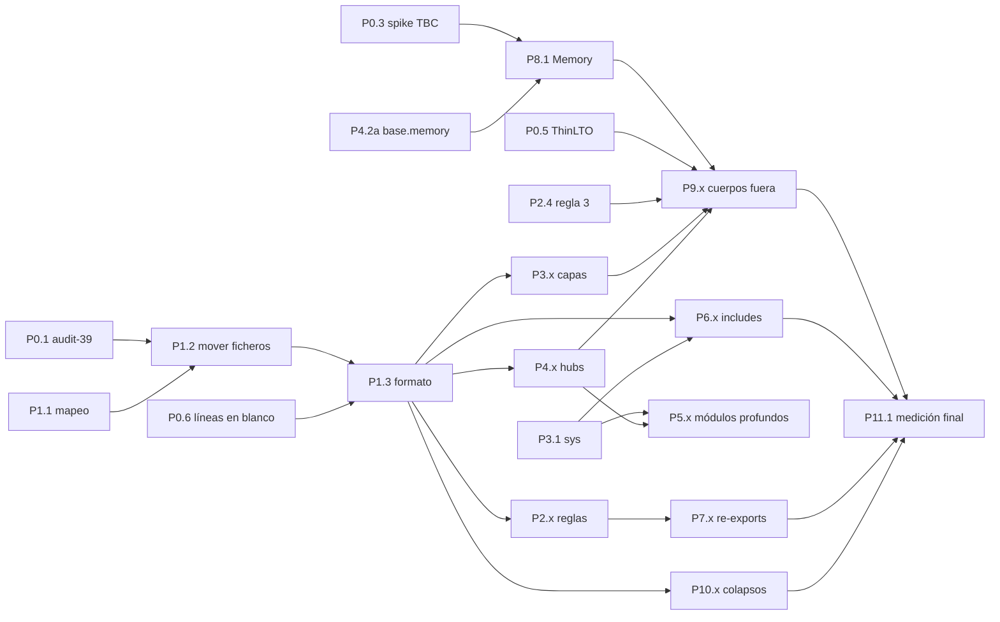

# TODO · Refactor a módulos profundos

Plan de origen: <https://claude.ai/artifact/LMd2ChCBMECmUbfQnPU7yx> (grafo de módulos de telar).
Estado de partida: `main @ 2890f72b1`, con `refactor/audit-39` abierta (30 commits por delante).

## Cómo se usa esta lista

- Cada tarea tiene un ID, sus dependencias (**Depende de**), lo que toca (**Toca**) y un criterio de cierre (**Hecho cuando**).
- Una tarea se puede empezar cuando todas sus dependencias están marcadas `[x]`.
- Cada tarea se ejecuta en su propio worktree y se integra al terminar. Un coordinador de telar las reparte entre máquinas: ver "Ejecución" más abajo.
- Dos tareas listas pueden ir a la vez si lo que tocan no se solapa. Si solo comparten ficheros calientes, también pueden ir a la vez y el conflicto se resuelve al integrar. Si se solapan en algo más, la segunda se despacha cuando la primera está integrada.
- Ficheros calientes que tocan casi todas las tareas: `docs/build/modules.json`, los `CMakeLists.txt` de cada árbol y `tools/check-cpp-modules.py`. Cada tarea toca ahí lo mínimo, para que el conflicto al integrar sea trivial.
- Cada regla nueva del checker entra en modo estricto con una **allowlist** de las violaciones que existen hoy. Cada tarea de arreglo borra sus entradas. Así las reglas entran pronto y los arreglos no dependen unos de otros. Si una tarea de arreglo llega antes que su regla, no hay entrada que borrar y no pasa nada.
- **Patrón agregador** para partir un módulo con muchos importadores: (1) crear los módulos nuevos y dejar el antiguo como agregador que hace `export import` de todos ellos, (2) migrar los importadores a los imports estrechos, un árbol por tarea (runtime, gui, cli, lib, tests) y en paralelo, (3) borrar el agregador. Las tareas con sufijo `a/b/c…` siguen este patrón.
- Tests: solo los del área tocada. La suite completa se ejecuta en P1.2, en los cierres de fase y en P11.1.
- Después de mover ficheros (P1.2) las rutas cambian. Por eso las tareas posteriores nombran módulos y no rutas.

## Ejecución

El coordinador es un agente en el checkout principal que usa la skill `telar-coordinator`. Es el único que edita esta lista y el único que integra.

- **Rama de integración:** `refactor/deep-modules`, creada desde `main` después de P0.1. Contiene esta lista, `docs/code-style.md` y `.clang-format` commiteados, porque a otra máquina solo viajan commits. Cuándo pasa a `main` lo decides tú; los cierres de fase (P3.17, P6.8, P9.11 y P11.1) son puntos estables.
- **Rama de cada tarea:** `refactor-<id>`, por ejemplo `refactor-p3-6`, creada desde la cabeza de la rama de integración en el momento de despacharla.
- **Elegir máquina:** el coordinador compara `telar --machine <label> runtime metrics --json` de las máquinas habilitadas (hoy, esta y `Personal`) y despacha a la que tenga más memoria libre. No pasa del máximo de tareas simultáneas por máquina, que sale del pico de memoria de un build en frío medido en P0.2: 3 en `Personal` y 3 en esta. Cada worktree empieza sin build, así que cada tarea paga un build completo.
- **Despachar:** la rama se crea en local (`git branch refactor-<id> refactor/deep-modules`) y después se lanza `telar worktree create refactor-<id> [--machine <label>] --setup --title "<id> · <título>" --json -- claude --dangerously-skip-permissions "<brief>"`. El brief cabe en 32 palabras: *"Lee la tarea <id> de TODO.md y docs/code-style.md. Impleméntala, cumple su Hecho cuando y commitea en esta rama. No edites TODO.md."*
- **LFS:** el historial antiguo tiene 11 punteros LFS (wallpapers de `desktop-mode`, materializados en `82ce41d42`). Con un hook `pre-push` de git-lfs, el despacho remoto falla al intentar subirlos; se despacha con `GIT_LFS_SKIP_PUSH=1` delante.
- **Integrar:** cuando el agente termina, el coordinador revisa el diff y ejecuta en el worktree el checker y los tests del área (`telar [--machine <label>] worktree exec`). Si la tarea corrió en otra máquina, la trae con `telar worktree fetch refactor-<id> --machine <label>`. Después hace merge en la rama de integración, resuelve los conflictos de los ficheros calientes, compila y prueba el área sobre el resultado, marca la tarea `[x]` aquí, commitea y borra el worktree con `--delete-branch`.
- **Barreras:** P1.2 y P1.3 se despachan solas, sin ninguna otra tarea en vuelo. Tocan todo el árbol, y cualquier tarea abierta tendría que rehacerse.
- **Límite de telar:** sigue como mucho 64 worktrees por máquina, así que los worktrees se borran al integrar.

## Vista por olas

Cada ola puede ejecutarse entera en paralelo cuando la anterior ha cerrado las dependencias que necesita. No hace falta esperar a que termine toda la ola anterior; manda el campo **Depende de** de cada tarea.

| Ola | Tareas |
|---|---|
| 0 · desde el día 1 | P0.7 primero; después P0.1, P0.2, P0.3, P0.4, P0.5, P0.6, P1.1, P2.4 (desarrollo del linter) |
| 1 · bloqueante | P1.2 → P1.3, P6.1 |
| 2 · tras el movimiento | P2.1, P2.2, P2.3, P2.4, P3.1, P3.2, P3.6–P3.16, P4.1a, P4.2a, P4.3a, P4.4a, P6.2, P6.7, P10.1–P10.3 |
| 3 | P3.3, P3.4a–e, P4.1b, P4.2b, P4.3b, P4.4b, P4.5, P5.1–P5.7, P6.3, P6.4, P7.1, P8.1 |
| 4 | P3.5, P4.1c, P4.2c, P4.3c, P4.4c, P6.5a–e, P6.6, P8.2, P8.3, P9.6–P9.9 |
| 5 | P3.17, P6.8, P7.2, P9.1–P9.5 |
| 6 · cierres | P9.10, P9.11, P11.1 |

Camino crítico: P0.1 → P1.2 → P1.3 → P4.2a → P8.1 → P9.x → P9.11 → P11.1. P0.3 tiene que estar verde antes de P8.1; si falla, la decisión de `Memory` se replantea antes de seguir.

---

## Fase 0 · Preparación (sin dependencias)

### [x] P0.1 · Integrar `refactor/audit-39`
- **Depende de:** —
- **Toca:** la rama entera (worktree `telar-worktrees/refactor`).
- **Hecho cuando:** el worktree del refactor parte de `main` con audit-39 integrada. Anotar en esta lista qué partes de P3.11 (caso 31), P3.14 (caso 34), P6.1 y P10.3 (caso 38) ya cubre la rama, para no repetirlas.
- **Resultado:** audit-39 entró en `main` por fast-forward (`2890f72b1..d1ab27cb6`). Lo que cubre queda anotado en cada tarea como **audit-39:**. Los dueños únicos que creó viven en `telar.platform` y `telar.base.text`, no en los submódulos del plan: P4.1 y P4.3 los mueven a su familia. Esos dos hubs y `telar.config` crecieron (unas 570, 180 y 600 líneas). Hay módulos nuevos que P1.1 tiene que mapear: `runtime.http.content` y `runtime.platform.private_tunnel`. El commit `d66fa0c16` metió por error `lib/tbc/out` como symlink en bucle; lo borra `5ab196eaa`.

### [x] P0.7 · Receta de setup para worktrees nuevos
- **Depende de:** —. Va antes que cualquier otra tarea y la ejecuta el coordinador en local, porque sin ella ningún worktree puede compilar.
- **Toca:** `.telar/setup.json` (nuevo).
- **Qué hace:** declara la receta que prepara un worktree recién creado: el bootstrap del toolchain fijado (`tools/cpp bootstrap`, que crea `.toolchain/`, ignorado por git) y lo que haga falta para configurar el build. Tiene que funcionar en cualquier máquina, sin rutas de una máquina concreta.
- **Hecho cuando:** `telar worktree create … --setup` deja un worktree que compila los tres procesos, tanto en local como en `Personal`.
- **Resultado:** `.telar/setup.json` ejecuta `tools/setup-checkout`, que enlaza `.toolchain`, `.dependencies-cache` y `.qt-cache` al checkout principal del clon y hace el bootstrap (`a44482e01`). `a3a2d2d46` hace que la clave de las dependencias gestionadas use la ruta real del toolchain, para que los worktrees reutilicen OpenSSL y Qt. Verificado: P0.2 compiló los tres procesos en un worktree de `Personal`, y P0.4, P6.1 y P10.3 el runtime y la GUI en worktrees locales.

### [x] P0.2 · Script de métricas y línea base
- **Depende de:** — (el script se escribe ya; la línea base se toma después de P0.1)
- **Toca:** `tools/` (script nuevo), `docs/build/` (fichero con la línea base).
- **Mide:** porcentaje del código de módulos que está en interfaces (hoy 94,7%), dependientes transitivos de los hubs (`telar.client.protocol` 148, `telar.base.memory` 167), aristas hacia arriba (hoy 41 entre componentes y 55 entre módulos), ciclos (5), aristas `export import` (681 de 1236), líneas en fragmentos globales (4,84 M) y unidades que recompila `ninja -n` después de tocar la interfaz de cada hub. Además, el tiempo y el pico de memoria de un build en frío en cada máquina, que el coordinador usa para decidir cuántas tareas caben a la vez.
- **Hecho cuando:** el script es reproducible y los números de partida están commiteados. P11.1 los vuelve a medir.
- **Resultado:** `tools/module-metrics.py` y `docs/build/module-metrics.json`, medido sobre `a1e1beb3c`. Interfaces 94,8 %; dependientes de `telar.client.protocol` 148 y de `telar.base.memory` 169; aristas hacia arriba 41 entre componentes y 56 entre módulos; 5 ciclos; `export import` 687 de 1251; camino crítico de 21 módulos; tocar un hub recompila 432–480 de 1154 unidades. Las líneas de fragmentos globales se cuentan sin blancos ni comentarios: 1,87 M en 231 unidades (no comparable con los 4,84 M del plan). Build en frío de los tres procesos: `Personal` (`Adrians-Laptop`, 10 núcleos, 32 GiB) 128 s y 7,5 GiB de pico; esta máquina (`Adrians-MacBook-Pro`, 8 núcleos, 16 GiB) 141 s y 3,5 GiB. El desempate del orden de componentes no reproduce exactamente la tabla del final: P2.1 toma su allowlist de la lista `upward` del JSON.

### [x] P0.3 · Spike: el lifetime checker de TBC con `tbc::view<Memory &, …>` sobre un tipo abstracto
- **Depende de:** —
- **Toca:** código desechable fuera del árbol del refactor. Se borra al terminar.
- **Hecho cuando:** hay un ejemplo mínimo que el checker acepta (o un parche a TBC que lo hace posible). Si no es viable, se para P8.1 y se replantea la decisión de `Memory` con tipo borrado.
- **Resultado:** viable sin tocar TBC (`bdcb86436`). Un `Memory` abstracto marcado `TBC_SHARED` se comparte por `tbc::view<Memory &, …>` y sus llamadas virtuales no invalidan préstamos; guardar un adaptador local que muere antes sigue dando `tbc-dangling-borrow`. El spike queda como 4 casos de regresión en `lib/tbc/tests/spec/declarations.cpp`. `590f57ca4` arregla cuatro procedencias rotas del corpus que hacían fallar `ctest -L spec` desde audit-39.

### [x] P0.4 · Launcher que conserva el `.pcm` cuando no cambia
- **Depende de:** —
- **Toca:** `cmake/managed_build.cmake` (ya cablea `CMAKE_CXX_COMPILER_LAUNCHER`), un launcher nuevo en `tools/`.
- **Qué hace:** compila a un fichero temporal y solo sustituye el BMI si el contenido cambia, para que `restat = 1` de ninja corte la cascada en los importadores directos.
- **Hecho cuando:** está medido en el build real, con el número de unidades que recompila tocar un comentario y un cuerpo no inline en un hub, antes y después. Si no compensa, se descarta con los números.
- **Resultado: descartado** (`docs/build/bmi-restat.md`). Tocar un comentario o un cuerpo no inline en `telar.base.memory` recompila 257 unidades con y sin launcher; en `telar.client.protocol`, 221. Clang 23 ya emite el BMI reducido, pero guarda offsets en bytes y un valor que depende del cuerpo de cada función, así que el `.pcm` cambia de verdad. El launcher solo ayuda cuando un fichero se reescribe sin cambiar (1 unidad frente a 257), y cuesta unos 35 ms por compilación. Lo que corta la cascada es P9.x.

### [x] P0.5 · ThinLTO en los builds optimizados
- **Depende de:** —
- **Toca:** `cmake/` y los presets de release. Hoy no hay `-flto` en ningún sitio.
- **Hecho cuando:** release y dev-release enlazan con ThinLTO, y están medidos el tiempo de build, el tamaño del binario y los benchmarks de hot path existentes (`tools/bench_*`, probes de latencia). Las regresiones quedan anotadas para P9.
- **Resultado:** `b1698437c`, medidas en `docs/build/thinlto.md`. Opción `TELAR_THIN_LTO` (activa) en `cmake/cpp_modules.cmake`: Release y RelWithDebInfo compilan con `-flto=thin` vía IPO de CMake, con caché de ThinLTO por build; en macOS enlaza ld64 con el libLTO del toolchain y en Linux `ld.lld` (sin verificar en Linux). Binarios: `telar-runtime` −16,7 %, `telar` −27,2 %, `telar-gui` −17,4 %. Build en frío dentro del ruido. Reenlazar el runtime tras editar un cuerpo pasa de 1–3 s a unos 18 s. Hot paths: escena `full` −5,4 %, PTY `cursor-byte-writes` −16,8 %. **Para P9:** separadores de comandos +1,2 % (pérdida consistente, causa sin establecer), `mode-report` +0,2 % (en el ruido), y repetir la medida del reenlace.

### [x] P1.1 · Tabla y script de destino de cada fichero
- **Depende de:** — (se escribe ya; se vuelve a ejecutar sobre `main` después de P0.1)
- **Toca:** `tools/` (script de movimiento), un fichero de mapeo.
- **Reglas del mapeo:** la carpeta es el módulo y la ruta sale del nombre actual del módulo, sin renombrar nada (`telar.base.memory` → `lib/base/memory/memory.cppm`). Las unidades de implementación van a la carpeta del módulo que declaran. Las particiones de interfaz se llaman `<módulo>-<partición>.cppm`. `src/runtime-cpp` → `src/runtime`, `src/gui-cpp` → `src/gui`, `src/cli-cpp` → `src/cli`. Las carpetas no llevan números.
- **Decisión abierta:** destino de las librerías que el árbol propuesto no nombra: `telar-git`, `telar-tls`, `telar-plugins`, `telar-lua`, `telar-machines`, `telar-render`, `telar-shell`, `telar-vocabulary`, `websock`, `ebnf`, `tbc`, `clipboard` y `src/auth-daemon`. Se decide aquí y queda escrita en el mapeo.
- **Hecho cuando:** el script genera el mapeo completo de forma determinista y `--dry-run` no deja ningún fichero sin destino.
- **Resultado:** `tools/move-cpp-tree.py` (`--dry-run`, `--write-map`, `--apply`) y `docs/build/tree-moves.json`: 1769 ficheros, 1560 se mueven, 209 se quedan y 3 symlinks se reapuntan. Las librerías `telar-*` pierden el prefijo (`lib/git`, `lib/tls`…); `clipboard`, `tbc`, `ebnf` y `src/auth-daemon` se quedan donde están. Las cabeceras siguen en `lib/<x>/include/telar_<x>/`, así que los `#include` solo cambian de include dir en CMake.

### [x] P2.4 · Regla 3 en el linter de TBC: la interfaz solo lleva declaraciones
- **Depende de:** — para desarrollarla en `lib/tbc/linter`. Para activarla en el build, de P1.2.
- **Toca:** `lib/tbc/linter`, `cmake/lint_prepare.cmake`.
- **Qué comprueba (sobre el AST, no con regex):** no hay cuerpos de función en unidades de interfaz salvo los `inline` de hot path anotados (definir la anotación aquí) y las plantillas que siguen siéndolo (primitivas de `base`).
- **Hecho cuando:** corre en CI con una allowlist por módulo, que hoy los contiene casi todos. P9.x la vacía.
- **Resultado:** `18dc56943`. `tbc-lint --checks=interface-bodies` avisa con `tbc-interface-body`. Se permiten las funciones `constexpr` y `consteval` (los importadores las evalúan; excepción añadida al implementar) y lo anotado con `TBC_HOT_PATH` (`<tbc/hot_path.hpp>`; en una clase cubre a todos sus miembros, y una función que no es plantilla tiene que ser además `inline`). La allowlist está en `docs/build/interface-bodies-allowlist.txt`, por módulo: 175 de 188. El check falla también si un módulo de la lista ya no tiene cuerpos, así que cada tarea de P9 borra su línea. Corre en `runtime-cpp.yml` y `gui-cpp.yml` (Release) y con `just runtime-interface-bodies` y `just gui-interface-bodies`; todavía no se ha ejecutado en GitHub.

### [x] P0.6 · Reglas de líneas en blanco de `docs/code-style.md` en el linter de TBC
- **Depende de:** —
- **Toca:** `lib/tbc/linter` y su integración en `cmake/lint_prepare.cmake`. Lo comparte con P2.4: P2.4 se despacha cuando P0.6 está integrada.
- **Qué comprueba sobre el AST, y cómo lo arregla insertando la línea en blanco:**
  - Una sentencia que acaba en su propia llave de cierre (bucle, `if`, `switch`, lambda o lista con llaves de varias líneas) va seguida de una línea en blanco, salvo que lo siguiente sea `else`, `catch`, el `while` de un `do` o el `}` que cierra el bloque.
  - Un grupo de declaraciones va seguido de una línea en blanco antes de la primera sentencia que no es una declaración. Hay una excepción: un `if` cuya condición usa la variable recién declarada va pegado a ella.
  - Una traza (`TELAR_TRACE(...)`) al principio de la función no exige línea en blanco.
- **Límites:** solo inserta líneas en blanco y nunca las borra, porque una línea en blanco que ya existe puede separar dos bloques por lo que hacen, que es la parte que no se puede automatizar. Lo que inserte se conserva después de clang-format (`MaxEmptyLinesToKeep: 1`).
- **Hecho cuando:** el linter avisa en cada caso, tiene un modo que aplica los arreglos y hay tests para cada regla y cada excepción, incluido que el resultado no cambia al pasarle clang-format.
- **Resultado:** `3038a2302`. `tbc-lint --checks=blank-lines` avisa con `tbc-blank-line-after-block` y `tbc-blank-line-after-declarations`; `--fix` inserta, `--header-filter` añade cabeceras. Sin `--checks` solo comprueba lifetimes, como antes. `telar_blank_line_check(... [FIX] [HEADERS <regex>])` en `cmake/lint_prepare.cmake` lo lanza; no está conectado a ningún proyecto ni a CI, eso es P1.3. Una macro de sentencia cuenta como sentencia, así que `TELAR_TRACE` no pide línea. Las etiquetas `case` no piden línea antes. Dos sentencias en una línea o una línea con `\` no se arreglan. Sobre las fuentes del propio linter salen unos 800 avisos, casi todos en `lifetime_analysis.cpp`: los arregla P1.3.

---

## Fase 1 · Movimiento físico

### [x] P1.2 · Commit que solo mueve ficheros
- **Depende de:** P0.1, P1.1
- **Toca:** todo el árbol, CMake, `docs/build/modules.json`, `tools/check-cpp-modules.py` (`SCOPES`, `LIBRARY_LAYERS`), `cmake/lifetime_check.cmake`, `cmake/lint_prepare.cmake` y los scripts de `tools/` con rutas fijas.
- **Contenido permitido:** `git mv`, rutas de `#include` relativas y CMake. Nada más.
- **De P2.4:** las regex de rutas de `src/runtime-cpp/cmake/interface_bodies.cmake` y `src/gui-cpp/cmake/interface_bodies.cmake` cambian con el movimiento. La allowlist va por nombre de módulo y no cambia.
- **Regla 1 en el checker:** ruta = nombre del módulo, ninguna unidad de implementación fuera de la carpeta de su módulo, ningún fichero de la carpeta declara otro módulo y las particiones siguen la forma `process-spawn.cppm` ↔ `:spawn`. Las particiones internas (`module X:detail;`) están permitidas.
- **Hecho cuando:** compilan los tres procesos, pasa la suite completa y pasa el checker con la regla 1 sin allowlist. Los módulos cajón (P3.14) y los ciclos (P3.13a, P3.14a, P3.15a, P3.15b) quedan a la vista en el árbol, pero cumplen la regla porque cada unidad está en la carpeta del módulo que declara.
- **Resultado:** `7ed3d95a6` es el movimiento (1559 renombrados, más rutas en `#include`, CMake, scripts, CI y docs) y es el commit que va a `.git-blame-ignore-revs`; `343b6d6f5` añade la regla 1 sin allowlist. Compilan los tres procesos en macOS (Linux sin compilar). Runtime 50/50 (también sobre la rama integrada), GUI 139/140: `gui-quick` ya fallaba antes (tarda ~126 s con límite de 90 y falla `configuredTooltipsYieldToOpenSurfaces`). `tests/controlled_awake_clock.cpp` declara `gui.platform.profile_file`, así que vive en su carpeta y el checker lo trata como unidad solo de test (`TEST_UNITS`) hasta P3.14a. Los filtros `out[^/]*` pasan a `out(-[^/]*)?` por la carpeta nueva `src/cli/output/`.

### [x] P1.3 · Aplicar el estilo de `docs/code-style.md` a todo el árbol
- **Depende de:** P1.2, P0.6. Todas las tareas que dependen de P1.2 dependen también de esta: el reformateo toca todos los ficheros, así que ninguna otra tarea puede estar editando mientras corre.
- **Toca:** todo el árbol (sin `vendor/`).
- **CI de TBC:** el workflow `tbc` falla en `main` desde al menos el 9 de noviembre en `format-check` y `lint` de `lib/tbc` (`tests/spec/*` y, desde P0.6, los `enum` de `blank_lines.hpp` y `main.cpp`). Esta tarea lo deja en verde.
- **Qué hace:** borra los 16 `.clang-format` por directorio (hoy hay 4 variantes, y tapan al de la raíz). Aplica los arreglos de líneas en blanco de P0.6, ejecuta después el `clang-format` del toolchain sobre todos los ficheros C++, Objective-C++ y de módulo, y añade los commits del movimiento y del formato a `.git-blame-ignore-revs`. Las comas finales en listas con llaves y la separación de bloques por lo que hacen no se pueden aplicar de forma mecánica: las aplica cada tarea a los ficheros que toca.
- **Hecho cuando:** solo queda `.clang-format` en la raíz, `clang-format --dry-run --Werror` y las reglas de P0.6 pasan en todo el árbol y se comprueban en CI, compilan los tres procesos y pasa la suite completa.
- **Resultado:** `8149b4971` inserta las líneas en blanco (solo añade líneas vacías), `b45e86560` borra los 17 `.clang-format` por directorio y formatea 1075 ficheros (además de la disposición, solo cambia un `#include` duplicado eliminado en `font_fixture`), y `a2207b63c` añade `.git-blame-ignore-revs` con los tres commits de movimiento y formato y las comprobaciones a CI. Las comprobaciones de CI no se han ejecutado en GitHub. Compilan los tres procesos en macOS. Falla `gui-quick`, igual que antes de la tarea (supera el timeout de 90 s y falla `configuredTooltipsYieldToOpenSurfaces`); `queuedFramesCannotSurviveAWindowBindingChange` es intermitente. Sin cubrir: el código solo de Linux y los probes sueltos fuera de las bases de compilación no han pasado por el chequeo de líneas en blanco. Si la rama se rebasa o se aplasta, `.git-blame-ignore-revs` hay que actualizarlo.

### [x] P1.4 · Lifetime checker en verde tras el movimiento y el formato
- **Depende de:** P1.3
- **Toca:** lo que haga falta para que el checker vuelva a pasar; sin cambios de diseño.
- **Qué pasa:** sobre `b52d70b74` (cabeza tras P1.3) el lifetime checker da 389 errores en `lib/git`, `lib/ebnf` y `src/runtime` (lo vio P4.2a). audit-39 lo dejó en verde. Hay que averiguar qué commit lo rompe (`7ed3d95a6` movimiento, `8149b4971` líneas en blanco, `b45e86560` formato, `a2207b63c` CI) y por qué: rutas en la configuración del checker, supresiones ancladas a líneas, o un cambio real.
- **Hecho cuando:** el lifetime check del runtime, la CLI, la GUI y las librerías da el mismo resultado que en `d1ab27cb6` (sin errores nuevos), y la causa queda anotada aquí.
- **Resultado:** no había regresión (`b19abb1e8`, commit vacío con las cifras). Los errores ya estaban en `d1ab27cb6`: audit-39 solo arregló los de las líneas que escribió, así que el check nunca estuvo en verde. Comparados uno a uno con las rutas traducidas por `tree-moves.json`: runtime, CLI y librerías 594 (52 distintos), GUI 728 (37 distintos), `lib/ebnf` 117, auth-daemon y clipboard 0, los mismos en los dos lados. Son regiones sin etiquetar en `lib/git`, `lib/ebnf` y el tracker de comandos, y algunos sueltos en el runtime y la GUI. Dejarlo en verde no es parte de este plan.

---

## Fase 2 · Reglas del checker (en paralelo tras P1.2)

### [x] P2.1 · Regla 2: solo se importa hacia abajo
- **Depende de:** P1.2
- **Toca:** `tools/check-cpp-modules.py`, `docs/build/modules.json`.
- **Qué hace:** generaliza `LIBRARY_LAYERS` a todos los componentes de `src/` y mueve el orden de capas a `modules.json`. La allowlist inicial son las 55 aristas entre módulos de la sección "Aristas hacia arriba" del final.
- **De P0.2:** la allowlist sale de la lista `upward` de `docs/build/module-metrics.json` (56 aristas), no de la tabla del final, que se calculó con otro desempate.
- **Hecho cuando:** el checker falla con cualquier arista hacia arriba nueva.
- **Resultado:** `7f7e342b4`. `process_layers` en `modules.json` ordena los componentes de `runtime`, `gui` y `cli` (con `tests` arriba); las librerías quedan por debajo de los procesos y entre ellas manda `library_layers`. La regla lee también los imports de las unidades de implementación. `upward_imports` es la allowlist: 53 aristas (las 56 de P0.2 menos las 3 que cerraron P3.15a y P3.15c), y el checker falla también si queda una entrada cuya arista ya no sube. **Cada tarea de P3 borra sus entradas de `upward_imports` al integrar.**

### [ ] P2.2 · Regla 4: `export import` solo si el tipo aparece en la interfaz exportada
- **Depende de:** P1.2
- **Toca:** el linter de TBC (lo más fiable sobre el AST) o el checker si basta una aproximación.
- **Hecho cuando:** la allowlist contiene los re-exports actuales que no cumplen (al menos los 67 que no mencionan ningún tipo del módulo re-exportado) y falla con cualquiera nuevo.

### [x] P2.3 · Regla 5: ningún `#include` fuera de las excepciones
- **Depende de:** P1.2
- **Toca:** `tools/check-cpp-modules.py`, `textual_boundaries` en `modules.json`.
- **Excepciones permitidas:** `lib/sys`, las cabeceras de macros del proyecto (P6.3), Qt/moc y Objective-C++.
- **Hecho cuando:** hay allowlist por fichero con los includes de hoy y el checker falla con cualquiera nuevo.
- **Resultado:** `f25185aaa` y `6e8549845`. Pueden incluir `lib/sys`, los adaptadores Qt/moc (los que incluyen una cabecera `<Q…>`), las fuentes C y Objective-C(++) y las cabeceras que todos ellos alcanzan; un módulo puede incluir sus propias cabeceras de `header_owners` que cruzan esa frontera; `macro_headers` (vacío hasta P6.3) no puede incluir nada. Tests y herramientas quedan fuera. La allowlist está en `docs/build/textual-includes.json` (3130 includes tras integrar P3.6), y el checker falla también con una entrada obsoleta: **cada tarea que quita o mueve un include actualiza ese fichero**. El checker también mira los ficheros sin rastrear, para comprobar los nuevos antes del commit.

---

## Fase 3 · Capas

### [x] P3.1 · Crear `lib/sys` (`telar.sys.*`)
- **Depende de:** P1.2
- **Toca:** `lib/sys/` nuevo.
- **Qué hace:** esqueleto de `telar.sys.posix`, `telar.sys.socket`, `telar.sys.process`, `telar.sys.apple` y `telar.sys.linux`, siguiendo el patrón `using ::open;` de `telar.platform.primitives`. Este es el único sitio con includes de C. Las conversiones de macros las hace P6.4.
- **Hecho cuando:** los módulos compilan, `telar.platform.primitives` pasa a reexportar desde `telar.sys.*` y la capa `sys` está en `modules.json`, por debajo de `platform`.
- **Resultado:** `3fd821cef`. `telar.sys.posix`, `.socket`, `.process`, `.apple` y `.linux` en `lib/sys/<familia>/`, con los nombres que el árbol llama hoy (`using ::open;`); `apple` y `linux` solo se compilan en su plataforma, y las extensiones solo de glibc van bajo `__GLIBC__` porque el código soporta musl. `telar.platform.primitives` hace `export import telar.sys.posix`. El orden de capas de las librerías pasa del checker a `library_layers` en `docs/build/modules.json`. Compilan los tres procesos en macOS; los módulos de Linux, sueltos, en Fedora (glibc) y Alpine (musl).

### [x] P3.2 · `telar.wire.vocabulary`
- **Depende de:** P1.2
- **Toca:** `telar.client.protocol`, `lib/wire/` nuevo.
- **Qué hace:** sacar de `telar.client.protocol` los tipos base, enums y codecs (`Byte`, `TerminalSize`, `FailureCode`, `TabLocation`, `Cursor`…) a `telar.wire.vocabulary`, y pasar `telar_protocol.hpp` y `telar_messages.hpp` a código de módulo. `telar.client.protocol` queda como agregador.
- **Hecho cuando:** compila sin cambiar ningún importador.
- **Resultado:** `a2f0cedd6`. `lib/wire` con `telar.wire.vocabulary`, dueño de las cabeceras de codecs, serializer, celdas, frame y mensajes, que reexporta los tipos base. El vocabulario de `telar_protocol.hpp` pasa a `telar_messages.hpp`, y `telar_protocol.hpp` se queda con los mensajes y sus schemas. Compilan los tres procesos y pasan los tests del área. **No convierte las cabeceras a código de módulo:** las incluyen unos 170 adaptadores Qt, tests y los fragmentos globales de `runtime.terminal.control`, `gui.core.primitives` y `gui.terminal.screen`, que no pueden importar módulos. Por eso el agregador reexporta el vocabulario desde su propio fragmento en vez de `export import telar.wire.vocabulary`: con dos BMI que llevan copia del texto, cada importador las fusiona (+7,8 % al compilar `client_control`). `telar-wire` toma sus cabeceras de `lib/client/include` hasta esa conversión.

### [x] P3.3 · Schemas de mensajes por dominio
- **Depende de:** P3.2
- **Toca:** `lib/wire/`.
- **Qué hace:** repartir los 128 `MessageSchema` en `telar.wire.<dominio>`: pane I/O, agentes, historial, tráfico y layout (la lista final sale del análisis). **El texto también se parte:** `telar_protocol.hpp` se divide en una cabecera por dominio (`protocol/pane_io.hpp`…), cada una con un único dueño, su módulo `telar.wire.<dominio>`. `telar_protocol.hpp` queda solo como paraguas que incluye las de dominio, y el agregador sigue reexportando. No migra includers ni importadores: eso es P3.4.
- **Por qué:** los adaptadores Qt nunca podrán importar módulos (moc no entiende `import` y sus cabeceras declaran señales con tipos del protocolo), así que partir solo los módulos no corta la cascada real. Medido sobre `ef8914a51`: `telar_protocol.hpp` lo incluyen 155 ficheros (77 adaptadores Qt, 67 tests, 44 cabeceras y su dueño), y llega por fragmento global a `gui.core.primitives` (`terminal_size.hpp`), `gui.terminal.screen` (`row_cache.hpp`) y `runtime.client_control` (`clipboard.hpp`). Un `export import` de dominios con una cabecera textual compartida además obliga a fusionar copias del texto (+7,8 % medido en P3.2).
- **Hecho cuando:** compila sin cambiar importadores, cada schema vive en un único dominio y cada cabecera de dominio tiene un único módulo dueño.
- **Resultado:** `b39218792`. 12 cabeceras en `telar_client/protocol/` con su módulo dueño `telar.wire.<dominio>`: `pane_io`, `content`, `layout`, `agents`, `history`, `graphics`, `worktrees`, `execution`, `clipboard`, `runtime`, `clients` y `editor`. Sin dominio de tráfico: su único mensaje, `ProxyStatus`, va a `runtime`. `clipboard.hpp` sustituye a `telar_clipboard_protocol.hpp` y `telar_runtime_clipboard.hpp`. 135 especializaciones, cada una en un solo dominio. Con BMI reducidos, cada dominio exporta `using telar::MessageSchema;` (y `clipboard`, `BodySchema`), o sus schemas no se ven importando solo ese dominio. Compilan los tres procesos y pasan los tests que decodifican mensajes.

### [x] P3.4a–e · Migrar los importadores de `telar.client.protocol`
- **Depende de:** P3.3
- **Toca:** a = runtime, b = gui, c = cli, d = lib, e = tests. Las cinco van en paralelo.
- **Qué hace:** cada unidad importa solo `telar.wire.vocabulary` y los dominios que usa. Las 33 unidades que no usan ningún nombre del módulo pierden el import. Cada fichero textual (adaptadores Qt en b, tests en e, cabeceras en su árbol) incluye solo las cabeceras de dominio que usa en lugar del paraguas, y lo mismo las tres cabeceras que llegan por fragmento global (`terminal_size.hpp`, `row_cache.hpp`, `clipboard.hpp`).
- **Hecho cuando:** ningún fichero del árbol importa `telar.client.protocol` ni incluye `telar_protocol.hpp`.
- **Decidido tras a y b:** se sigue con los 12 dominios aunque cuesta compilación. Medido en tiempo de CPU por unidad, alternando antes y después: en el runtime, las unidades que importan varios dominios suben de +59 % a +103 % (`client_control` +101 %; casi todo al escribir el BMI, que pasa de 1,41 a 3,06 s) porque cada dominio lleva su copia del vocabulario textual; en la GUI, +5 % a +8 %. P3.5 no lo quita: importar vocabulario y 7 dominios directamente cuesta +50 %. La cascada (`ninja -n`) no baja hasta que d y e dejen el agregador.
- **Resultado de a:** `ff03ad9cf`. 47 unidades importan vocabulario y dominios, 6 pasan a `telar.vocabulary`, 9 pierden el import; `clipboard.hpp` incluye solo su dominio.
- **Resultado de b:** `7d229c3f3`. 52 unidades de módulo (9 pierden el import, 34 solo vocabulario, el resto vocabulario y dominios; `session` importa 11) y 84 ficheros textuales (adaptadores Qt, herramientas, `terminal_size.hpp` y `row_cache.hpp`) incluyen solo sus cabeceras de dominio. `gui.prompt.routing` reexporta `pane_io` y el vocabulario en vez del agregador. Al integrar, las cabeceras de dominio que Qt ya no alcanza pasan a la allowlist de la regla 5 (32 entradas).
- **Resultado de c:** `f07f17cdd`. 25 unidades de la CLI: 18 importan vocabulario (13 también dominios; `worktree` 7), `command_limit` y `output` pasan a `telar.vocabulary`, 5 pierden el import y `main.cpp` deja de incluir el paraguas. CPU por unidad: `runtime_observer` +33 %, `worktree` y `project_setup` +8 %, `command_limit` −6 %. Pasan los 14 tests de la CLI.
- **Resultado de d:** `d2f677bf3`. `telar.client` y `telar.plugins` importan solo `telar.wire.vocabulary`; `telar.config`, también `telar.wire.clients` (codifica un `ShowNotification`); `wire` entra en las capas de `plugins` y `config`. Primera bajada medida de la cascada (runtime, builds reales): tocar `pane_io.hpp` recompila 62 unidades en vez de 91, `clients.hpp` 85 en vez de 91; `telar_messages.hpp` sigue en 113. `config` +4 % de CPU.
- **Resultado de e:** `fb0ed0838`. 122 unidades de test (18 pierden el import, 19 a `telar.vocabulary`, 32 solo vocabulario, 53 vocabulario y dominios), 12 fixtures que reexportaban el agregador reexportan solo sus módulos wire, y 67 ficheros textuales incluyen sus dominios o pierden el paraguas. CPU por unidad −8 % a +7 %, salvo `session_fixture` (+38 %, importa 8 módulos). Con a–e, ningún fichero fuera de `lib/client` importa el agregador ni incluye el paraguas.
- **De P3.3:** las cabeceras de dominio incluyen el vocabulario como texto, así que un fichero que importe el vocabulario y varios dominios fusiona una copia del vocabulario por dominio (el coste medido en P3.2). `ClientCommand`, `PaneForeground`, `PaneFrame`, `RequestRuntimeState` y `SystemMetrics` los exportan tanto el vocabulario como el dominio de su schema. Medir con `ninja -n` y con el tiempo de compilación de alguna unidad que importe varios dominios antes de cerrar cada subtarea.

### [ ] P3.5 · Borrar el agregador `telar.client.protocol`
- **Depende de:** P3.4a–e
- **Qué hace:** borra el módulo y la cabecera paraguas `telar_protocol.hpp`.
- **Hecho cuando:** ni el módulo ni la cabecera paraguas existen, y `ninja -n` tras tocar la cabecera de un dominio recompila solo a sus usuarios, adaptadores Qt y tests incluidos (no basta con el grafo de módulos de P0.2).

### [x] P3.6 · Bajar `background_executor` y limpiar `runtime/platform`
- **Depende de:** P1.2
- **Toca:** `telar.runtime.runtime.background_executor`, `runtime.platform.request_worker`, `runtime.platform.stream_read_buffer`, `runtime.platform.process_probe`, `runtime.history.store`, `runtime.editors.remote_editor`, `runtime.metrics.host_sampler`, `runtime.agents.session_host`.
- **Cierra:** `platform → runtime`, `editors → runtime`, `history → runtime` (las tres por `background_executor`), `platform → metrics`, `platform → agents`.
- **Hecho cuando:** `background_executor` vive en platform o en un componente de ejecución base y esas 5 aristas salen de la allowlist de P2.1.
- **Resultado:** `53ae00b9f`. `telar.runtime.platform.background_executor` (con `RequestContext`, `EditorCandidate` y `SuggestionService`), `platform.session_host` (antes en agents) y `platform.host_metrics` (`HostCounters`, `HostMetricsProbe`, `NativeHostMetrics` y sus `.cpp` de macOS y Linux). El concept `BackgroundExecutor` no puede bajar sin crear el ciclo `platform ↔ worktrees` y la arista `platform → history`, así que sube con `SubmitsRequest` a `runtime.runtime`, su único usuario. `upward_imports` de 53 a 48. El `host_metrics.cpp` de Linux no se ha compilado.

### [x] P3.7 · Separar el vocabulario de diagnóstico del colector de telemetría
- **Depende de:** P1.2
- **Toca:** `runtime.diagnostics.*`, `runtime.diagnostics.runtime_telemetry`, `runtime.platform.request_worker`.
- **Qué hace:** los contadores y las operaciones van a un módulo base sin dependencias. El colector (`runtime_telemetry`) sube junto a `runtime.runtime`.
- **Cierra:** `diagnostics → graphics, history, model, proxy, terminal` y `platform → diagnostics` (`request_worker → diagnostics.operation`).
- **Hecho cuando:** graphics y terminal importan solo el vocabulario y esas 6 aristas salen de la allowlist.
- **Resultado:** `ace1ea675`. El colector pasa entero (con el log, `LogSession` y los samples) a `telar.runtime.runtime.runtime_telemetry`, junto a `runtime.runtime`; el namespace no cambia. En `runtime/diagnostics` quedan `line`, `operation` y `runtime_counters`, que solo importan librerías, y `diagnostics` pasa a ser el primero de `process_layers.runtime`. Salen 7 aristas, no 6: también cae `runtime_telemetry → exchange_capture.exchange`, que no estaba en la tabla. Los tres módulos de vocabulario no se fusionan en uno: habría ensanchado los imports de más de 60 importadores. `upward_imports` de 48 a 41.

### [x] P3.8 · Romper `history.event` → `command_capture.tracker`
- **Depende de:** P1.2
- **Toca:** `runtime.history.event`, `runtime.command_capture.tracker`, `runtime.platform.request_worker`.
- **Cierra:** `history → command_capture` y `platform → history` (`request_worker → history.event`). Las dos están en el camino crítico de 20 módulos.
- **Resultado:** `e36bfddca`. `CapturedCommand` pasa a `telar.runtime.history.command` (lo importan el tracker y `history.event`), `HistoryQueryOrder` a `request_worker`, su único usuario, y `history` baja por debajo de `command_capture` en `process_layers`; de rebote deja de subir `agents.snapshot → history.store`. Tres módulos de `redirect` usaban `Byte` por una cadena de re-exports cortada y ahora importan `telar.vocabulary`. Camino crítico de 22 a 21.
- **Hecho cuando:** salen de la allowlist.

### [ ] P3.9 · Romper `terminal.text_reader` → graphics
- **Depende de:** P1.2
- **Toca:** `runtime.terminal.text_reader`, `runtime.graphics.kitty`, `runtime.graphics.pane_media`, `runtime.graphics.prepared_images`.
- **Cierra:** `terminal → graphics` (3 aristas).
- **Estado:** hecha en `refactor-p3-9` (`b1648c7cb`, más el probe `3dd416e1e`) en `Personal`, **sin integrar hasta medir**: `Terminal` deja de conocer `PaneMedia` y la llama por una tabla de punteros a función, así que `feed` hace llamadas indirectas en los paneles con media. Medir en `Personal` sin builds en marcha, desde el worktree `refactor-p3-9`: `python3 src/runtime/tools/bench_terminal_media_feed.py --baseline $SP/A/runtime --candidate $SP/B/runtime --output $SP/media-feed-1`, con `SP` el scratchpad que nombra el agente (builds en `/private/tmp`; si desaparecen, se rehacen en Release con el target `terminal-media-feed-probe`). Se integra si B no empeora fuera del ruido; si empeora, alternativa sin indirección. Al integrar, borrar sus 3 entradas de `upward_imports`.

### [x] P3.10 · Bajar lo que usan otros de `model.client_layouts` y de `execution_service`
- **Depende de:** P1.2
- **Toca:** `runtime.model.client_layouts`, `runtime.agents.snapshot`, `runtime.persistence.session_store`, `runtime.runtime.execution_service`.
- **Cierra:** `agents → model`, `persistence → model` y `persistence → runtime`. La arista `diagnostics → model` la cierra P3.7.
- **Resultado:** `6533c068a`. `AgentSnapshotBuilder` lee el modelo entero, así que sube a `runtime.runtime`, su único usuario, en vez de bajar el modelo (como `BackgroundExecutor` en P3.6). `Restore` recibe el servicio de paneles como parámetro de plantilla acotado por un concept nuevo, `PaneLauncher` (`launch` y `flushInput`), y `SessionStore` pierde `Poller` y `History`. `persistence → model` ya no subía con el orden actual. `upward_imports` de 36 a 34. El módulo sigue llamándose `agents.snapshot` aunque el builder ya no está ahí.

### [ ] P3.11a · `telar.platform.net`
- **Depende de:** P1.2. Antes, revisar qué dejó hecho el caso 31 de audit-39.
- **Toca:** `telar.platform` (nueva familia `net`), `runtime.proxy.relay_direction` y sus importadores (tls, traffic, redirect, plugins).
- **Qué hace:** socket, address y would-block salen de `relay_direction` a `telar.platform.net`.
- **audit-39:** `socketWouldBlock` y `earliest` ya están en `telar.platform` (`3c491c53c`), y existen `NetworkAddress::ipv4/ipv6` (`bd74f143f`). Queda crear la familia `net` y llevar allí `NetworkAddress` y `SocketStream`, que siguen en `relay_direction`. Las seis aristas siguen abiertas.
- **Cierra:** `plugins → proxy`, `redirect → proxy` (3), `tls → proxy`, `traffic → proxy` (2). Con eso caen los ciclos proxy ↔ tls, proxy ↔ redirect y proxy ↔ traffic.

### [ ] P3.11b · `traffic.vocabulary`
- **Depende de:** P1.2. Comparte `traffic.control_backend` con P3.11a: no se ejecutan a la vez.
- **Toca:** `runtime.plugins.protocol`, `runtime.plugins.tap_configuration`, `runtime.traffic.control_protocol`, `runtime.traffic.control_backend`, `runtime.http.message`, `runtime.http1.intercepted_relay`, `runtime.redirect.ingress`, `runtime.redirect.socket_owners`.
- **Qué hace:** lo que comparten proxy, plugins, traffic y http pasa a un módulo de vocabulario por debajo de todos ellos.
- **audit-39:** no lo cubre. `43f4b712e` añadió `HttpInterceptionSlot` como unidad `http/interception_slot.cppm` del módulo `http1.intercepted_relay`, otra unidad fuera de la carpeta de su módulo para P1.2.
- **Cierra:** `traffic → plugins` (3), `redirect → plugins`, `redirect → traffic`, `http → plugins`, `http1 → http`, `http1 → traffic`. Con eso caen los ciclos plugins ↔ traffic y http ↔ plugins.

### [x] P3.12a · Sacar `PaneLayout` y la geometría de `gui.application.sound_playback`
- **Depende de:** P1.2
- **Toca:** `gui.application.sound_playback` (contiene `pane_layout`, `workbench_geometry`, `pane_bottom_reservation`, `layout_token`, `navigation_history`, `saved_layouts`), `gui.presentation.frame_pacer`, `gui.presentation.history_inspection_geometry`, `gui.graphics.pauses`.
- **Cierra:** `presentation → application` (2) y `graphics → application`.
- **Hecho cuando:** `sound_playback` contiene solo la reproducción de sonido y la geometría vive en su propio módulo, por debajo de presentation.
- **Resultado:** `01e026c63`. `telar.gui.layout.geometry` (`PaneBottomReservation`, `PaneLayout`, `WorkbenchGeometry`) y `telar.gui.layout.snapshots` (`TabLayoutPreset`, `LayoutToken`, `NavigationHistory`, `SavedLayouts`); el componente `gui/layout` va justo encima de `core` e `history` en `process_layers`. `sound_playback` se queda con `SoundRequestOutcome` y `SoundPlayback`. Al integrar con P3.4b, los tres módulos importan `telar.wire.layout`/`telar.wire.vocabulary` en vez del agregador. Compilan GUI, runtime y CLI sobre la rama integrada.

### [x] P3.12b · Sacar las notificaciones y los records de `gui.application.workspace_replica`
- **Depende de:** P1.2
- **Toca:** `gui.application.workspace_replica`, `gui.presentation.notification_stack`, `gui.presentation.activity_order`.
- **Cierra:** `presentation → application` (2).
- **Resultado:** `telar.gui.model.records` y `telar.gui.model.replicas` en un componente nuevo `gui/model`, y `telar.gui.presentation.notification_center`; `workspace_replica` se queda con `Pane` y los records de entrada y reexporta los tres. `StatusAge` baja a `model.records` y `TabActivity::derive` recibe el `PaneProgressState` en vez del `Pane*`, porque `Pane` contiene un `GraphicsStore` de una capa superior.

### [ ] P3.12c · Sacar el payload de notificación y el estado de vista de `gui.application.host_effects`
- **Depende de:** P1.2
- **Toca:** `gui.application.host_effects`, `gui.config.gui_query`, `gui.platform.notification_commands`.
- **Cierra:** `config → application` y `platform → application`.

### [x] P3.13a · `gui.terminal.copy_mode` y el ciclo con `gui.fonts.face`
- **Depende de:** P1.2
- **Toca:** `gui.terminal.copy_mode` (contiene Symbol, box_edges y text_runs), `gui.fonts.face` (su `face.cpp` cierra el ciclo), `gui.input.copy_pointer`, `gui.input.key_encoder`.
- **Cierra:** `terminal → fonts`, `terminal → input` (2) y el ciclo `fonts.face` ↔ `terminal.copy_mode`.
- **Resultado:** `51116a128`. `copy_mode` se parte sin cambiar código en `gui.terminal.glyphs` (box y símbolos; `face.cpp` importa solo esto), `gui.terminal.selection` (`CellSelection`), `gui.fonts.text_runs` y `gui.input.copy_mode` (el modo copia sube a input porque depende de teclas y puntero). `upward_imports` de 32 a 29. Compila la GUI sobre la rama integrada.

### [x] P3.13b · Sacar tab drag/drop de `gui.input.child_mouse`
- **Depende de:** P1.2
- **Toca:** `gui.input.child_mouse`, `gui.presentation.frame_pacer`, `gui.presentation.history_filter_geometry`, `gui.presentation.history_meta_geometry`.
- **Cierra:** `input → presentation` (3).
- **Resultado:** `47948ad82`. `gui.presentation.tab_drop` (`TabDrag`, `TabDropTarget`, `TabDropSurface`…) y, porque solo el drag/drop no cerraba las tres aristas, `gui.presentation.history_pointer` (`HistoryActionCapture`, `HistoryHover`). `child_mouse` se queda con `ChildMouse*` y `HistoryScroll`. Código movido sin cambios. `upward_imports` de 29 a 26. Compila la GUI sobre la rama integrada.

### [ ] P3.13c · `gui.input.configuration` y `gui.components.builtin_content` contra config
- **Depende de:** P1.2
- **Toca:** `gui.input.configuration`, `gui.config.gui_query`, `gui.components.builtin_content`, `gui.config.plugin_effects`.
- **Cierra:** `input → config` y `components → config`.

### [ ] P3.14a · Módulo cajón `gui.platform.profile_file` y el ciclo con `login_shell`
- **Depende de:** P1.2. Antes, revisar qué cubre el caso 34 de audit-39.
- **Toca:** `gui.platform.profile_file` (implementa `awake_clock`, `runtime_endpoint`, `shared_image_source` y un fichero de test), `gui.platform.login_shell` (`managed_directory.cpp`, `runtime_endpoint.cpp`), `gui.attachments.catalog`, `gui.machines.discovery`.
- **Qué hace:** cada unidad pasa a su propio módulo. `tests/controlled_awake_clock.cpp` deja de ser una unidad de un módulo de producción.
- **Cierra:** `platform → attachments`, `platform → machines` y el ciclo `login_shell` ↔ `profile_file`.

### [ ] P3.14b · Módulo cajón `gui.platform.private_file_stamp`
- **Depende de:** P1.2
- **Toca:** sus unidades `background_effect`, `glyph_rasterizer`, `peer_identity`, `process_group` y `secure_random`.
- **Cierra:** `platform → fonts`.
- **audit-39:** `secure_random.cpp` ya no existe (`f8cc271a9`). Las otras cuatro unidades y la arista siguen. P3.14a, P3.14c y P3.14d no los cubre.

### [ ] P3.14c · Módulo cajón `gui.platform.notification_commands`
- **Depende de:** P1.2. Toca `host_effects`, igual que P3.12c.
- **Toca:** sus unidades `stdio_socket`, `wall_clock` y `window_lease`.

### [ ] P3.14d · Módulos cajón del runtime
- **Depende de:** P1.2
- **Toca:** `runtime.platform.system_certificates` (contiene `event_loop`) y `runtime.platform.launch_program` (contiene `local_listener`).

### [x] P3.15a · Ciclo `cli.tab` ↔ `cli.integration.settings`
- **Depende de:** P1.2
- **Toca:** `cli.tab`, su unidad `integration.cpp`, `cli.integration.settings`, `cli.server`.
- **Cierra:** `integration → (root)` (`→ cli.server`, `→ cli.tab`) y el ciclo.
- **Resultado:** `e20d44089`. `CommandError` sale a `telar.cli.base.command_error` (`cli.server` lo reexporta) e `IntegrationAction`, `IntegrationOptions` y `runIntegration` pasan de `cli.tab` a `cli.integration.settings`, con su `integration.cpp`. La salida de los errores al usuario no cambia. Ciclos de 5 a 3. Sobre la rama integrada con P3.15b compila el CLI y pasan 11 de 12 tests: `machine-setup-cli-tests` se cuelga en esta máquina también con el binario de P3.15a sola, que su agente vio pasar, así que es del entorno y no de la integración.

### [x] P3.15b · Ciclo `cli.window` ↔ `cli.machine`
- **Depende de:** P1.2
- **Toca:** `cli.window`, `cli.machine`, `launch_commands.cpp`.
- **Resultado:** `5287efcf6`. `launch_commands.cpp` y `completions.cpp` pasan a un módulo nuevo, `telar.cli.launch_commands`, por encima de `cli.machine` y `cli.window`, con las declaraciones de arranque que estaban en `window.cppm`. Compila el CLI y pasan sus 6 tests; `cli-window-tests` falló una vez y luego pasó 5 de 5 (intermitente). El checker solo lee interfaces, así que este ciclo, que pasaba por una unidad de implementación, no lo veía: P3.17 tiene que cubrirlo.

### [x] P3.15c · `cli.hooks.session` → `cli.runtime_observer`
- **Depende de:** P1.2
- **Cierra:** `hooks → (root)`.
- **Resultado:** `849a9af15`. `ControlFailure`, `RuntimeConnection` (con su `.cpp`) y `ControlSession` pasan sin cambios a `telar.cli.control_session`; `hooks.session` importa solo ese módulo y `runtime_observer` lo reexporta. Compila el CLI en Release y pasan sus 12 tests.

### [ ] P3.16 · `gui.core.primitives` sin application ni input
- **Depende de:** P1.2
- **Toca:** `gui.core.primitives`, que incluye `application/dependencies.hpp` e `input/wheel_accumulator.hpp`.
- **Hecho cuando:** core no incluye ni importa nada de application ni de input.

### [ ] P3.17 · Cierre de capas
- **Depende de:** P2.1, P3.6–P3.16
- **Hecho cuando:** la allowlist de la regla 2 está vacía, el checker no encuentra ciclos (tampoco a través de unidades de implementación) y P0.2 da 0 aristas hacia arriba. Se ejecuta la suite completa.

---

## Fase 4 · Estrechar los hubs anchos

Cada hub sigue el patrón agregador: `a` crea los módulos y deja el agregador, `b` migra a los importadores (una subtarea por árbol, en paralelo) y `c` borra el agregador.

### [x] P4.1a/b/c · `telar.platform` por familias
- **Depende de:** a: P1.2 · b: P4.1a · c: P4.1b, P3.11a
- **Familias:** process (`Command`, `PipeProcess`, `PtyProcess`, `SpawnOptions`), git (`GitFiles`, `GitHead`, `LinkedWorktree`, `HardenedGit`: **decidido, se mueve a `telar.git`**, que pasa a ser el único dueño de lo de git; si alguna librería por debajo de `git` lo usa, se ajusta el orden de capas), fs (`PrivateDirectory`, `ReadFile`, `WritePrivateFile`, `OpenBeneath`), paths y entorno, events. La familia `net` la crea P3.11a.
- **Contexto:** 127 dependientes, 34 secciones, cada importador usa de media el 8%.
- **Resultado de a:** `284a6e6ba`. `telar.platform` reexporta un módulo por familia en `lib/platform/<familia>/`: `error`, `process` (con login shell y ruta del ejecutable), `thread`, `fs`, `paths`, `daemon`, `events` (`ObservationTime`, `earliest`), y dos que el plan no nombraba, `sha256` y `graphics`. La familia git va a `telar.git.checkout` (lib/git), que importan directamente sus 5 importadores y 3 tests, porque `platform` no puede reexportar algo de una capa superior; `git` puede importar `vocabulary`. `socketWouldBlock`, `suppressSocketSignals` y `peerCredentials` se quedan en el agregador para P3.11a. Compilan runtime, CLI, GUI y `lib/git` sobre la rama integrada. El `[x]` del título marca solo `a`.

### [x] P4.2a/b/c · `telar.base.memory` por familias
- **Depende de:** a: P1.2 · b: P4.2a · c: P4.2b
- **Familias propuestas:** allocators (`allocator`, `buffer`, `recycling`, estadísticas), sensibles (`erasing_allocator`, `sensitive_allocation`, `sensitive_buffer`, `sensitive_text`) y contenedores (`byte_queue`, `slot_indexes`, `retained_stream`, `drop_channel`, `fixed_text`, `c_allocation_blocks`).
- **Contexto:** 167 dependientes, 7% de uso medio.
- **Resultado de a:** `4536d6696`. `telar.base.memory.allocators` (dueño de `allocator.hpp` y `allocation_statistics.hpp`, más `BufferAllocator`), `.sensitive` (`eraseSensitive`, `ErasingAllocator`, `RecyclingAllocator`, `SensitiveAllocation`, `SensitiveBuffer`, `SensitiveText`) y `.containers` (`fixed_text.hpp`, `ByteQueue`, `ByteStorage`, `CAllocationBlocks`, `DropChannel`, `RetainedStream`, `SlotIndexes`). `RecyclingAllocator` va a sensitive y no a allocators: borra cada bloque con `eraseSensitive`, y en allocators crearía un ciclo. `telar.base.memory` queda como agregador sin cuerpos. Compilan los tres procesos. **b y c siguen abiertas**: el `[x]` del título marca solo `a`.

### [x] P4.3a/b/c · `telar.base.text`: JSON aparte
- **Depende de:** a: P1.2 · b: P4.3a · c: P4.3b
- **Qué hace:** `json`, `json_error`, `json_fields` y `json_node` a `telar.base.text.json`. ASCII, `fields`, `hostname` y `schema_version` se quedan en su propio módulo.
- **Resultado de a:** `450f8127a`. `telar.base.text.json` (`JsonError`, `JsonValue`, `JsonEscapes`, `escapeJson`, `appendJsonText`, `JsonFields`, `JsonKind`, `JsonNode`), con `import std` y dependiendo solo de `base.memory.allocators` y de un módulo nuevo, `telar.base.text.utf8` (dueño de `utf8.hpp`), sin el cual había un ciclo entre el JSON y `SchemaVersion`. `telar.base.text` hace `export import` de los dos. **En b, los importadores que solo usan UTF-8 pasan a `telar.base.text.utf8`.** El `[x]` del título marca solo `a`.

### [x] P4.4a/b/c · `telar.config` por proceso
- **Depende de:** a: P1.2 · b: P4.4a · c: P4.4b
- **Decidido:** módulos separados (`telar.config.core`, `.runtime`, `.client`, `.gui`), no particiones: una partición no se puede importar desde fuera de su módulo, así que no corta la cascada entre procesos. La tarea `a` actualiza la regla "un módulo por biblioteca" de `docs/build/cpp-modules.md`.
- **Contexto:** 86 dependientes, 45 secciones, 4,3% de uso medio y 15 secciones que nadie usa desde fuera. Las 15 se borran o se pasan a internas en `a`.
- **Resultado de a:** `7c0014718`. Cinco módulos y `telar.config` como agregador: `.core` (lo compartido: avisos de límites, restricciones, proveedores de agentes, `IntegrationProvider`, `LocalModules`, `GraphicsLimits`), `.runtime`, `.client`, `.gui` (secciones `gui` y `theme`) y `.snapshot` (`SnapshotReader`, que valida el config entero y usan los tres procesos; dentro de `.runtime` habría obligado a importar `.client` y `.gui`). `docs/build/cpp-modules.md` actualizado. El `[x]` del título marca solo `a`.

### [ ] P4.5 · Un solo lector tipado del schema de config
- **Depende de:** P4.4a
- **Qué hace:** hoy el schema se valida en la lib y la GUI lo vuelve a leer por su cuenta, por eso la GUI rechaza `client.prompt.skin` y la lib lo acepta. Queda un único lector tipado y la GUI consume su resultado.
- **Hecho cuando:** hay un test que cubre `client.prompt.skin` en los dos procesos y no queda código de lectura del schema en la GUI.
- **audit-39:** `3529b1fdc` creó `GuiReader` y `PromptReader` en `telar-config`, que ya leen `gui` y `client.prompt` y aceptan `skin`. La GUI sigue leyendo por su cuenta el resto de `client.*`, los temas, los atajos y los componentes (unas 130 llamadas a `field(…)` en `gui.config.generation`), y el test de `skin` solo existe en la GUI.

---

## Fase 5 · Módulos profundos para el conocimiento duplicado

Cada tarea empieza localizando todas las copias, crea un módulo con una interfaz mínima y borra las copias.

| ID | Conocimiento | Copias | Destino | Depende de |
|---|---|---|---|---|
| [x] P5.1 | Ruta del config | 6 | `telar.platform.paths` | P4.1a |
| [x] P5.2 | Paste framing / paste encoder | 3 | módulo en platform | P1.2 |
| [x] P5.3 | Hardening de git | 3 | `telar.platform.git` | P4.1a |
| [x] P5.4 | `setup.json` | 2 | módulo dueño único (decidir capa) | P1.2 |
| [ ] P5.5 | Login shell | 4 | `telar.platform.process` o `telar.sys.process` | P4.1a, P3.1 |
| [ ] P5.6 | Nombres de errno | 8 | `telar.sys.posix` (`lastError()` y el nombre) | P3.1 |
| [ ] P5.7 | Spawn con higiene de descriptores | — | `telar.platform.process` | P4.1a, P3.1 |

**audit-39** ya dejó un dueño único para casi todo, aunque en el hub y no en el destino de la tabla. Mover cada dueño a su familia es parte de P4.1 y P4.3:
- P5.1: `RuntimePaths::configHome/configFile` y `SocketLocation` en `telar.platform` (`c96b3e0ee`).
- P5.2: `BracketedPaste` en `telar.base.text` (`743848d0a`).
- P5.3: `HardenedGit` en `telar.platform` (`e1d10a384`).
- P5.4: `cli.project_setup::prepare` (`b12d9a859`).
- P5.5: `loginShell` y `loginShellScript` en `telar.platform` (`8bfa863cd`). Quedan dos lecturas sueltas de `$SHELL`: en la CLI (`worktree_git`) y en `Command` de `telar.platform`.
- P5.6: `systemErrorName` en `telar.platform` (`845c69d6d`), sin `lastError()`. Quedan copias en `runtime.runtime.execution_service`, `runtime.execution.execution` y en `worktree_git` e `history` de la CLI.
- P5.7: todos los spawns usan `SpawnOptions` (`be47a6b84`). Tres sitios repiten a mano "conservar los tres flujos estándar y cerrar el resto": `traffic.control_backend`, `machine_ssh` de la CLI y `tls` del runtime.

---

## Fase 6 · Includes

### [x] P6.1 · Borrar los includes muertos
- **Depende de:** P0.1 (audit-39 trae "Drop the remaining unused code, options and includes": revisar antes qué queda). Puede entrar antes o después de P1.2, porque el movimiento va por script.
- **Toca:** `Security.h` en `proxy/runtime.cppm`, `traffic/control_backend.cppm` y `platform/system_certificates.cppm` (34 mil líneas cada uno). `<print>` textual en `cli/server.cppm` (26 600 líneas) pasa a `import std;`.
- **audit-39:** `73136591c` lo quitó de `proxy/runtime.cppm`. Queda el de `traffic.control_backend`, que no lo usa; en `system_certificates` está incluido dos veces y sí lo usa, así que solo sobra el duplicado; y el `<print>` sigue en `runtime.cli.server`.
- **Resultado:** `3e840f6d6` quita `Security.h` y `CoreFoundation.h` de `traffic.control_backend`, el bloque duplicado de `system_certificates` (también el de OpenSSL en Linux) y `<print>` de `runtime.cli.server`. Compilado y probado en macOS; en Linux no se ha compilado. Tres tests siguen incluyendo `Security.h` (`linux_platform_test`, `tls_trust_test`, `traffic_control_test`): son de la pasada de tests, fuera de alcance.

### [ ] P6.2 · Partir `tbc/view.hpp`
- **Depende de:** P1.2
- **Qué hace:** una cabecera mínima solo con las anotaciones TBC (`TBC_SHARED`) y un módulo con el resto. Los `UINT*_MAX` pasan a `std::numeric_limits`.
- **Contexto:** 98 unidades de módulo y 456 mil líneas; 68 de ellas no usan ninguna macro suya.

### [ ] P6.3 · Cabeceras de macros del proyecto (categoría C)
- **Depende de:** P6.2
- **Qué hace:** dos o tres cabeceras sin includes propios: traza (`TELAR_TRACE`), diagnóstico (`TELAR_DIAGNOSTIC(S)`, `TELAR_DEBUG`) y anotaciones TBC (la de P6.2). Se registran como excepción en la regla 5.

### [ ] P6.4 · Convertir macros de sistema en `telar.sys.*` (categoría B)
- **Depende de:** P3.1
- **Qué hace:** las constantes pasan a `inline constexpr` (`O_CLOEXEC`, `EINTR`, `PATH_MAX`, `POLLIN`…), las macros con forma de función a funciones `inline` (`WIFEXITED`, `S_ISREG`, `htons`) y `errno` a `lastError()`. `isfinite` pasa a `std::isfinite`. Las comprobaciones de plataforma (`__APPLE__`) no necesitan include.
- **Se puede partir por familia en paralelo:** fs, wait/process, socket, apple y linux.

### [ ] P6.5a–e · Sustituir los includes por imports (categorías A y B)
- **Depende de:** P3.1, P6.4, P6.3
- **Toca:** a = lib, b = runtime, c = gui (sin Qt ni `.mm`), d = cli, e = auth-daemon. Las cinco van en paralelo.
- **Decidido (librerías de terceros):** cada librería externa (OpenSSL, ghostty, freetype, brotli, pcap, nghttp2, xcb, wayland, md4c…) se incluye solo en el fragmento global de un módulo dueño registrado en `modules.json`, y el resto importa ese módulo. Subtarea **f**: mover cada include de terceros a su dueño. Quedan como excepción de la regla 5 el linter de TBC (herramienta Clang sin módulos, 73 includes de Clang/LLVM) y los fragmentos de datos `.inc` generados.
- **Qué hace:** la libc estándar pasa a `import std;` o `import std.compat;` (está en el toolchain y hoy nadie lo usa), las cabeceras del proyecto al módulo dueño y POSIX/Apple a `telar.sys.*`. Cada subtarea borra sus entradas de la allowlist de P2.3.

### [ ] P6.6 · Los hubs dejan de ser dueños textuales
- **Depende de:** P4.2a, P4.3a, P4.4a
- **Toca:** `base.memory`, `base.text`, `base.diagnostics` y `telar.config`, que incluyen entre 7 y 20 cabeceras de C++ en su fragmento global por compartir cabeceras con Objective-C++ y Qt.
- **Qué hace:** lo que cruza a `.mm` y a Qt se reduce a una cabecera C o de tipos mínima. El resto pasa a código de módulo con `import std`.

### [x] P6.7 · Cabeceras pesadas que convierten módulos pequeños en sumideros
- **Depende de:** P1.2
- **Qué hace:** partir `runtime.terminal.control` (118 líneas propias y 13 256 de cabeceras, `control/engine.hpp` y sus 28 headers) por familia de secuencias: graphics, clipboard, glyph y checksum. Revisar `gui.terminal.screen` (6456 líneas de cabeceras) y `gui.attachments.catalog` (7784). Lo de `gui.core.primitives` es P3.16.
- **Se puede partir:** a = terminal.control, b = gui.terminal.screen, c = attachments.catalog.
- **Resultado de a:** `07d2de5a4`. `runtime.terminal.control` se queda con parser, estado VT, replies, reports, clasificación y consultas de color y graphics; `control.clipboard`, `control.glyph`, `control.checksum` y `control.engine` pasan a código de módulo. Fragmento global de la base: 12 888 → 7 934 líneas del proyecto. Graphics no se separa: sus consultas leen cabeceras de `graphics.kitty`, que está por encima, y con `<arm_neon.h>` en dos fragmentos globales Clang emite dos veces sus intrínsecos. `VtState::writeAscii` pasa a pública porque el `friend class Engine` no se puede nombrar entre módulos. El `[x]` del título marca solo `a`.

### [ ] P6.8 · Cierre de includes
- **Depende de:** P2.3, P6.1–P6.7
- **Hecho cuando:** la allowlist de la regla 5 está vacía y P0.2 da la nueva cifra de líneas en fragmentos globales.

---

## Fase 7 · Re-exports

### [ ] P7.1 · Quitar los `export import` que no cumplen la regla 4
- **Depende de:** P2.2
- **Se puede partir por árbol:** runtime (`runtime.runtime` re-exporta 23 y `runtime.cli.server` ve 90), gui (`gui.application.session` re-exporta 29, `gui.machines.profile_store` ×3…) y cli.
- **Qué hace:** los importadores que dependían del transitivo pasan a import explícito. Los 443 imports directos "redundantes" se quedan, porque la regla elige el estilo explícito.

### [ ] P7.2 · Cierre de re-exports
- **Depende de:** P7.1
- **Hecho cuando:** la allowlist de la regla 4 está vacía.

---

## Fase 8 · `telar::Memory` con tipo borrado en la frontera de servicio

### [x] P8.1 · `Memory`, `ConcurrentMemory`, `ErasingMemory`, `MemoryAdapter<A>`
- **Depende de:** P0.3, P4.2a
- **Qué hace:** una interfaz de unas 20 líneas con `allocate`/`deallocate` virtuales `noexcept` que devuelven `nullptr` al fallar (no `std::pmr`). `ConcurrentMemory : Memory` sustituye al concept `ConcurrentAllocator` y `ErasingMemory : Memory` cubre los secretos. `MemoryAdapter<A>` envuelve cualquier `Allocator`, también los fakes de los tests.
- **Hecho cuando:** está en la familia de allocators de base, tiene tests con los fakes que fallan y con presupuesto, y el lifetime checker lo acepta en el build real. No se migra ningún servicio en esta tarea.
- **De P0.3:** `TBC_SHARED` no se hereda. `Memory`, `ConcurrentMemory`, `ErasingMemory`, `MemoryAdapter<A>` y cada implementación llevan su propia marca.
- **Resultado:** `812d232a1`, en `telar.base.memory.allocators`. `Memory` tiene destructor protegido no virtual y prohíbe la copia, y cumple el concept `Allocator`, así que `Vector<T, Memory>` funciona sin cambios. `ConcurrentMemory` lleva `thread_safe = true`. `ErasingMemory` se detecta con un concept nuevo, `SensitiveAllocator` (`erasing = true` en `ErasingAllocator` y `RecyclingAllocator`). `MemoryAdapter<A>` es `final`, guarda el allocator por referencia y toma el tipo más fuerte que `A` permite, con el borrado por delante de la concurrencia. `testMemoryInterface` cubre un fake que rechaza todo, un presupuesto que se agota y el borrado. Sin avisos del lifetime checker en `lib/base`. Compilan runtime, CLI y GUI, y pasan los tests de base y de render.

### [ ] P8.2 · Medir el coste de la llamada virtual
- **Depende de:** P8.1, P0.5
- **Qué mide:** alloc+free con `Memory` frente al concept, con ThinLTO y con `-fwhole-program-vtables` (lo medido sin LTO es de +0,50 a +1,08 ns sobre 13 a 26 ns de `malloc`). También los hot paths del proxy y del render.
- **Hecho cuando:** los números están en `docs/build/` y queda decidido si `-fwhole-program-vtables` entra en release.

### [ ] P8.3 · Allocators de producción detrás de `Memory`
- **Depende de:** P8.1
- **Toca:** las raíces de composición que combinan `BudgetAllocator<SystemAllocator>`, `Synchronized`, `Erasing`, `Recycling` y `Buffer`, y el allocator de la GUI que elige `TELAR_GUI_ALLOCATOR`.
- **Hecho cuando:** cada raíz de composición construye un `MemoryAdapter` y lo pasa como `Memory &`, `ConcurrentMemory &` o `ErasingMemory &`.

---

## Fase 9 · Cuerpos fuera de las interfaces

Para cada módulo: `extern template class X<Memory>;` en la interfaz, la instancia con los cuerpos en una unidad de implementación de la carpeta y las funciones no plantilla a `module X;`. Lo que se quede inline en la interfaz lleva la anotación de hot path de P2.4 y una medición. Cada tarea borra sus entradas de la allowlist de la regla 3. Siguen siendo plantillas las primitivas pequeñas y calientes de `base`: `Vector`/`String` sobre `AllocatorRef`, `ByteQueue`, `FixedText`, `SlotIndexes` y `SensitiveAllocation`.

| ID | Módulos | Depende de |
|---|---|---|
| [ ] P9.1 | `telar.wire.*` | P3.5, P8.1, P2.4 |
| [ ] P9.2 | `telar.platform.*` | P4.1c, P8.1, P2.4 |
| [ ] P9.3 | `telar.base.text.*`, `telar.base.diagnostics` | P4.3c, P6.6, P8.1, P2.4 |
| [ ] P9.4 | `telar.base.memory.*` (solo lo que no es primitiva) | P4.2c, P6.6, P8.1, P2.4 |
| [ ] P9.5 | `telar.config.*` | P4.4c, P4.5, P8.1, P2.4 |
| [ ] P9.6 | Resto de `lib/`: git, tls, plugins, lua, machines, render, shell | P1.2, P8.1, P2.4 |
| [ ] P9.7 | Runtime, una subtarea por dominio en paralelo (terminal, panes, agents, history, traffic/{proxy,tls,http,redirect}, plugins, graphics…) | P8.1, P0.5, P2.4 y las tareas de P3 del dominio |
| [ ] P9.8 | GUI, una subtarea por dominio. `gui.application.session` (5815 líneas) pasa a `session/session.cppm` con `prompt.cpp`, `blocks.cpp`, `copy_mode.cpp`… | P8.1, P0.5, P2.4 y las tareas de P3 del dominio |
| [ ] P9.9 | CLI | P8.1, P2.4, P3.15a–c |

- **Hecho cuando (cada una):** compila, pasan los tests del área, y en runtime y GUI los benchmarks de hot path no empeoran respecto a P0.5 o la diferencia está justificada.

### [ ] P9.10 · Quitar el parámetro de plantilla `Memory` donde ya no aporta
- **Depende de:** P9.1–P9.9
- **Qué hace:** los servicios que solo se instancian con `Memory` dejan de ser plantillas y se borran los `extern template`.

### [ ] P9.11 · Cierre de la regla 3
- **Depende de:** P9.1–P9.10
- **Hecho cuando:** la allowlist de la regla 3 está vacía y se ejecuta la suite completa.

---

## Fase 10 · Colapsos (prioridad baja)

### [ ] P10.1 · Módulos pequeños con un solo importador pasan a partición del importador
- **Depende de:** P1.2
- **Módulos:** `gui.terminal.fold_map` (10 líneas), `telar.vocabulary` (19), `runtime.traffic.tap` (60, con 21 includes), `runtime.tls.system_root_bundle` (63), `runtime.persistence.launch_record` (71), `gui.prompt.routing` (71), `runtime.workspaces.git_probe` (82), `runtime.execution.execution` (93).

### [ ] P10.2 · Cadenas lineales
- **Depende de:** P1.2
- **Qué hace:** evaluar si se colapsan `gui.prompt.text` → `prompt.editor` → `prompt.line` y `render.document` → `render.terminal` → `cli.render`. Comparte `prompt` con P9.8: no se ejecutan a la vez.

### [x] P10.3 · Módulos sin importadores
- **Depende de:** P0.1 (el caso 38 cubre `telar.websock`)
- **Qué hace:** borrar `gui.input.scroll_motion`, `gui.tools.probe_io` y, si sigue vivo, `telar.websock`.
- **audit-39:** `812601fdd` borró `telar.websock`; queda una entrada `websock` en `src/runtime-cpp/.clang-tidy`. Los otros dos módulos siguen sin importadores, aunque código Qt incluye `scroll_motion.hpp`.
- **Resultado:** `6d8523d26` borra `gui.input.scroll_motion` (la cabecera se queda para Qt y sus tests) y `gui.tools.probe_io`, quita `websock` de `.clang-tidy` y actualiza `modules.json` y `tree-moves.json`. La GUI compila en macOS y pasa `gui-scroll`; en Linux no se ha compilado.

---

## Fase 11 · Cierre

### [ ] P11.1 · Medición final frente a la línea base
- **Depende de:** P3.17, P6.8, P7.2, P9.11, P10.1–P10.3
- **Hecho cuando:** P0.2 se vuelve a ejecutar y el resultado se compara en `docs/build/` con la línea base. Cifras a comparar: código en interfaces (94,7%), dependientes del hub de protocolo (148), dependientes de `base.memory` (167), aristas hacia arriba (55 → 0), ciclos (5 → 0), `export import` (681), líneas en fragmentos globales (4,84 M), unidades recompiladas al tocar cada hub y longitud del camino crítico (20 módulos). Se ejecuta la suite completa.

---

## Fuera de alcance

- La pasada de includes de los tests (19,9 M de líneas, 12,2 M de cabeceras de fixtures).
- La clase dios `Application` de Qt (`qt/application.hpp`, 38 TUs y 1,0 M de líneas a través del PCH).
- Header units: CMake no las soporta (4.4 ni 4.5-rc).

## Aristas hacia arriba (allowlist inicial de P2.1)

| Componente → componente | Arista entre módulos | Tarea |
|---|---|---|
| cli/hooks → cli/(root) | `cli.hooks.session → cli.runtime_observer` | P3.15c |
| cli/integration → cli/(root) | `cli.integration.settings → cli.server`, `→ cli.tab` | P3.15a |
| gui/components → gui/config | `gui.components.builtin_content → gui.config.plugin_effects` | P3.13c |
| gui/config → gui/application | `gui.config.gui_query → gui.application.host_effects` | P3.12c |
| gui/graphics → gui/application | `gui.graphics.pauses → gui.application.sound_playback` | P3.12a |
| gui/input → gui/config | `gui.input.configuration → gui.config.gui_query` | P3.13c |
| gui/input → gui/presentation | `gui.input.child_mouse → presentation.frame_pacer`, `→ history_filter_geometry`, `→ history_meta_geometry` | P3.13b |
| gui/platform → gui/application | `gui.platform.notification_commands → gui.application.host_effects` | P3.12c |
| gui/platform → gui/attachments | `gui.platform.profile_file → gui.attachments.catalog` | P3.14a |
| gui/platform → gui/fonts | `gui.platform.private_file_stamp → gui.fonts.face` | P3.14b |
| gui/platform → gui/machines | `gui.platform.profile_file → gui.machines.discovery` | P3.14a |
| gui/presentation → gui/application | `frame_pacer → sound_playback`, `history_inspection_geometry → sound_playback` | P3.12a |
| gui/presentation → gui/application | `notification_stack → workspace_replica`, `activity_order → workspace_replica` | P3.12b |
| gui/terminal → gui/fonts | `gui.terminal.copy_mode → gui.fonts.face` | P3.13a |
| gui/terminal → gui/input | `gui.terminal.copy_mode → input.copy_pointer`, `→ input.key_encoder` | P3.13a |
| runtime/agents → runtime/model | `runtime.agents.snapshot → runtime.model.client_layouts` | P3.10 |
| runtime/diagnostics → graphics, history, model, proxy, terminal | `runtime.diagnostics.runtime_telemetry → graphics.kitty`, `history.event`, `model.client_layouts`, `proxy.http2_capture_streams`, `terminal.control` | P3.7 |
| runtime/editors → runtime/runtime | `runtime.editors.remote_editor → runtime.background_executor` | P3.6 |
| runtime/history → runtime/command_capture | `runtime.history.event → runtime.command_capture.tracker` | P3.8 |
| runtime/history → runtime/runtime | `runtime.history.store → runtime.background_executor` | P3.6 |
| runtime/http → runtime/plugins | `runtime.http.message → runtime.plugins.protocol` | P3.11b |
| runtime/http1 → runtime/http | `runtime.http1.intercepted_relay → runtime.http.message` | P3.11b |
| runtime/http1 → runtime/traffic | `runtime.http1.intercepted_relay → runtime.traffic.control_protocol` | P3.11b |
| runtime/persistence → runtime/model | `runtime.persistence.session_store → runtime.model.client_layouts` | P3.10 |
| runtime/persistence → runtime/runtime | `runtime.persistence.session_store → runtime.execution_service` | P3.10 |
| runtime/platform → runtime/agents | `runtime.platform.process_probe → runtime.agents.session_host` | P3.6 |
| runtime/platform → runtime/diagnostics | `runtime.platform.request_worker → runtime.diagnostics.operation` | P3.7 |
| runtime/platform → runtime/history | `runtime.platform.request_worker → runtime.history.event` | P3.8 |
| runtime/platform → runtime/metrics | `runtime.platform.stream_read_buffer → runtime.metrics.host_sampler` | P3.6 |
| runtime/platform → runtime/runtime | `runtime.platform.request_worker → runtime.background_executor` | P3.6 |
| runtime/plugins → runtime/proxy | `runtime.plugins.worker → runtime.proxy.relay_direction` | P3.11a |
| runtime/redirect → runtime/plugins | `runtime.redirect.ingress → runtime.plugins.protocol` | P3.11b |
| runtime/redirect → runtime/proxy | `redirect.socket_owners → proxy.relay_direction`, `redirect.ingress → proxy.authenticate`, `redirect.ingress → proxy.relay_direction` | P3.11a |
| runtime/redirect → runtime/traffic | `runtime.redirect.socket_owners → runtime.traffic.capture` | P3.11b |
| runtime/terminal → runtime/graphics | `runtime.terminal.text_reader → graphics.kitty`, `→ graphics.pane_media`, `→ graphics.prepared_images` | P3.9 |
| runtime/tls → runtime/proxy | `runtime.tls.interception → runtime.proxy.relay_direction` | P3.11a |
| runtime/traffic → runtime/plugins | `traffic.control_protocol → plugins.protocol`, `traffic.control_backend → plugins.protocol`, `→ plugins.tap_configuration` | P3.11b |
| runtime/traffic → runtime/proxy | `runtime.traffic.control_backend → proxy.relay_direction`, `→ proxy.runtime` | P3.11a |
