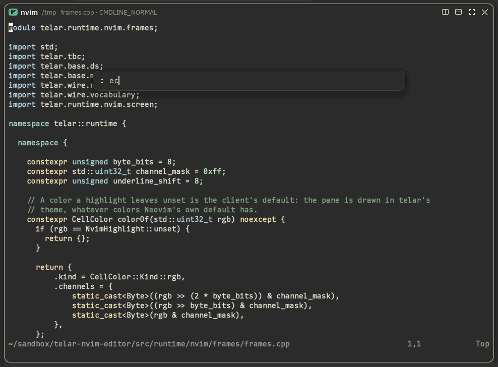
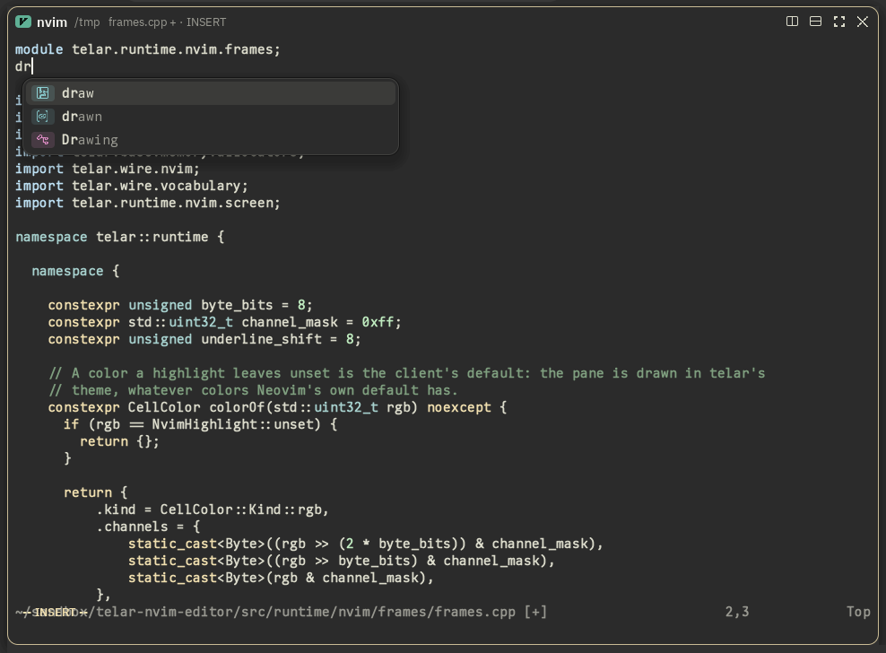
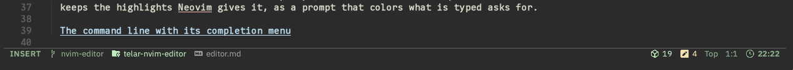
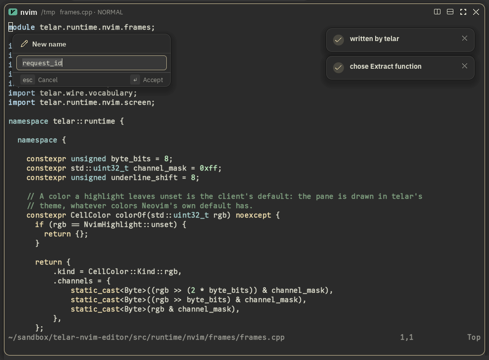
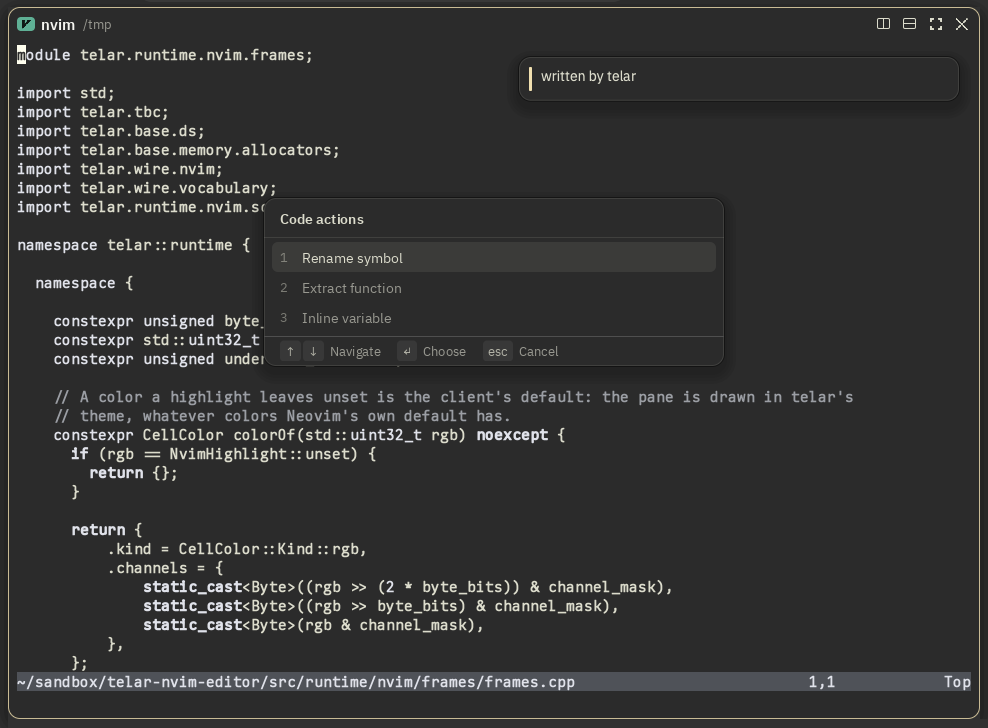
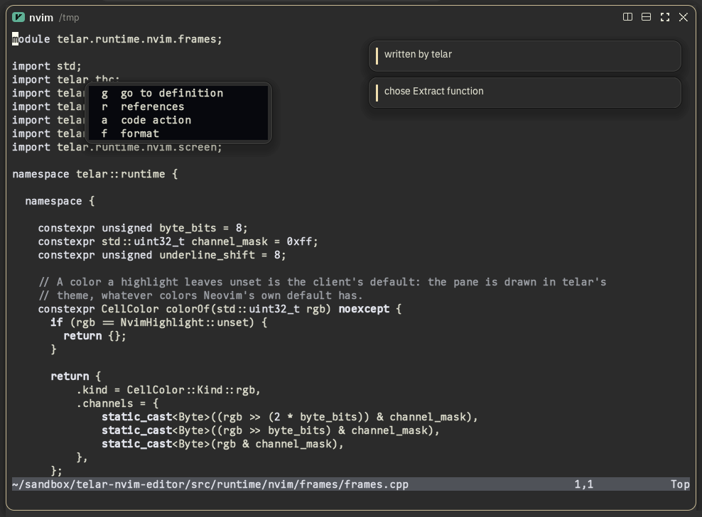
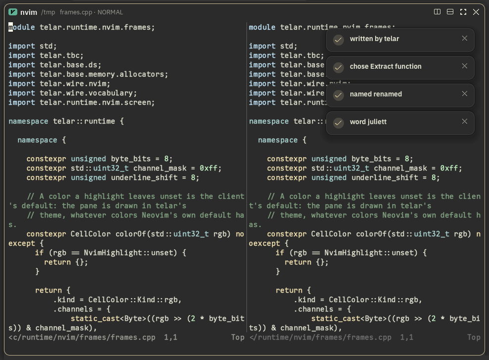
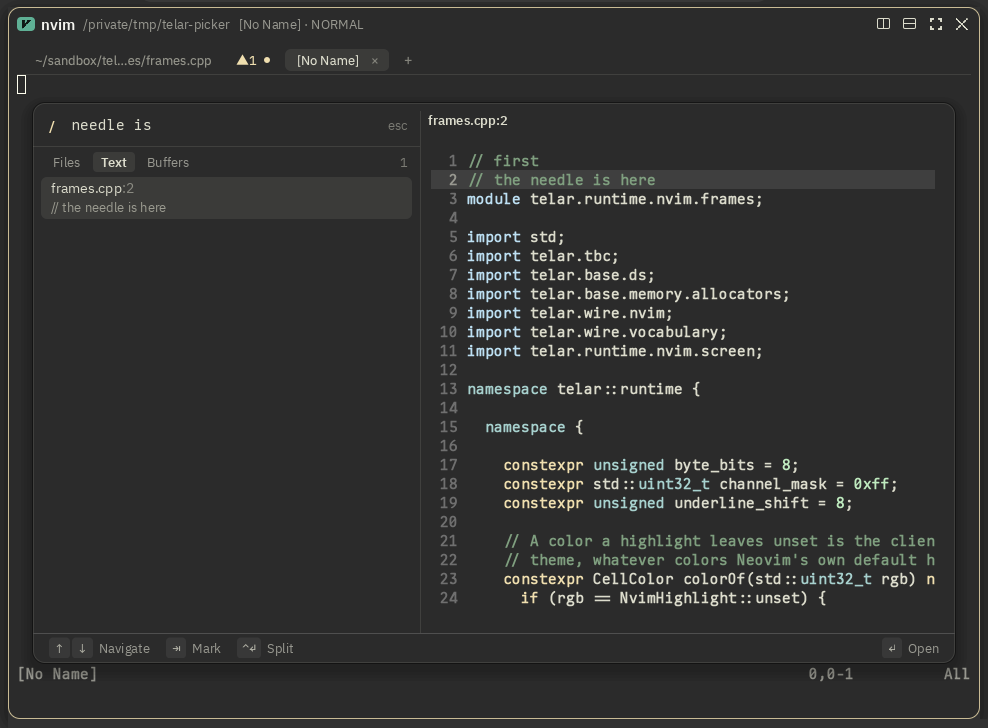
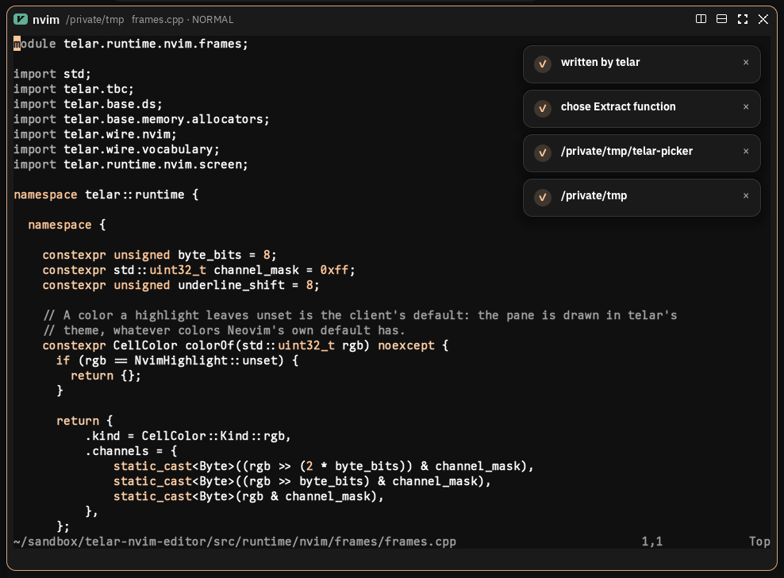

# Edit in a native Neovim pane

An editor pane runs Neovim on the runtime's machine and draws it in the window, without a
terminal between them. The runtime starts `nvim --embed`, is its only UI, and sends the window
what Neovim shows; the window draws it with the painter its terminals use and with its own
surfaces. On a remote machine the editor runs there, beside the files, and only what changed
on its screen crosses the connection.


Open one from the palette with **New editor** or **New editor tab**, or with the prefix and
`e` or `E`. In a configuration the actions are `telar.action.new_editor()` and
`telar.action.new_editor_tab()`. The editor starts in the directory of the focused pane. The
pane's header says the file it shows, and its status line the mode it is in.

## Open a file in it

```sh
telar edit src/main.cpp:42
```

`telar edit FILE[:LINE]` shows the file in the editor pane of a tab and gives that pane the
focus. The tab is the one of the pane the command runs in; a tab without an editor pane gets
one beside it. From outside a pane, `--client ID` names the window, and without it the window
last typed in takes the request.

In a worktree, `telar worktree exec BRANCH -- telar edit FILE` opens the file in an editor
pane of a new tab of that worktree.

A file path clicked in a terminal opens the same way when the tab has an editor pane. A tab
without one opens the link as before: in the editor `editor` or `$EDITOR` names.

## What the window draws itself

Neovim leaves these to its UI, and the window draws each as one of its own surfaces:

- The command line, for `:`, a search or a prompt, with the menu that completes it. Its text
  keeps the highlights Neovim gives it, as a prompt that colors what is typed asks for.

  

- The completion menu while typing. A click on an entry takes it. An entry that says its kind,
  as a language server's do, shows it by its icon, and the letters typed of each word are
  marked.

  
- The status line of the whole editor, while `laststatus` is 3, as lualine and telar's own
  configuration set it: what the configuration puts there, drawn over its row in telar's type
  and flat, on the editor's own background. Its sections on a background of their own keep
  their color and are parted by space, their icons are drawn with the bundled symbols, and a
  line that opens with the name of the mode writes it in the theme's color for that mode.
  telar's configuration opens the line with the mode, before what Neovim's own line says;
  a `statusline` your layer sets takes its place. What Neovim says of a macro being
  recorded, of a command half typed and of the ruler is written on the line too, before its
  last side.

  

- Messages, as notices that go away by themselves. An error stays longer, and none waits for
  a key.
- Tab pages, as a strip over the editor once there is more than one. With a single tab page
  the strip lists the buffers instead, once there is more than one: a click shows a buffer in
  the window in use, and its mark closes it. Either way an entry says the type of its file,
  whether it has changes not written, and how many warnings and errors.

  

- `vim.ui.select` and `vim.ui.input`, whatever asks and whatever the configuration loads: a
  plugin that replaces them later is ignored. They open by the word under the cursor. A
  selection says who asks, the language server of a code action or the caller's kind, and a
  list longer than nine opens as the picker, with a search. A text to type starts with what
  Neovim proposes, selected.

  

  

The surfaces draw their icons with Symbols Nerd Font, the font telar bundles: the same glyphs
Neovim's own interfaces draw with it. A file, in the picker, in the terminal's path search and
in a tab page, shows the icon of its type; a folder, a folder's. Their colors are roles of the
window's palette, so they follow the theme.

A floating window keeps its own cells and gets the surface and the shadow of a dialog. When
its window has a border, the window draws the frame in place of the border's characters and
writes the float's title and footer on it. A window shows how far down its buffer it is while
its text moves, and a line of the window's own stands between two windows side by side; drag
it to resize them.



A scroll slides the rows to their places with the motion a terminal's rows have, and follows
the same `scroll.smooth` setting. The cursor is drawn in a layer of its own, in the shape the
mode gives it: it slides along its row to where a jump takes it, takes a step to the next cell
or to another row at once, so it is never behind the row Neovim highlights, and moving or
blinking it draws none of the text again. Keys reach Neovim as what
was pressed: Command and Option are told apart from Control, and every combination with Shift
arrives, which a terminal cannot always tell Neovim.



## The picker

`:Telar files`, `:Telar grep` and `:Telar buffers` open a picker over the editor. The query,
the list and the keys are the window's; the runtime searches under the editor's directory and
answers with what it found, so the whole list never crosses the connection. Text is searched
with ripgrep when the machine has it, and with git in a repository when it does not.



In a repository, a file found by its name says at the end of its row what git holds of it: `M`
changed, `A` added to the index, `D` removed, `U` never added, `!` in conflict. The terminal's
path search says the same. The first search after the picker opens reads the directory again,
so a file made or changed since shows, and says so.

The palette opens the same picker on the editor of the focused tab with **Find file in
editor**, **Search text in editor** and **Switch editor buffer**; in a configuration they are
`telar.action.editor_files()`, `telar.action.editor_grep()` and `telar.action.editor_buffers()`,
to bind to a key or to call from a mod. `telar.action.edit("docs/notes.md")`, or
`telar.action.edit({ file = "src/main.cpp", line = 42 })`, opens a file by its name, taken
from the focused pane's directory.

The entry under the selection is shown beside the list in a float of Neovim itself: the preview
is the real buffer, with its highlighting. `Enter` opens the entry, `Control+Enter` or
`Command+Enter` in a split, and `Option+Enter` in a tab page. `Tab` marks entries, and `Enter`
then sends the marked ones to the quickfix list. `Shift+Tab` changes what is listed.

## The explorer

`:Telar explore` opens the [explorer](explorer.md#with-the-editor) on the directory of the file
you are editing, with that file selected. In a buffer without a file it opens on the editor's
directory.

The explorer knows which files the editor has open: it marks their rows, apart while a buffer
has changes that were not written, and its plan warns before it moves or deletes such a file.
When it moves or renames a file, the buffer that shows it shows it under its new name, with
its changes and its undo, and nothing is written for it.

## telar's theme

The editor's colorscheme is the theme of the window that shows it: the same colors color the
syntax, the interface of Neovim and the surfaces above. Changing the theme in telar changes it
in the editor at once, and a `:colorscheme` set by the configuration or by a plugin is replaced
by it again. `vim.g.telar_tint` takes the options of the theme's engine, such as
`{ transparent = false }`.



## The clipboard, the focus and the directory

- The registers `+` and `*` are the clipboard of the machine you type on, wherever Neovim
  runs: what is yanked to them is copied there while the runtime's `clipboard_write` policy is
  `allow`, as it is unless configured. With `ask` or `deny` nothing is copied, as for a
  terminal's program. Pasting the clipboard with the window's own shortcut reaches Neovim as
  one change.
  `"+p` puts back the last text yanked in the editor; it does not read the clipboard.
- A link of the web or of mail opens on the machine you type on, wherever Neovim runs: `gx`,
  Command and a click, and anything a plugin opens with `vim.ui.open`. One link opens for each
  thing you do, while Neovim does it, so nothing in the editor opens links by itself. A file opens on the host, as
  `vim.ui.open` always did. Text whose highlight names a URL, as a link of a Markdown file
  does, is underlined, and the pointer over it is the one of a link.
- Moving the focus to a side with `navigate_pane` asks the editor first for a window on that
  side, and moves to the pane there when it has none: a terminal, another editor, or the
  [explorer](explorer.md#beside-the-panes) that stands as a pane. No plugin is needed for it.
- The pane's directory is the one of Neovim's current window, `:lcd` and `:tcd` included.

Nothing is installed in Neovim for any of this: the runtime teaches it when it starts, before
the configuration loads. A configuration that sets `g:clipboard` keeps its own.

## Which Neovim, and which configuration

The runtime starts, in this order: the program `TELAR_NVIM` names in the runtime's
environment; the Neovim telar provisioned; the one telar's own package ships under
`share/telar/nvim/VERSION`, beside the directory of its programs; the `nvim` on the
runtime's `PATH`. On a Linux host without glibc, where the releases of Neovim do not run,
only the first and the last are tried. It needs
Neovim 0.11 or later: an older one is refused and its pane closes.

```sh
telar integration install editor
```

fetches the Neovim release this telar was built for, checks the archive against the SHA-256
the build carries, and unpacks it under `~/.local/share/telar/nvim/VERSION`. A telar whose
package brought its Neovim, on a host that runs it, fetches nothing: the command and
`telar integration status editor` say it is shipped with this telar. `telar machine
setup` runs it on the machine it sets up, unless `--skip editor`. When the telar you run came
with its Neovim and the machine is of the same system and processor, setup sends it that one
first, and the machine fetches nothing. On a machine without a
network, `TELAR_NVIM_ARCHIVE=/path/to/archive` takes an archive that is already there; it is
checked the same.

Neovim always starts on telar's own configuration, never on the one of your own Neovim:
neither `~/.config/nvim` nor the one `NVIM_APPNAME` names is read. telar's is small and
installs nothing: no plugins and no language servers, and it fetches nothing. `<leader>f`,
`<leader>/` and `<leader>b` open the picker.

Text is highlighted with tree-sitter. Neovim ships parsers for C, Lua, Markdown, Vim script
and its help; telar brings the ones for Bash, C++, CSS, a diff, a Dockerfile, Go, HTML, Java,
JavaScript, JSON, Make, Python, regular expressions, Ruby, Rust, TOML, TypeScript, TSX, YAML
and Zig, built with telar for its system and kept in `share/telar/editor` beside its programs,
with the queries of nvim-treesitter that highlight with them. Any other language is highlighted
by the syntax files Neovim ships. A parser your layer installs, as nvim-treesitter does, takes
the place of telar's. Another machine has them when the telar installed there is a package of
telar's; a development build installed with `machine setup --binary` brings only its program.

### Your layer: `~/.config/telar/editor`

What you add goes in `~/.config/telar/editor/init.lua` (under `$XDG_CONFIG_HOME` when it is
set). It loads after telar's own configuration, so what it sets wins. The directory is a
configuration of Neovim's like any other: Neovim runs under `NVIM_APPNAME=telar/editor`, so
its `lua/` and `plugin/` load, and what it installs is kept under `telar/editor` of Neovim's
data and state directories, apart from a Neovim of your own. A layer that fails to load is
reported as a notice, and telar's configuration keeps working.

Plugins are yours to declare there, with `vim.pack` or with a manager such as lazy.nvim;
LazyVim works this way too. Keep the manager's lockfile in the directory (`nvim-pack-lock.json`,
`lazy-lock.json`): it travels with the rest, so every machine installs the same versions. A
machine fetches the plugins itself the first time, so it needs git and a network.

A plugin that cannot work in telar's window is turned off whatever loads it, and a notice
says so once. The window already draws natively what such a plugin would replace. Today
that is noice.nvim, which needs to draw the command line, the messages and the completion
menu itself: its module is replaced by an inert one that takes any call, so a configuration
that sets it up, as LazyVim does, still loads.

### On other machines

Each time the window connects to another machine, it brings that machine its editor
configuration: the files of `~/.config/telar/editor` replace the ones the machine has there,
and the files the window does not have are removed, so every machine runs the same editor. A
name that starts with a dot (`.git`, `.luarc.json`) is neither sent nor removed. Without that
directory here, a machine keeps its own. A configuration larger than one message (4 MiB, or
1024 files) is not sent, and the window says so. An editor already running there takes the
new configuration when it starts again.

## Over a slow connection

In insert mode, when a key's round trip takes longer than a screen refresh, the letter is
drawn at once where it will be, underlined as a guess, until the frame that carries it
arrives. A frame that says otherwise wins. A pane whose guesses fail stops guessing, and a
local runtime answers too fast for any to be made.

## What an editor pane is not

It is a pane like any other in the layout: it splits, moves, takes the focus and closes as a
terminal does, and a session that is restored starts it again on the files it was opened with.
`telar pane read` gives the text its screen shows. What only a terminal has does not apply to
it: the prompt line, the command history, the commands' separators and searching its
scrollback. A request of that kind for an editor pane fails with `unsupported_pane_kind`.

An agent in an editor pane cannot be sent a prompt or interrupted through the pane, as one in
a terminal can. Images a plugin draws with the terminal's graphics protocol are not shown:
there is no terminal to draw them.

## Measure it

Two tools, built with the tests, measure what the runtime adds to Neovim's own time:

```sh
tools/cpp build dev -- --target nvim-redraw-bench nvim-embed-probe
out/dev/src/runtime/nvim-redraw-bench            # decoding a redraw and writing its frame
out/dev/src/runtime/nvim-embed-probe --clean     # the same against the Neovim on this host
```

`TELAR_EDITOR_METRICS=FILE` makes the window test's `editorPaneDrawsNeovim` case write how long
a key takes from the view to the frame that shows it, and `TELAR_EDITOR_SHOTS=DIR` makes it
save the window at each step. `TELAR_EDITOR_METRICS_KEYS=N` types that many keys, enough of
them to make the window scroll while it types, and `TELAR_EDITOR_METRICS_SURFACE=cmdline`
types them in the command line. Without `QT_QPA_PLATFORM=offscreen` and `QT_QUICK_BACKEND`
the case runs in a window of the desktop, drawn as the one you use is; only the measurement
is meant to pass there.

## Its reference pictures

`src/gui/tests/references/editor` keeps a picture of each surface of the editor pane, with
the Zenburn preset and with Vesper. `just gui-references` runs the same case with each preset
and fails when a surface is apart from its picture in more than 2 % of its pixels;
`just gui-references update` takes them again, and the change shows in the diff of the
pictures. They are of macOS's fonts, drawn offscreen, so the comparison is run when asked
for and not with the suite.
