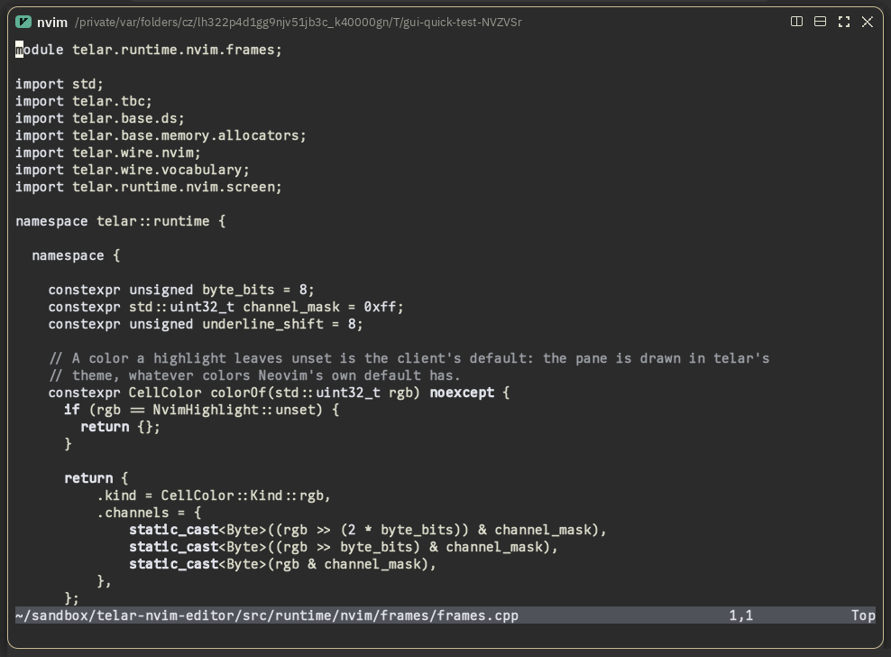
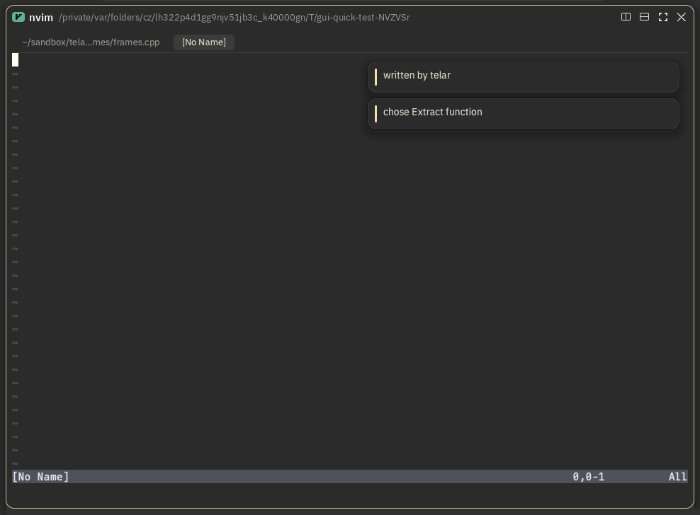

# Edit in a native Neovim pane

An editor pane runs Neovim on the runtime's machine and draws it in the window, without a
terminal between them. The runtime starts `nvim --embed`, is its only UI, and sends the window
what Neovim shows; the window draws it with the painter its terminals use and with its own
surfaces. On a remote machine the editor runs there, beside the files, and only what changed
on its screen crosses the connection.



Open one from the palette with **New editor** or **New editor tab**, or with the prefix and
`e` or `E`. In a configuration the actions are `telar.action.new_editor()` and
`telar.action.new_editor_tab()`. The editor starts in the directory of the focused pane.

The runtime's machine needs Neovim 0.11 or later on the `PATH` the runtime was started with.
Neovim reads its usual configuration.

## What the window draws itself

Neovim leaves these to its UI, and the window draws each as one of its own surfaces:

- The command line, for `:`, a search or a prompt, with the menu that completes it.

  

- The completion menu while typing.
- Messages, as notices that go away by themselves. An error stays longer, and none waits for
  a key.
- Tab pages, as a strip over the editor once there is more than one.

  

- `vim.ui.select` and `vim.ui.input`, whatever asks and whatever the configuration loads: a
  plugin that replaces them later is ignored.

  

A floating window keeps its own cells and gets the surface and the shadow of a dialog. A window
shows how far down its buffer it is while its text moves.


Keys reach Neovim as what was pressed: Command and Option are told apart from Control, and
every combination with Shift arrives, which a terminal cannot always tell Neovim. Colors that
a highlight leaves unset are the pane's own, so the editor's text and background follow telar's
theme.


## What an editor pane is not

It is a pane like any other in the layout: it splits, moves, takes the focus and closes as a
terminal does, and a session that is restored starts it again on the files it was opened with.
What only a terminal has does not apply to it: `telar pane read`, the prompt line, the command
history and the commands' separators. A request of that kind for an editor pane fails with
`unsupported_pane_kind`.

## Measure it

Two tools, built with the tests, measure what the runtime adds to Neovim's own time:

```sh
tools/cpp build dev -- --target nvim-redraw-bench nvim-embed-probe
out/dev/src/runtime/nvim-redraw-bench            # decoding a redraw and writing its frame
out/dev/src/runtime/nvim-embed-probe --clean     # the same against the Neovim on this host
```

`TELAR_EDITOR_METRICS=FILE` makes the window test's `editorPaneDrawsNeovim` case write how long
a key takes from the view to the frame that shows it, and `TELAR_EDITOR_SHOTS=DIR` makes it
save the window at each step.
