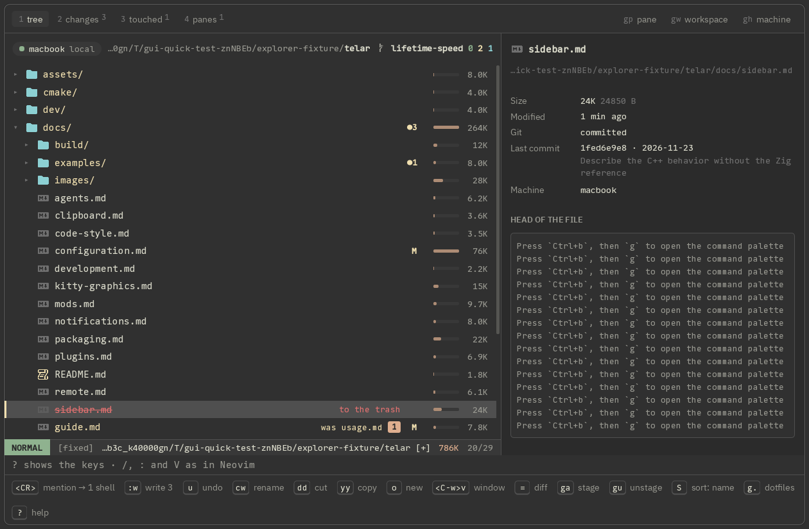
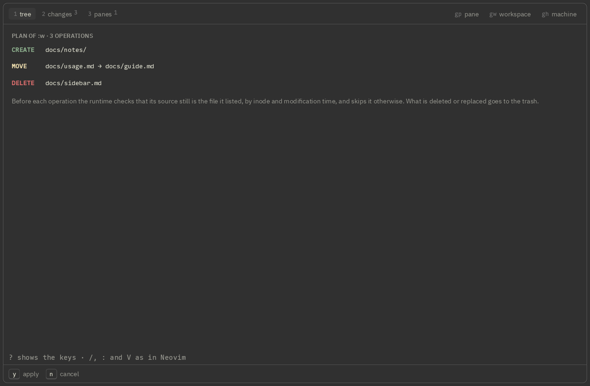
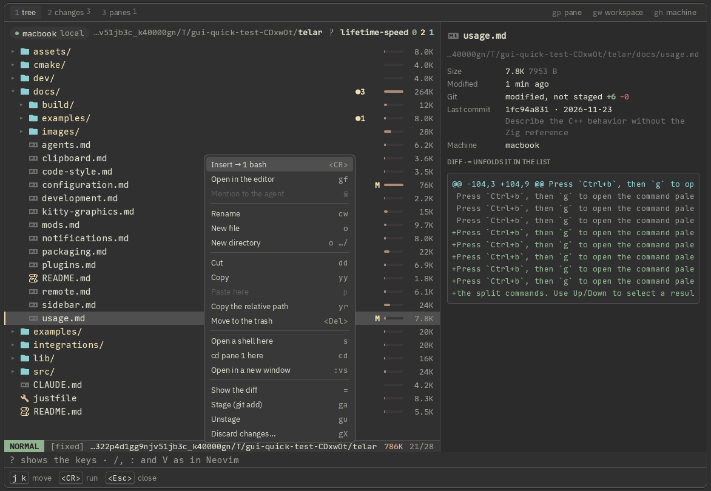

# Explore the files of a machine

The explorer lists the files of the window's machine over the panes of the tab. The runtime of
that machine reads the directories, measures them, asks git and changes the files, so on a
remote machine the explorer works beside the files, and only what a window shows crosses the
connection.

Open it with the prefix and `o`, with **Open explorer** in the palette, or with
`telar.action.explorer()` in a configuration. The same key closes it, as `q` does.

It moves with Neovim's keys, and it changes files the way [oil.nvim](https://github.com/stevearc/oil.nvim)
does: a rename, a new entry or a cut is a change typed on the listing, and nothing is written
until `:w` shows the plan and you accept it. `?` lists every key.

## Move in the listing

| Keys | What they do |
| --- | --- |
| `j` `k`, `gg` `G`, `Ctrl+d` `Ctrl+u` | Move by a row, to the first or the last, by half a page. A count applies: `5j`, `12G`. |
| `h` `l` | Fold and unfold a directory. `h` on a file goes to its directory; `l` on an unfolded directory moves into it. |
| `za` `zM` `zR` | Toggle a fold, fold every directory, unfold the directories that show. |
| `Enter` | On a directory, make it the root of the window. |
| `-` `_` `~` | Go to the directory above, to the workspace's, to the home. |
| `Ctrl+o` `Ctrl+i` | Go back and forward through the roots visited. |
| `ma` `'a` | Set a mark on the selection, and return to it. `:marks` lists them. |
| `/` | Filter the listing as you type; Enter keeps the filter, Escape drops it. |
| `]c` `[c` | Go to the next or the previous row git says changed. |
| `S`, `g.`, `gi` | Sort by name, size or time; show dotfiles; show what git ignores. |
| `R` | Read the directories again. |

A click selects a row, a double click acts as Enter, and the wheel scrolls. Shift and a click
selects up to that row, and Cmd or Ctrl and a click picks rows one by one.

## What a row says

Each row has the icon of its type, the same the editor's surfaces use. To its right:

- the state git gives the file, `M` `A` `D` `R` `U` `C`, and for a directory how many paths
  changed below it, as `●3`;
- the panes whose shell is in that directory, by their number in the tab;
- the marks set on it;
- its size, with a bar that says its share of the largest entry beside it. The runtime
  measures a directory after it lists it, for two seconds at most: a size still to come shows
  as `…`, and one it did not finish ends in `+`.

The preview beside the listing says the size, the time of the last change, what git says and
the last commit of the selection, and shows its diff when it has changes not committed, or the
head of its text.

## Three lenses

`gt` and `gT` go from one to the next, and `1gt`, `2gt`, `3gt` go to one.

- **tree**: the directories, unfolded as you ask.
- **changes**: what git says changed, in three groups: staged, unstaged and untracked.

  

- **panes**: the panes of the tab, each with its directory. Enter goes to the pane.

## Follow a pane

A window follows the focused pane until you send it somewhere else: its root is the pane's
workspace, and the selection is the pane's directory. `gp` roots it at the pane's directory
instead, `gw` at the workspace's and `gh` at the home of the machine. Enter on a directory,
`-` or `:e` take the window where you say, and the status line says `[fixed]`; `F` follows the
pane again.

## Hand a file to a pane

| Keys | What they do |
| --- | --- |
| `Enter` on a file | Gives it to the focused pane as that pane takes it: a shell gets the path typed, quoted where a shell would split it; an agent gets a mention, `@path`; an editor pane opens it. |
| `V`, then `Enter` | The same with every row selected. |
| `@` | Mentions the file to the agent of the tab. |
| `gf` | Opens it in the tab's [editor pane](editor.md). |
| `cd` | Changes the directory of the focused shell to the row's. |
| `s` | Opens a new shell in the row's directory, in a split. |
| `yy` `yr` `yn` | Copy the path, the path from the root, or the name to the clipboard. |

The explorer closes when a file goes to a pane. `Ctrl+w` `T` keeps it open instead.

## Change files as text

| Keys | What they do |
| --- | --- |
| `cw` `i` `a` | Rename on the row. |
| `o` | Add an entry in the row's directory. A name that ends in `/` is a directory. |
| `dd` | Cut: the row goes to the trash, or moves where `p` pastes it. |
| `yy`, then `p` | Copy into the directory of the selection, in this window or in another. |
| `u` | Take the last change typed back. |
| `:w` | Show the plan. `:w!` lets a move or a copy replace what exists. |

A count takes that many rows: `3dd`. `V` selects rows for `d`, `y`, `ga` and `gu`.

The shortcuts of a file manager name the same commands: Cmd or Ctrl with `c`, `x`, `v`, `z` and
`s` are `yy`, `dd`, `p`, `u` and `:w`, and F2 renames.

`:w` shows what the runtime will be asked to do, and `y` sends it:

- The runtime checks before each operation that the source still is the file the window
  listed, by its inode and the time of its last change, and skips it otherwise.
- What is deleted or replaced goes to the trash of the machine: `~/.Trash` on macOS, the
  trash of the XDG specification on Linux, and the trash of the volume for a file on another
  one.
- Without `:w!`, a move or a copy onto a name that exists takes another name beside it.
- `u` with nothing typed takes the last plan back.
- A plan holds 64 operations at most.

`q` and `:q` do not close the last window while changes wait; `:q!` and `:e!` discard them.

## With the pointer

A right click on a row opens its menu, as Shift+F10 or the menu key does on the selected row.
It lists what applies to that row, each line with the keys that do the same, so the menu
teaches them. `j` and `k` move in it, Enter runs the line, and Escape or a click elsewhere
closes it. On a row of a selection it acts on the whole selection; on another row, on that one.

Rows are dragged onto a directory, onto a window, or onto another window of the explorer. A
drop is a change typed, the same `dd` or `yy` and then `p` leave there: it moves the rows, or
copies them with Alt held, when `:w` writes it, and `u` takes it back. A row of a selection
takes the selection with it. A label beside the pointer says what letting go would do and to
how many rows, and the directory that would take them is marked. A drop that would leave a row
where it is, or put a directory into itself, is refused.

## Git

| Keys | What they do |
| --- | --- |
| `=` | Unfold the diff of the file below its row. |
| `ga` `gu` | Stage and unstage, at once. |
| `gX` | Discard the changes of a file. It is a change typed, written by `:w`, as it loses work. |
| `gc` | Commit what is staged: it opens `:commit` for the message. |

The head of a window says the branch, how far it is from its upstream, and how many paths are
staged, changed and untracked.

## Windows

The explorer splits into three windows at most, each on its own directory.

| Keys | What they do |
| --- | --- |
| `Ctrl+w` `v`, `Ctrl+w` `s` | Another window, beside or below. |
| `Ctrl+w` `w`, `Ctrl+w` `h` `j` `k` `l` | Go to the next window, or to the one that way. |
| `Ctrl+w` `q`, `Ctrl+w` `o` | Close this window, or every other one. |
| `:e PATH`, `:vs PATH`, `:sp PATH` | Take this window, or a new one, to a path. `~` is the home, and a relative path starts at the window's root. |

`yy` in one window and `p` in another copies between two directories; `dd` and `p` moves.

## What it does not do yet

- A window lists the machine the window shows: two windows cannot be on two machines, and
  nothing is copied from one machine to another.
- Nothing is dragged onto a pane, out to the desktop, or in from it.
- The home of a remote machine's account is not known to the window, so its paths are
  written whole and `~` goes nowhere there.
