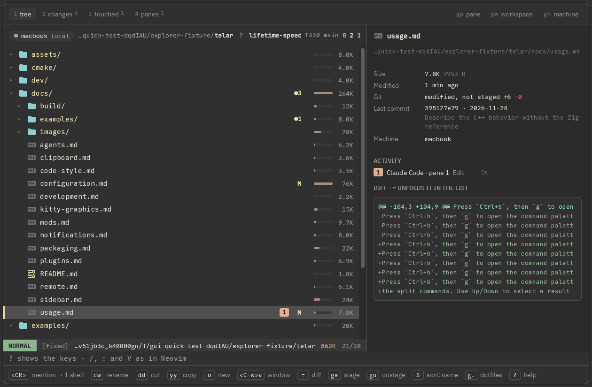
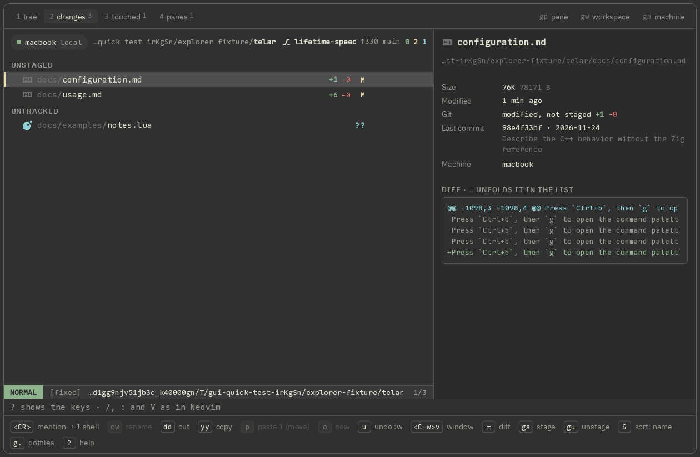

# Explore the files of a machine

The explorer lists the files of a machine over the panes of the tab: the one the window shows
when it opens, and any other one the window keeps, a window of the explorer each. The runtime
of the machine reads the directories, measures them, asks git and changes the files, so on a
remote machine the explorer works beside the files, and only what a window shows crosses the
connection.

Open it with the prefix and `o`, with **Open explorer** in the palette, or with
`telar.action.explorer()` in a configuration. The same key closes it, as `q` does.

It moves with Neovim's keys, and it changes files the way [oil.nvim](https://github.com/stevearc/oil.nvim)
does: a rename, a new entry or a cut is a change typed on the listing, and nothing is written
until `:w` shows the plan and you accept it. `?` lists every key.

## Move in the listing

| Keys | What they do |
| --- | --- |
| `j` `k`, `gg` `G`, `Ctrl+d` `Ctrl+u` | Move by a row, to the first or the last, by half a page. A count applies: `5j`, `12G`. |
| `h` `l` | Fold and unfold a directory. `h` on a file goes to its directory; `l` on an unfolded directory moves into it. |
| `za` `zM` `zR` | Toggle a fold, fold every directory, unfold the directories that show. |
| `Enter` | On a directory, make it the root of the window. |
| `-` `_` `~` | Go to the directory above, to the workspace's, to the home. |
| `Ctrl+o` `Ctrl+i` | Go back and forward through the roots visited. |
| `ma` `'a` | Set a mark on the selection, and return to it. `:marks` lists them. |
| `/` | Filter as you type; Enter keeps the filter, Escape drops it. `n` and `N` go to the next and the previous match, around the ends. |
| `]c` `[c` | Go to the next or the previous row git says changed. |
| `]a` `[a` | Go to the next or the previous file an agent touched, in the tree, unfolding the directories that lead to it. Past the last one it starts again. |
| `S`, `g.`, `gi` | Sort by name, size or time; show dotfiles; show what git ignores. |
| `R` | Read the directories again. |

A click selects a row, a double click acts as Enter, and the wheel scrolls. Shift and a click
selects up to that row, and Cmd or Ctrl and a click picks rows one by one.

## Filter every path below the root

`/` asks the runtime of the machine for the paths below the window's root that match what you
type, with the search the path picker of `Ctrl+b` `f` uses: the letters in their order, wherever
they are in the path. It reaches what the window never unfolded.

The matches show as a flat list, best first, each with the path that leads to it, and the status
line says how many there are: `/base 3`, `50+` when more match than the fifty a list holds, and
`…` while the runtime still reads its index. A match is a row as any other: Enter hands it to the
pane, `cw` renames it, `dd` cuts it, the preview shows it. The window did not list its directory,
so before the plan of `:w` shows, the runtime says which file each one is, and that is the file
it then checks.

In the changes and the panes, and with a runtime that has no path search, `/` narrows the rows
the window already lists.

## What a row says

Each row has the icon of its type, the same the editor's surfaces use. To its right:

- the state git gives the file, `M` `A` `D` `R` `U` `C`, and for a directory how many paths
  changed below it, as `●3`;
- the panes whose shell is in that directory, by their number in the tab;
- the marks set on it;
- its size, with a bar that says its share of the largest entry beside it. The runtime
  measures a directory after it lists it, for two seconds at most: a size still to come shows
  as `…`, and one it did not finish ends in `+`.

The preview beside the listing says the size, the time of the last change, what git says and
the last commit of the selection, and shows its diff when it has changes not committed, or the
head of its text.

## Four lenses

`gt` and `gT` go from one to the next, and `1gt` to `4gt` go to one, as `:tree`, `:changes`,
`:touched` and `:panes` do.

- **tree**: the directories, unfolded as you ask.
- **changes**: what git says changed, in three groups: staged, unstaged and untracked.

  

- **touched**: the files the panes of the machine touched below the root, the newest first.
  Each row says the tool or the command that touched it, who did, how long ago, what git says
  and its size. A row is a file as in any other lens: Enter, `@`, `gf`, `=`, the menu and the
  preview work on it.

  

- **panes**: the panes of the tab, each with its directory. Enter goes to the pane.

## Who touched a file

The runtime of a machine keeps the files its panes touched lately: the ones the tools of an
agent name, as its hooks report them, and the ones the commands of a pane's history name. It
keeps a file only when the name leads to a regular file below the directory of its pane, so a
command that names no file, or one of another directory tree, leaves nothing.

In every lens the row of a touched file shows a chip before what git says: `you` for a command
you ran, and the place in the tab of the pane an agent runs in, in the agent's color. A pane the
tab does not show has `·`. The preview lists the last four touches of the selection under
**Activity**: who, from which pane, with which tool or command, and how long ago.

What it does not know:

- A touch is what a line names, not what a process did: a tool given a path that telar's line
  of 96 bytes cuts, or a command that reaches a file through a glob or a script, is not seen.
- The index lives in the memory of the runtime: it keeps 512 touches for a day and answers the
  newest 128, and it starts empty when the runtime does.
- An agent with no hooks reports no tool, so only the commands its shell records count.
- The history records that an agent ran a command and not which agent: the touch takes the
  agent whose tools the pane reported, and has a chip of no agent's color when none did.

The window asks a machine who touched what when it shows files of it, and again when a pane of
that machine starts or ends a program or its agent reports. A machine with no window is asked nothing.

## Follow a pane

A window follows the focused pane until you send it somewhere else: its root is the pane's
workspace, and the selection is the pane's directory. `gp` roots it at the pane's directory
instead, `gw` at the workspace's and `gh` at the home of the machine. Enter on a directory,
`-` or `:e` take the window where you say, and the status line says `[fixed]`; `F` follows the
pane again.

## Hand a file to a pane

| Keys | What they do |
| --- | --- |
| `Enter` on a file | Gives it to the focused pane as that pane takes it: a shell gets the path typed, quoted where a shell would split it; an agent gets a mention, `@path`; an editor pane opens it. |
| `V`, then `Enter` | The same with every row selected. |
| `@` | Mentions the file to the agent of the tab. |
| `gf` | Opens it in the tab's [editor pane](editor.md). |
| `cd` | Changes the directory of the focused shell to the row's. |
| `s` | Opens a new shell in the row's directory, in a split. |
| `yy` `yr` `yn` | Copy the path, the path from the root, or the name to the clipboard. |

The explorer closes when a file goes to a pane. `Ctrl+w` `T` keeps it open instead.

## Change files as text

| Keys | What they do |
| --- | --- |
| `cw` `i` `a` | Rename on the row. |
| `o` | Add an entry in the row's directory. A name that ends in `/` is a directory. |
| `dd` | Cut: the row goes to the trash, or moves where `p` pastes it. |
| `yy`, then `p` | Copy into the directory of the selection, in this window or in another. |
| `u` | Take the last change typed back. |
| `:w` | Show the plan. `:w!` lets a move or a copy replace what exists. |

A count takes that many rows: `3dd`. `V` selects rows for `d`, `y`, `ga` and `gu`.

The shortcuts of a file manager name the same commands: Cmd or Ctrl with `c`, `x`, `v`, `z` and
`s` are `yy`, `dd`, `p`, `u` and `:w`, and F2 renames.

`:w` shows what the runtime will be asked to do, and `y` sends it:

- The runtime checks before each operation that the source still is the file the window
  listed, by its inode and the time of its last change, and skips it otherwise.
- What is deleted or replaced goes to the trash of the machine: `~/.Trash` on macOS, the
  trash of the XDG specification on Linux, and the trash of the volume for a file on another
  one.
- Without `:w!`, a move or a copy onto a name that exists takes another name beside it.
- `u` with nothing typed takes the last plan back.
- A plan holds 64 operations at most.

`q` and `:q` do not close the last window while changes wait; `:q!` and `:e!` discard them.

## With the pointer

A right click on a row opens its menu, as Shift+F10 or the menu key does on the selected row.
It lists what applies to that row, each line with the keys that do the same, so the menu
teaches them. `j` and `k` move in it, Enter runs the line, and Escape or a click elsewhere
closes it. On a row of a selection it acts on the whole selection; on another row, on that one.

Rows are dragged onto a directory, onto a window, or onto another window of the explorer. A
drop is a change typed, the same `dd` or `yy` and then `p` leave there: it moves the rows, or
copies them with Alt held, when `:w` writes it, and `u` takes it back. A row of a selection
takes the selection with it. A label beside the pointer says what letting go would do and to
how many rows, and the directory that would take them is marked. A drop that would leave a row
where it is, or put a directory into itself, is refused. Onto a window of
[another machine](#between-machines) a drop copies, and moves with Shift held.

## Git

| Keys | What they do |
| --- | --- |
| `=` | Unfold the diff of the file below its row. |
| `ga` `gu` | Stage and unstage, at once. |
| `gX` | Discard the changes of a file. It is a change typed, written by `:w`, as it loses work. |
| `gc` | Commit what is staged: it opens `:commit` for the message. |

The head of a window says the branch, how far it is from its upstream, and how many paths are
staged, changed and untracked.

## Windows

The explorer splits into three windows at most, each on its own directory.

| Keys | What they do |
| --- | --- |
| `Ctrl+w` `v`, `Ctrl+w` `s` | Another window, beside or below. |
| `Ctrl+w` `w`, `Ctrl+w` `h` `j` `k` `l` | Go to the next window, or to the one that way. |
| `Ctrl+w` `q`, `Ctrl+w` `o` | Close this window, or every other one. |
| `:e PATH`, `:vs PATH`, `:sp PATH` | Take this window, or a new one, to a path. `~` is the home, and a relative path starts at the window's root. A path of [another machine](#machines) starts with its label and a colon. |
| `Tab` | On one of those lines and on `:cd`, complete the directory being typed: the one that matches, or the start that several share, which it lists beside the line. |

`yy` in one window and `p` in another copies between two directories; `dd` and `p` moves.

## Machines

Each window of the explorer is on one machine, and two windows can be on two. The head of a
window says which: its label, and `local` for the machine the window runs on or `remote` for
another one. What a window lists, measures, previews and searches, and what git says there,
comes from the runtime of its own machine; a machine with no window is asked for nothing.

| Keys | What they do |
| --- | --- |
| `:e LABEL:PATH`, `:vs LABEL:PATH`, `:sp LABEL:PATH` | Take this window, or a new one, to a path of the machine with that label: `:vs box:~/logs`. `~` is the home of the account there, which its runtime says. |
| `:machine LABEL` | Take this window to that machine: where this explorer last was on it, or its home. `:machine` alone lists the machines. |
| `gm`, or a click on the machine in the head | The next machine that answers, around. |
| `Tab` | Complete the label of a machine before its colon, where no directory starts that way. |

- A machine that is disabled or not connected, or whose runtime is too old to answer for
  files, says so in its window, and is asked for nothing until it answers.
- A window on another machine than the one the window shows follows no pane: `gp` and `gw`
  are refused there, and `gh` goes to the home of its machine.
- A mark in lower case belongs to the machine it was set on; from another one, `'a` says so
  and goes nowhere. A mark in upper case keeps its machine: `'B` takes the window there in
  one jump, which `Ctrl+o` takes back. The jumps go back and forward across machines.
- A path names a file on its own machine alone. With the file on one machine and the
  focused pane on another, Enter and `@` type nothing and ask whether to
  [bring a copy](#between-machines); `cd` is refused. `gf` opens the file in an editor of its
  machine and shows that machine; `yy` copies `LABEL:/absolute/path`.
- `:w` shows one plan for every window, and each line says its machine when they are of more
  than one. Accepting it sends each runtime the operations on its own files; the line under
  the windows counts what all of them did, and `u` takes the plan back on every machine it
  touched. The changes of a machine that does not answer wait.

### Between machines

The runtimes do not talk to each other: the window reads a file from one and writes it to the
other, 256 KiB at a time, and holds one such piece of it and no more.

| What you do | What happens |
| --- | --- |
| `yy` in a window, `p` in a window on another machine, `:w` | The plan has a COPY line that names both machines, as `box:/home/ops/deploy.sh`. A yes starts the transfer. |
| `dd`, `p` on another machine, `:w` | A MOVE line. The original goes to the trash of its machine once the copy is whole and has its name, and not before. |
| A drag onto a window of another machine | A copy; with Shift held, a move. On its own machine a drag moves, and copies with Alt. |
| Enter or `@` on a file, with the focused pane on another machine | The line under the windows asks `bring a copy there? [y/N]`. With `y` the file goes to `~/Downloads/telar/LABEL/` on the pane's machine, in a directory made when it is missing, and its path is typed at the pane once it is whole. Any other key leaves it. |
| `:cancel` | Stops the files on their way to or from the machine of this window; `:cancel!` stops every one. |

- A file that arrives shows as a row where it will be, with how much of it arrived, until
  its directory is read again. The status line of a window counts the files on their way to
  or from its machine, and the sidebar lists them under TRANSFERS with their route, how much
  arrived, the rate, and a control that cancels one.
- Two files travel at once and the rest wait their turn. A transfer goes on while the
  explorer is closed.
- While it arrives a file has a name of the runtime's own beside its target,
  `.telar-partial-` and sixteen digits, which no listing shows. Where the target exists, the
  file takes a free name beside it, or with `:w!` what was there goes to the trash.
- A transfer that is cancelled or that fails removes what had arrived, and the line under
  the windows says why: the file changed since it was listed, its machine stopped answering,
  the directory did not take it. The original is never touched before the copy is whole.
- `u` takes back what the last plan brought: the copies go to the trash of the machine they
  arrived on, and the originals of a move come out of the trash of theirs.
- A window that closes ends its transfers. What had arrived stays under its hidden name
  until the next file arrives on that machine, which removes the ones no piece reached for a
  quarter of an hour.

## What it does not do yet

- A directory is not carried from one machine to another: a paste or a drop of one is
  refused, and its files are carried one by one.
- A transfer does not go on after its machine was disconnected and connected again: it
  fails, and is started again by hand.
- Nothing is dragged onto a pane, out to the desktop, or in from it.
- `Tab` completes no path of another machine than the window's.
