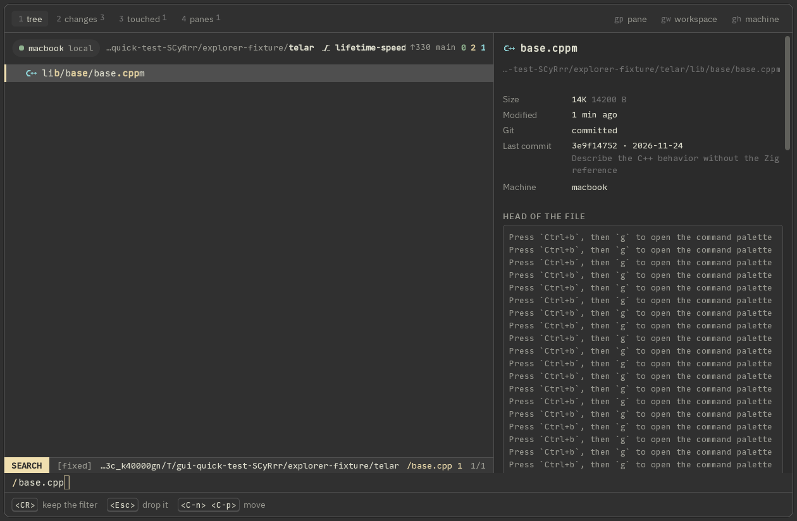
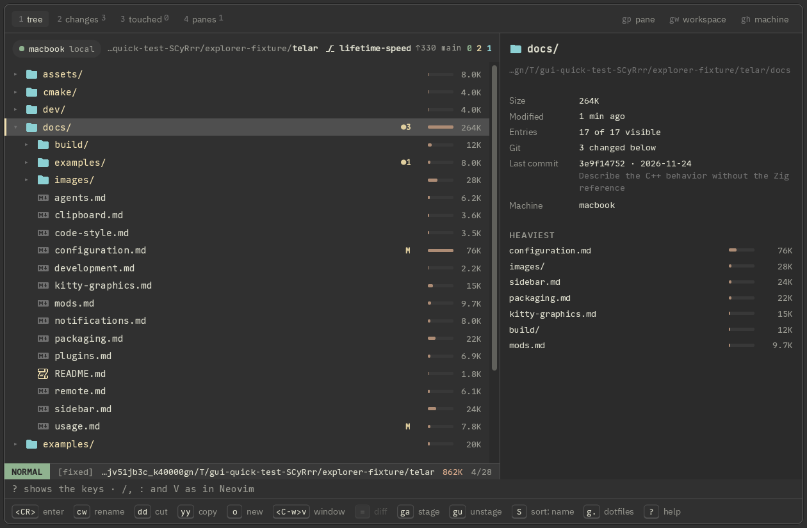
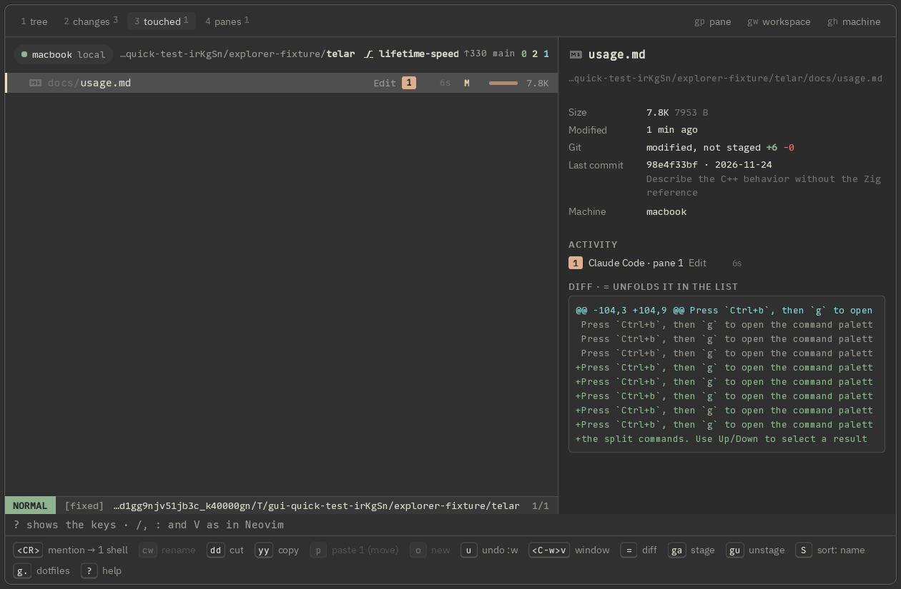
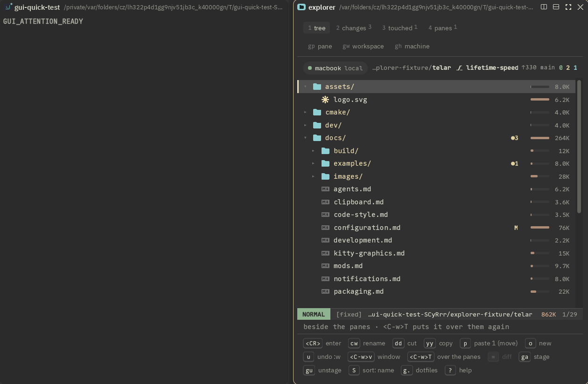
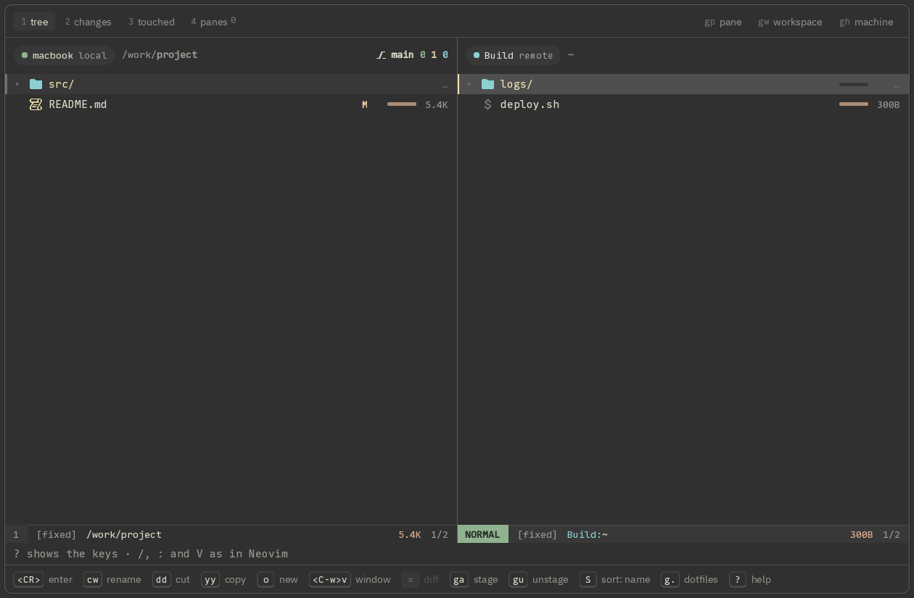
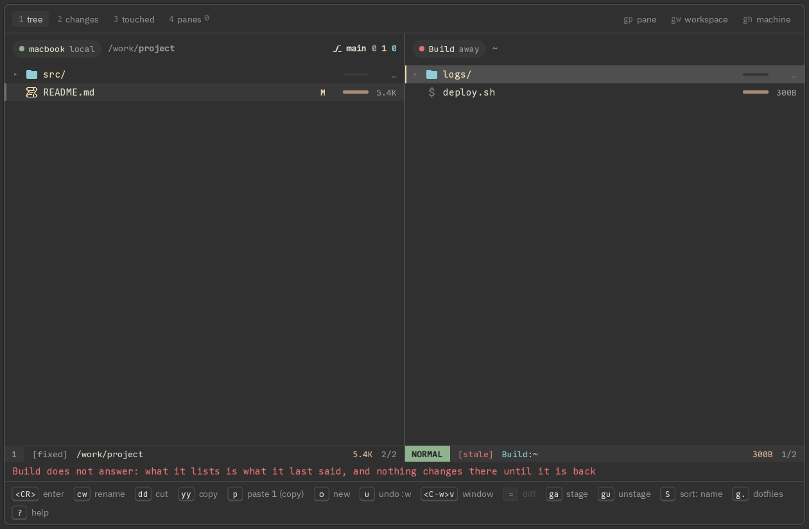
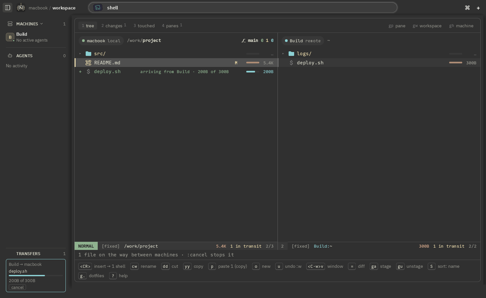

# Explore the files of a machine

The explorer lists the files of a machine over the panes of the tab: the one the window shows
when it opens, and any other one the window keeps, a window of the explorer each. The runtime
of the machine reads the directories, measures them, asks git and changes the files, so on a
remote machine the explorer works beside the files, and only what a window shows crosses the
connection.

Open it with the prefix and `o`, with **Open explorer** in the palette, or with
`telar.action.explorer()` in a configuration. The same key closes it, as `q` does.

It moves with Neovim's keys, and it changes files the way [oil.nvim](https://github.com/stevearc/oil.nvim)
does: a rename, a new entry or a cut is a change typed on the listing, and nothing is written
until `:w` shows the plan and you accept it. `?` lists every key, on a sheet over the windows
that the wheel scrolls when it does not show whole.

## Move in the listing

| Keys | What they do |
| --- | --- |
| `j` `k`, `gg` `G`, `Ctrl+d` `Ctrl+u` | Move by a row, to the first or the last, by half a page. A count applies: `5j`, `12G`. `Ctrl+n` and `Ctrl+p` move as `j` and `k`, and `:12` goes to a row as `12G`. |
| `h` `l` | Fold and unfold a directory. `h` on a file goes to its directory; `l` on an unfolded directory moves into it. |
| `za` `zo` `zc` | Toggle a fold, unfold, fold. `zc` on what is in a directory folds that directory, and selects it. |
| `zM` `zR` | Fold every directory; unfold every one, each as its listing arrives. `zR` stops when a window has 64 directories unfolded. |
| `Enter` | On a directory, make it the root of the window. |
| `-` `_` `~` | Go to the directory above, to the workspace's, to the home. Backspace goes up as `-` does. |
| `Ctrl+o` `Ctrl+i` | Go back and forward through the roots visited. |
| `ma` `'a` | Set a mark on the selected row, and go to it; `` `a `` goes there too. The mark of a directory makes it the root of the window; the mark of a file selects it where the window listed it. `:marks` lists them. |
| `/` | Filter as you type; Enter keeps the filter, Escape drops it. While you type, the arrows and `Ctrl+n` `Ctrl+p` move among what it found. `n` and `N` go to the next and the previous match, around the ends. |
| `]c` `[c` | Go to the next or the previous path git says changed below the root, in the tree, unfolding the directories that lead to it. Past the last one it starts again. |
| `]a` `[a` | Go to the next or the previous file an agent touched, in the tree, unfolding the directories that lead to it. Past the last one it starts again. |
| `S`, `g.`, `gi` | Sort by name, size or time; show dotfiles; show what git ignores. |
| `R` | Read the directories again. |

A click selects a row, a double click acts as Enter, and the wheel scrolls. The rows are not
all as tall: a heading of the changes is taller than a file's row and a line of a diff shorter,
and the list shows the rows that fit whole, with a heading above its first row and what the
tree leaves out below its last. A click on the row
that is already selected folds or unfolds its directory, and on a file git says changed it
shows or hides its diff below it. Shift and a click selects up to that row, Cmd or Ctrl and a
click picks rows one by one, and Cmd or Ctrl with `a` picks every row. A click on a directory
of the path the head of a window shows roots the window there.

The tree ends with a row that says how many entries of its root the window does not list,
dotfiles and what git ignores, with the keys that list them.

`]c` and `[c` follow the tree's order by name, whatever the window is sorted by, and step over
what a hidden directory holds until `g.` lists it.

## Filter every path below the root

`/` asks the runtime of the machine for the paths below the window's root that match what you
type, with the search the path picker of `Ctrl+b` `f` uses: the letters in their order, wherever
they are in the path. It reaches what the window never unfolded, and each row shows the letters
it was found by, lit where they stand in its path.

The matches show as a flat list, best first, each with the path that leads to it, and the status
line says how many there are: `/base 3`, `50+` when more match than the fifty a list holds, and
`…` while the runtime still reads its index. A match is a row as any other: Enter hands it to the
pane, `cw` renames it, `dd` cuts it, the preview shows it. The window did not list its directory,
so before the plan of `:w` shows, the runtime says which file each one is, and that is the file
it then checks.

In the changes, the touches and the panes, and with a runtime that has no path search, `/`
narrows the rows the window already lists.

## What a row says

Each row has the icon of its type, the same the editor's surfaces use. To its right:

- the state git gives the file, in the two columns of `git status -s`: what the index holds,
  then what the working tree does, `M` `A` `D` `R`, and `??` for a file git does not track; for
  a directory, how many paths changed below it, as `●3`;
- the panes whose shell is in that directory, by their number in the tab;
- the marks set on it;
- a ring, `○`, when an [editor pane](#with-the-editor) of its machine has the file in a
  buffer, and a yellow dot, `●`, while that buffer has changes that were not written;
- its size, with a bar that says its share of the largest entry beside it. The runtime
  measures a directory after it lists it, for two seconds at most each time it is asked: a
  size still to come shows as `…`, and one it did not finish ends in `+`. It is asked again
  for the ones it did not finish, four times at most, and goes further each time, since it
  remembers the directories it finished; a tree too large for that stays with its `+`.

The runtime remembers what a directory weighed for thirty seconds, 16 384 of them at most,
while the directory itself is the one it was: an entry that came or went is seen at once,
and what changed deeper within those thirty seconds is not. A change the runtime itself
applies, a plan or a file that arrived, makes it forget every size. A directory that holds a
file with several names is measured each time, as that file counts where it is met first.
A directory newly asked for waits behind no sizes: the measure that runs for the window ends,
keeping what it finished, and the window asks again for the ones it still shows.

The preview beside the listing says the size, the time of the last change, what git says and
the last commit of the selection, which editor pane holds it and the marks set on it, and shows
its diff when it has changes not committed, or the head of its text. A row that is no file has
a preview of its own: a pane says what it is and where, and an entry a change adds, or a file
on its way from another machine, says what waits to be done. What does not fit is reached with
the wheel over the preview, and another selection starts at its top.

Of a directory it says how many of its entries the window lists, as `17 of 19 visible`, and
lists the seven that weigh the most under **Heaviest**, each with its size and its part of all
the directory holds, and `hidden` or `ignored` beside one the window leaves out of its rows. It does so from what the window already holds: a directory it lists whole,
as an unfolded one, and for the heaviest with every directory in it measured. Until then it
says neither, since the heaviest of a part is not the heaviest.

## Four lenses

`gt` and `gT` go from one to the next, and `1gt` to `4gt` go to one, as `:tree`, `:changes`,
`:touched` and `:panes` do.

- **tree**: the directories, unfolded as you ask.
- **changes**: what git says changed below the window's root, in three groups: staged,
  unstaged and untracked, each path from that root. The number beside the lens counts them.
  `=` unfolds the diff of a file below its row here too, and in the lens of what was touched.

  

- **touched**: the files the panes of the machine touched below the root, the newest first.
  Each row says the tool or the command that touched it, who did, how long ago, what git says
  and its size. A row is a file as in any other lens: Enter, `@`, `gf`, `=`, the menu and the
  preview work on it.

  

- **panes**: the panes of the window's machine, of every workspace and tab of it, each with
  its workspace and its directory; an editor is listed by the file it is on. Enter goes to
  the pane, whose tab comes into view, and whose machine does when it is another one. The
  preview says what kind of pane it is, the file an editor is on and what an agent is doing.
  A pane of a tab the window never showed has no directory: its runtime lists it without one.

## Who touched a file

The runtime of a machine keeps the files its panes touched lately: the ones the tools of an
agent name, as its hooks report them, and the ones the commands of a pane's history name. It
keeps a file only when the name leads to a regular file below the directory of its pane, so a
command that names no file, or one of another directory tree, leaves nothing.

In every lens the row of a touched file shows a chip before what git says: `you` for a command
you ran, and the place in the tab of the pane an agent runs in, in the agent's color. A pane the
tab does not show has `·`. The preview lists the last four touches of the selection under
**Activity**: who, from which pane, with which tool or command, and how long ago.

What it does not know:

- A touch is what a line names, not what a process did: a tool given a path that telar's line
  of 96 bytes cuts, or a command that reaches a file through a glob or a script, is not seen.
- The index lives in the memory of the runtime: it keeps 512 touches for a day and answers the
  newest 128, and it starts empty when the runtime does.
- An agent with no hooks reports no tool, so only the commands its shell records count.
- The history records that an agent ran a command and not which agent: the touch takes the
  agent whose tools the pane reported, and has a chip of no agent's color when none did.

The window asks a machine who touched what when it shows files of it, and again when a pane of
that machine starts or ends a program or its agent reports. A machine with no window is asked nothing.

## Follow a pane

A window follows the focused pane until you send it somewhere else: its root is the pane's
workspace, and the pane's directory is unfolded and selected. With an editor pane it is the
file the editor is on that is selected, in its directory, and the window goes with the editor
from one file to the next. `gp` roots it at the pane's directory
instead, `gw` at the workspace's and `gh` at the home of the machine, as `:scope pane`,
`:scope workspace` and `:scope machine` do. Enter on a directory,
`-` or `:e` take the window where you say, and the status line says `[fixed]`; `F`, `:follow`
or a click on that part of the status line follows the pane again, and the same stops it.

## Hand a file to a pane

| Keys | What they do |
| --- | --- |
| `Enter` on a file | Gives it to the focused pane as that pane takes it: a shell gets the path typed, quoted where a shell would split it; an agent gets a mention, `@path`; an editor pane opens it. |
| `V`, then `Enter` | The same with every row selected. |
| `@` | Mentions the file to the agent of the tab. |
| `gf` | Opens it in the tab's [editor pane](editor.md). |
| `cd` | Changes the directory of the focused shell to the row's. `:cd PATH` does it with a path, as the window reads one, and `:cd` alone with the window's root. |
| `s` | Opens a new shell in the row's directory, in a split. |
| `yy` `yr` `yn` | Copy the path, the path from the root, or the name to the clipboard. `yy` also takes the rows for `p`; `yr` and `yn` copy text and leave what `yy` took. |
| `.` | Repeats the last of these, and of the ones that change files or git's index, on the row selected now. |

The explorer closes when a file goes to a pane, so what the pane did with it shows. [Beside
the panes](#beside-the-panes) it stays.

## Change files as text

| Keys | What they do |
| --- | --- |
| `cw` `cc` `i` `a` | Rename on the row: with the name selected up to its extension, with all of it selected, with the caret before it, or after it. `I` and `A` are `i` and `a`. |
| `o` | Add an entry in the row's directory. A name that ends in `/` is a directory. |
| `dd` | Cut: the row goes to the trash, or moves where `p` pastes it. |
| `yy`, then `p` | Copy into the directory of the selection, in this window or in another. |
| `u` | Take the last change typed back. |
| `:w` | Show the plan. `:w!` lets a move or a copy replace what exists. `:wq` is `:w`, and `:wa!` is `:w!`. |

Enter and Escape both end a name: what was typed is the change, and so does a click on
another row. An empty name leaves a rename undone and adds no entry. A new entry keeps the
selection once it has its name.

A count takes that many rows: `3dd`. `V` selects rows for `d`, `y`, `ga` and `gu`. A
selection also takes the keys of normal mode it has none of its own for, `:` and `?` among
them: one that only moves keeps the selection, and any other ends it once it ran. `q` leaves
the selection, not the explorer.

`p` puts what was taken in the tree: the lists of changes, of touches and of panes have no
directory to take it. Nothing is put where it already is, nor a directory into itself. While
rows wait for a place, the hints say how many and whether `p` moves or copies them.

Keys that name nothing say so under the windows, and the keys that change how a window lists,
`S`, `g.`, `gi`, `zM`, `zR` and `F`, say what they did.

The shortcuts of a file manager name the same commands: Cmd or Ctrl with `c`, `x`, `v`, `z`,
`s` and `a` are `yy`, `dd`, `p`, `u`, `:w` and every row picked; F2 renames, and Delete, or Cmd
with Backspace, cuts.

`:w` shows what the runtime will be asked to do, a long path on as many lines as it needs, and
`y` sends it. `n`, `q` or Escape leave the
plan with the changes still pending, and any other key is no answer:

- The runtime checks before each operation that the source still is the file the window
  listed, by its inode and the time of its last change, and skips it otherwise.
- What is deleted or replaced goes to the trash of the machine: `~/.Trash` on macOS, the
  trash of the XDG specification on Linux, and the trash of the volume for a file on another
  one.
- Without `:w!`, a move or a copy onto a name that exists takes another name beside it.
- A line says the size of what it changes, when the window knows it, and in yellow what to
  know before a yes: that the name it goes to is taken, and so it takes another or, with
  `:w!`, replaces what is there; that an agent named the file after the time its listing
  gave it, so the runtime may find another file and skip it; that an editor holds the file,
  or one below the directory, in a buffer with changes that were not written; that a
  directory goes to the trash with all it holds. A name is known as taken from the listings
  the window holds: one in a directory it never listed is found by the runtime, which gives
  the file another.
- Below its paths a line says what it does besides: that it is carried from one machine to
  another through the window, the trash a delete goes to, what a restore discards.
- Once the runtimes answered, the line under the windows says how many of the plan's
  operations they applied, `2 of 3`, and what became of the others.
- `u` with nothing typed asks whether to take the last plan back, and `y` does: what it
  deleted returns from the trash. The hints say `undo :w` while that is what `u` would do.
- A plan holds 64 operations at most.

`q` and `:q` do not close the last window while changes wait; `:q!` and `:e!` discard them.

## With the pointer

A right click on a row opens its menu, as Shift+F10 or the menu key does on the selected row.
It lists what applies to that row, each line with the keys that do the same, so the menu
teaches them. `j` and `k` move in it, Enter runs the line, and Escape or a click elsewhere
closes it. On a row of a selection it acts on the whole selection; on another row, on that one.

Rows are dragged onto a directory, onto a window, or onto another window of the explorer. A
drop is a change typed, the same `dd` or `yy` and then `p` leave there: it moves the rows, or
copies them with Alt held, when `:w` writes it, and `u` takes it back. A row of a selection
takes the selection with it. A label beside the pointer says what letting go would do and to
how many rows, and the directory that would take them is marked. A drop that would leave a row
where it is, or put a directory into itself, is refused. Onto a window of
[another machine](#between-machines) a drop copies, and moves with Shift held.

Files and directories dragged in from the desktop or a file manager are let go on a directory
the same way, and are copied there when `:w` writes it: the drop itself writes nothing. They
are files of the machine the window runs on, so on a window of another machine the plan
carries them [between the two](#between-machines). The runtime is asked what each is before
the plan shows. What is no file of this machine, as a link to a page, is refused.

Rows dragged past the frame of the window go to the program under the pointer as their paths,
a line each: a file of the machine the window runs on as its path and as a file, which an
editor opens and a file manager copies, and a file of another machine as `LABEL:/absolute/path`,
the text `yy` copies. The explorer holds them no more once they leave: dragged back in, they
are files dropped as any other program's are.

A file of another machine dragged out is also the file itself, which the window downloads:

- **macOS.** The row is a promise of the file. Let go on the desktop, on a folder of the
  Finder or on a program that takes files, the system says where it wants it and the window
  carries it there, under the name the system gave. Nothing is carried for a row that is let
  go where no file is wanted. A directory is promised the same way, as a folder, and what
  the system asks for is [its tree](#between-machines): the directory made where the system
  wants it, then what it holds below it and nowhere else, a link inside as a link.
- **Linux.** The system asks for no file after the drop, so the files are carried first: to
  `dragged/` in the window's directory of your cache, `~/.cache/Telar/telar-gui` unless
  `XDG_CACHE_HOME` says another, and the rows are given to the system once they are whole
  there, as files. Only what is small goes that way, 8 files and 32 MiB a drag at most; past
  either the rows leave at once, as text. Letting go before the files are here stops them. A
  drag's directory is removed a day after it was last written.

Either way the file is [one more transfer](#between-machines): it shows in the sidebar with
its progress, `:cancel` stops it and removes what had arrived, of a directory the one it had
made, and a name that is taken where it goes is not replaced: what arrives takes another
beside it, and the system is told it is not where it asked. A link of another machine dragged
on its own leaves as its text alone, and so does a directory on Linux.

## Git

| Keys | What they do |
| --- | --- |
| `=` | Unfold the diff of the file below its row. |
| `ga` `gu` | Stage and unstage, at once. |
| `gX` | Discard the changes the working tree holds of a file, or of every file below a directory; what the index holds stays. It is a change typed, written by `:w`, as it loses work. |
| `gc` | Commit what is staged: it opens `:commit` for the message, which may stand between quotes. |

The head of a window says the branch, how far it is from its base, as `↑6 main`, and how many
paths are staged, changed and untracked. The base is the branch the remote has as its head,
`origin/HEAD`, of the remote the branch follows or of `origin`; where the remote names none,
as in a repository that was not cloned, it is the branch this one follows; and with neither
the head says no distance. It is shown by its name without the remote, and the number is the
commits the branch has that the base lacks. On the base itself it shows only when there are
some. The runtime asks git for it once for a commit and keeps it for fifteen seconds, so a
fetch that moves the base shows a little later.

## Windows

The explorer splits into three windows at most, each on its own directory. The status line of
the window that takes the keys says its mode; the others say which they are, `1` to `3`. A
window on another machine than the one telar runs on names it before its root, `box:~/logs`.

| Keys | What they do |
| --- | --- |
| `Ctrl+w` `v`, `Ctrl+w` `s` | Another window, beside or below. |
| `Ctrl+w` `w`, `Ctrl+w` `h` `j` `k` `l` | Go to the next window, around the last; or to the one on that side, where there is one: `h` and `l` between windows side by side, `k` and `j` between one below the other. |
| `Ctrl+w` `q`, `Ctrl+w` `o` | Close this window, or every other one. |
| `:e PATH`, `:vs PATH`, `:sp PATH` | Take this window, or a new one, to a path. `~` is the home, and a relative path starts at the window's root. A directory becomes the root; a file is selected in its own directory, in the tree where it is below the root. A path where nothing is says so, and the window stays where it was. A path of [another machine](#machines) starts with its label and a colon. |
| `Tab` | On the command line, complete the name of a command; and on one of those lines the directory or the file being typed, on `:cd` the directory alone: the one that matches, or the start that several share, which it lists beside the line. |

Alt with `w` starts the same sequences as `Ctrl+w`, for a system that keeps that key for
itself, unless a configuration binds it.

`yy` in one window and `p` in another copies between two directories; `dd` and `p` moves.

## Beside the panes

`Ctrl+w` `T`, or `:pin`, stands the explorer as a pane of the tab, at the right of the pane
that had the focus, and not over the panes; the same key closes that pane and puts the explorer
over them again, with the windows it had. Nothing of a pane is covered. As a pane it shows no
preview.

It is a pane of the runtime as a terminal and an editor are, with no program in it: the tab's
layout holds it, so it is split, resized, swapped, shown whole and closed as any pane, the
sidebar and the bar of the tab name it `explorer`, and `telar` lists it among the panes. What
only a terminal answers, such as its text or keys typed at it, the runtime refuses for it. A
tab has one explorer pane at most: `Ctrl+b` `o` in a tab that has one goes to it.

The runtime keeps where its windows are: the machine, the root and the selected row of each,
its lens, its order, whether it lists hidden and ignored entries, whether it follows the
focused pane, which window has the keys and how they are split. So the explorer is in its pane,
where it was, when the tab shows again, when a window attaches later, and when the runtime
starts again from the session it wrote. It is told when a window moves or lists another way,
and when the keys leave the explorer; moving the selection alone tells it nothing. Changes
typed and not written are the window's, not the runtime's: they stay while the window lives,
and another window does not see them.

As a pane the explorer takes the keys only while its pane has the focus:

- the prefix and `o` give its pane the focus, and return it to the pane it came from; a click
  in it gives it too;
- the keys that move the focus between panes enter it as they enter any pane, go from one of
  its windows to the other, and leave it past the first and the last. From an editor pane
  `navigate_pane` asks Neovim first for a window on that side, and goes to the explorer's pane
  when it has none;
- `q` closes it with its pane.

The pane a file is handed to, and the one a window follows, is the one that had the focus
before the explorer's own took it. It does not close when it hands a file over. And rows can be
dragged out of it onto a pane, which takes them as Enter would give them to it: a shell gets
the paths typed, an agent a mention, an editor opens them. The pane that would take them is
marked while they are over it.

## Machines

Each window of the explorer is on one machine, and two windows can be on two. The head of a
window says which: its label, and `local` for the machine the window runs on or `remote` for
another one. What a window lists, measures, previews and searches, and what git says there,
comes from the runtime of its own machine; a machine with no window is asked for nothing.

| Keys | What they do |
| --- | --- |
| `:e LABEL:PATH`, `:vs LABEL:PATH`, `:sp LABEL:PATH` | Take this window, or a new one, to a path of the machine with that label: `:vs box:~/logs`. `~` is the home of the account there, which its runtime says. |
| `:machine LABEL` | Take this window to that machine: where this explorer last was on it, or its home. `:machine` alone goes to the next one, as `gm` does, and a label that is no machine's is answered with the ones there are. A machine keeps what a window had unfolded on it, for the window that next goes there. |
| `gm`, or a click on the machine in the head | The next machine that answers, around. |
| `Tab` | Complete the label of a machine before its colon, where no directory starts that way; and after the colon, the directory being typed, from what that machine lists: `:e box:~/lo` becomes `:e box:~/logs/`. A path that starts nowhere starts at the home there. |

- A machine that is disabled or not connected, or whose runtime is too old to answer for
  files, says so in its window, and is asked for nothing until it answers.
- A machine that goes away while a window lists it keeps what it last listed there, to be
  read: the dot of its head turns red and says `away`, and the status line says `[stale]`.
  The selection moves, a path is copied, and what was already listed below unfolds; a change
  typed there, `cw`, `o`, `dd`, `p`, `ga`, `gu`, `gX` or `gc`, is refused with a line that
  says why. Once the machine is back the window reads it again.

  
- A window on another machine than the one the window shows follows no pane. What it hands
  over goes to the tab its own machine has in view: `_`, `gw` and `gp` take it to the root of
  the workspace of that tab, `gh` to the home of its machine, `@` mentions the files to the
  agent of that tab, the focused pane when it is one, and `s` opens a shell there in the
  directory of the row. They say so when that machine has no tab in view, or no agent in it.
- A mark in lower case belongs to the machine it was set on; from another one, `'a` says so
  and goes nowhere. A mark in upper case keeps its machine: `'B` takes the window there in
  one jump, which `Ctrl+o` takes back. The jumps go back and forward across machines.
- The marks and the jump list outlive the window. The runtime of the machine the window runs
  on keeps them: the explorer gives them to it when a mark is set or the window goes to
  another place, and the next window reads them back when its explorer first opens. A mark
  set before they were read stays as it was set. A runtime that restores its session
  restores them with it. A place of a machine the next window does not keep is kept all the
  same: `:marks` lists it, and going to it says its machine is none of the window's.
- A path names a file on its own machine alone. With the file on one machine and the
  focused pane on another, Enter types nothing and asks whether to
  [bring a copy](#between-machines), and so do rows let go on a pane; `cd` is refused. `gf`
  opens the file in an editor of its machine and shows that machine; `yy` copies
  `LABEL:/absolute/path`.
- `:w` shows one plan for every window, and each line says its machine when they are of more
  than one. Accepting it sends each runtime the operations on its own files; the line under
  the windows counts what all of them did, and `u` takes the plan back on every machine it
  touched. The changes of a machine that does not answer wait.

### Between machines

The runtimes do not talk to each other: the window reads a file from one and writes it to the
other, 256 KiB at a time, and holds one such piece of it and no more.

| What you do | What happens |
| --- | --- |
| `yy` in a window, `p` in a window on another machine, `:w` | The plan has a COPY line that names both machines, as `box:/home/ops/deploy.sh`. A yes starts the transfer. |
| `dd`, `p` on another machine, `:w` | A MOVE line. The original goes to the trash of its machine once the copy is whole and has its name, and not before. |
| A drag onto a window of another machine | A copy; with Shift held, a move. On its own machine a drag moves, and copies with Alt. |
| A file of another machine dragged out of the window | A copy where it is let go: on macOS where the system asks for it, a directory too, as its tree; on Linux a file, through the cache. See [the pointer](#with-the-pointer). |
| Enter on a file, or on rows chosen with `V`, with the focused pane on another machine; or those rows let go on a pane of another machine | The line under the windows asks `bring a copy there? [y/N]`, of each row when they are several. With `y` each goes to `~/Downloads/telar/LABEL/` on the pane's machine, in a directory made when it is missing, a directory as its tree, and its path is typed at the pane once it is whole, as a mention for an agent. Any other key leaves it. An editor's pane is brought nothing: `gf` opens the file where it is. |
| `:cancel` | Stops the transfer started last that still runs; `:cancel N` the one of that number, and `:cancel!` every one. |

- A file that arrives shows as a row where it will be, with how much of it arrived, until
  its directory is read again. The status line of a window counts the files on their way to
  or from its machine, and the sidebar lists them under TRANSFERS, a card each, with its route,
  how much arrived, the rate, and `cancel` while it is on its way.
- Two files travel at once and the rest wait their turn. A transfer goes on while the
  explorer is closed.
- A directory is carried as its tree, as one transfer. Its own directory is made where it
  goes, under a free name when the name is taken; then each directory of it is listed as it is
  now where it comes from, made where it goes, and its files carried one at a time. Its row
  and the sidebar say how many files and bytes arrived, of the ones its walk has seen so far.
  A symbolic link is carried as what it says: a link with the same text is made where it
  goes, relative when it was relative, whether or not it leads anywhere there. A socket, a
  pipe or a device is not carried: the line that says the tree arrived counts the ones left
  out. A tree of more than 50000 entries, deeper than 32 directories, or with a
  directory of more entries than a window lists, is refused. A tree that moves sends the
  directory it came from to the trash once all of it arrived.
- While it arrives a file has a name of the runtime's own beside its target,
  `.telar-partial-` and sixteen digits, which no listing shows. Where the target exists, the
  file takes a free name beside it, or with `:w!` what was there goes to the trash.
- A transfer that is cancelled or that fails removes what had arrived, and the line under
  the windows says why: the file changed since it was listed, its machine stopped answering,
  the directory did not take it. Of a tree, one file that fails does that for all of it, and
  the directory the tree had made goes to the trash of its machine with what had arrived in
  it. The original is never touched before the copy is whole.
- `u` takes back what the last plan brought: the copies go to the trash of the machine they
  arrived on, and the originals of a move come out of the trash of theirs.
- A window that closes ends its transfers. What had arrived stays under its hidden name
  until the next file arrives on that machine, which removes the ones no piece reached for a
  quarter of an hour.

## With the editor

The explorer and the [editor panes](editor.md) of a machine know of each other.

- **Which files are open.** Each editor says which files its listed buffers show, and which
  of them have changes that were not written. A row of such a file is marked, `○` or `●`,
  and its preview says which pane holds it: `pane 2 · changes not written`, or `another tab`
  for an editor of a tab that does not show.
- **Before a file is taken from under a buffer.** A line of the plan that moves, deletes or
  restores a file an editor holds with changes not written, or with `:w!` replaces it, says
  so in yellow. It is a warning: the runtime does what the plan says when you answer `y`.
- **A buffer follows its file.** When a plan moves or renames a file, or a directory above
  it, the runtime tells every editor of the machine, and the buffer that shows the file shows
  it under its new name, as after Neovim's `:file`: its changes and its undo are kept, and
  nothing is written for it. A buffer without changes reads the file again where it is. One
  with changes asks for `:w!` the first time it is written there, as Neovim does after
  `:file`. `u` with nothing typed, which takes the plan back, takes the buffer back too. A
  file that was deleted leaves its buffer as Neovim leaves one whose file is gone.
- **From the editor.** `:Telar explore` opens the explorer on the directory of the file being
  edited, fixed there and with that file selected; in a buffer without a file, on the
  editor's directory. As a pane, its pane takes the focus.

Neovim names a file by the real path of its directory. A row reached through a symbolic link
has another name, and is not marked; its buffer still follows a move.

## Change its keys

The keys of normal and visual mode are the ones above until a configuration changes them:
[`client.explorer.keys`](configuration.md#explorer-keys) binds a sequence of keys to a command
by its name, or to nothing. The help, the hints and the menus then show the keys you bound.

## What it does not do yet

- A transfer does not go on after its machine was disconnected and connected again: it
  fails, and is started again by hand.
- A link of another machine is not downloaded by dragging it out of the window on its own: it
  leaves as text. On Linux neither is a directory, nor a file larger than the bound, and
  neither X11's direct save nor a file asked for after the drop is used: the files are
  carried before the drag has them. telar is not built for Windows, so its virtual files are
  not written.
- Two windows that show the same explorer pane do not follow each other: each reads where its
  windows are when the pane comes into view, and the runtime keeps what it was last given.
- An explorer pane takes the half of the pane it splits, as any pane does, whatever the width
  its windows need.
- The files an editor holds are the ones the window last saw it hold, and it sees an editor
  while its tab shows: what an editor of another tab opened or wrote since is not marked,
  nor warned of in the plan, until its tab shows again. Its buffers follow a move all the
  same, which the runtime sees to. No more than 64 files of an editor are told.
- A file moved from one machine to another is a copy there and a deletion here: its buffer
  does not follow it.
- The tab another machine has in view is the one its session in this window shows: a window
  of the explorer on that machine does not choose another workspace of it to act in.
- The directories made above what is brought for a pane, `~/Downloads/telar/LABEL/`, stay
  when the copy is taken back or cancelled.
